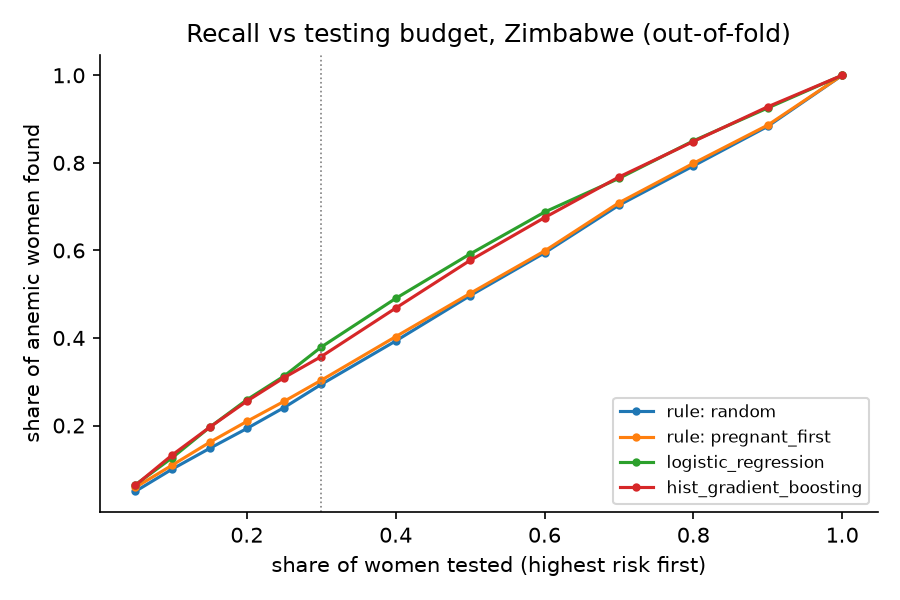
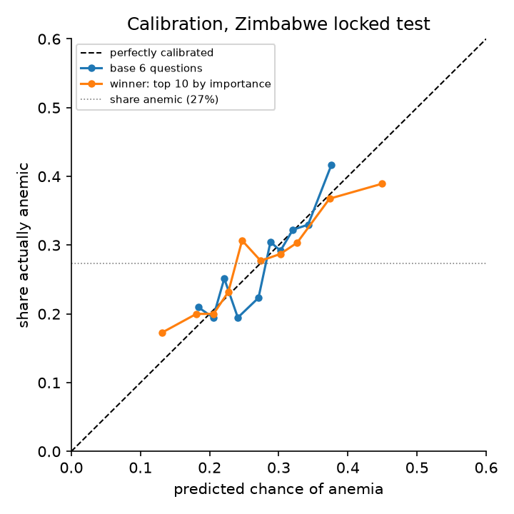
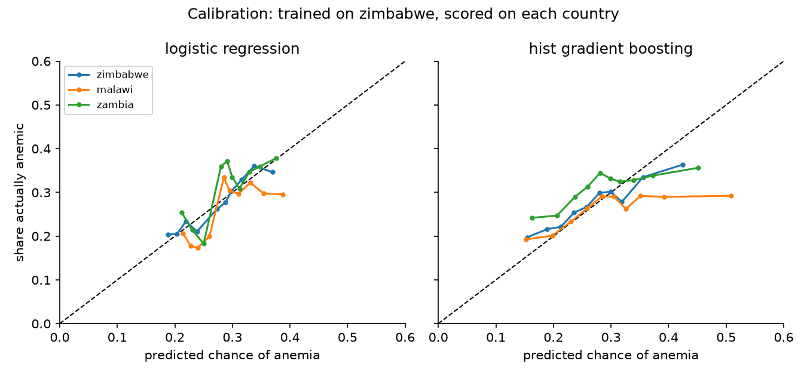
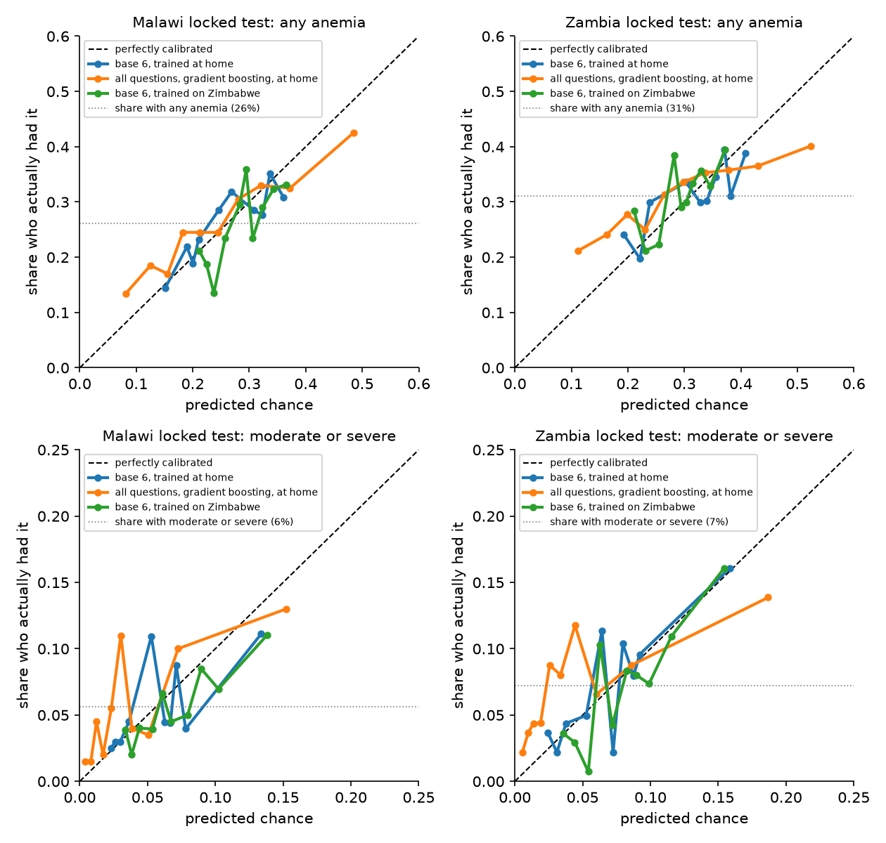

# Can routine survey answers flag anemia in women?

*Student research project for RBC Borealis's Let's SOLVE it mentorship program: the DHS survey half. The eyelid-photo
half lives on the `jaineel` branch. Research code only. This is not a medical device and must not be used to diagnose
anyone.*

> **Key findings at a glance** (AUROC: 0.5 = coin flip, 1.0 = perfect; 95% CIs from 2000 village-bootstrap resamples)
>
> | Question | Answer |
> |---|---|
> | Do 6 routine questions (age, pregnancy, wealth, education, contraception, urban/rural) predict anemia in Zimbabwe? | weakly: **0.58** [0.57, 0.59]. Testing the top 30% finds 38% of anemic women instead of 29% |
> | Does that model work unchanged in Malawi and Zambia, surveyed 9 years later? | yes, with little loss: **0.57** and 0.57, calibration stays close |
> | Can choosing from all ~500 questions do better? | a little. Every method stops at about **0.60-0.63**; the best (predicting the Hb number with gradient boosting) scores **0.614** [0.585, 0.643] on Zimbabwe's locked test |
> | Is it better at moderate or severe anemia (Hb < 10.0 g/dL)? | somewhat: **0.684** [0.639, 0.726] on Zimbabwe's locked test |
> | Is our village split too harsh? (mentor question) | **no.** Holding out women at random instead of whole villages changes AUROC by at most +0.017, in all three countries |
> | Does each country, trained on its own data, do better? | no: Zimbabwe 0.62, Malawi 0.63, Zambia 0.61 (cross-validation, best model). Base 6 trained on Zimbabwe does as well on Malawi's and Zambia's locked tests as base 6 trained at home |
> | What would it save a clinic? | little. To still catch 90% of anemic women it saves **8** [2, 11] blood tests per 100 women (17 [11, 28] for moderate or severe) |
>
> **In one line:** the survey answers carry a real but weak signal, it is the same strength in all three countries, and
> neither the model, the split nor the country is what limits it. The limit is the information in the questions.

## Contents

1. [Question and data](#1-question-and-data)
2. [How we kept the numbers honest](#2-how-we-kept-the-numbers-honest)
3. [Results](#3-results)
4. [What it means](#4-what-it-means)
5. [Ethics and data use](#5-ethics-and-data-use)
6. [Limitations](#6-limitations)
7. [Reproducing](#7-reproducing)
8. [Reports and files](#8-reports-and-files)
9. [Glossary](#9-glossary)
10. [Next steps](#10-next-steps)

## 1. Question and data

Anemia is confirmed with a blood test, which many clinics can't run for everyone. Routine intake details (age,
pregnancy, wealth) shift a woman's risk. **We ask whether survey answers can tell health workers whom to test first, and
whether a model built in one country works in another.** Our starting point is Chemhaka et al. [1], a machine-learning
model on the Zimbabwe DHS.

| | Zimbabwe 2015 | Malawi 2024 | Zambia 2024 |
|---|---|---|---|
| File (DHS Individual Recode [2]) | ZWIR72FL | MWIR81FL | ZMIR81FL |
| Women 15-49 with an Hb test | 9,265 | 10,000 | 6,829 |
| Villages (DHS clusters) with a tested woman | 400 | 793 | 545 |
| Any anemia | 27.3% | 26.1% | 31.1% |
| Moderate or severe (Hb < 10.0) | 7.0% | 5.8% | 6.9% |

### Anemia definitions (the same in all three countries)

- **Any anemia (main target):** DHS's own label `v457` codes 1-3, which is WHO's cutoff for women on Hb **adjusted for
  altitude and smoking** (`v456`): **< 12.0 g/dL, or < 11.0 g/dL if pregnant.** We checked that `v457` equals this rule
  for every tested woman in all three files.
- **Moderate or severe (second target):** adjusted Hb **< 10.0 g/dL for every woman, pregnant or not.**
  - This equals Zimbabwe 2015's `v457` codes 1-2. It does **not** equal Malawi's and Zambia's 2024 `v457` 1-2. Those
    use WHO 2011 (< 11.0 g/dL, or < 10.0 if pregnant).
  - We chose one rule for all three countries on 2026-11-23, before running, so the countries are comparable.
- Cutoffs are set in `configs/survey.yaml` (Stages 7-8), `configs/feature_selection.yaml` (Stage 29) and
  `configs/countries.yaml` (Stage 30).

### What the audit found (`src/survey/audit.py`)

- Every variable of the 6-question baseline exists in all three surveys with the same codes.
- Zimbabwe's survey is **9 years older** than the other two, so transfer mixes country with time.
- Half of the 2024 households were never selected for the Hb test; only tested women are used.
- Malawi's wealth index is missing for 408 tested women, all in the Central region.
- The DHS wealth index is built separately for each survey, so "richest fifth" doesn't mean the same wealth in each
  country.

## 2. How we kept the numbers honest

- **Split by village.** Neighbours are alike, so whole villages (DHS clusters, `v001`) go to one side of every split.
  Stage 30 also reports a random split over women, as the mentors asked.
- **A locked test, used once.** In Stages 29-30, 20% of each country's villages were set aside before anything else
  and scored once at the end.
  - Zimbabwe's locked test was used in Stage 29 and is now spent.
  - Malawi's and Zambia's were used once, in Stage 30.
- **Choices written down first.** Every new model, target and success rule was written into the config before it was
  run ("pre-registration"), and every variant is reported, whether it helped or not.
- **Baselines next to every model:**
  - a dummy (everyone gets the same risk);
  - a simple rule (pregnant women first, or the region's anemia share);
  - the 6-question logistic regression ("base 6").
- **Every number gets a 95% CI** from 2000 bootstrap resamples of whole villages. Differences between two models are
  *paired*: both are scored on the same women.
- **Not accuracy alone.** We report:
  - AUROC, PR-AUC and sensitivity at 90% specificity;
  - recall when only the top 30% by risk get tested;
  - Brier score and calibration;
  - tests saved per 100 women to still catch 90% of cases.
- **Seed 42 everywhere.** Every run saves its metrics, the config used and the git commit to `results/*.json`.

## 3. Results

The results are ordered by the question each part answers. The project ran in numbered stages (7, 8, 29, 30; the
missing numbers were the eyelid work). [3.8](#38-stage-history) maps each stage to the part where it now appears.

### 3.1 Data and cleaning: what we kept

We started from every column of each survey file. Columns were dropped only for written reasons that never look at
anemia:

- the anemia label and anything from the blood test (leakage);
- questions not asked in that country;
- bookkeeping (IDs, sample weights, interviewer, dates);
- repeated copies for older children (only the most recent birth is kept);
- free text, and times stored as codes;
- constant columns, and columns more than 70% blank.

Then a question was dropped when another kept question already predicts its answer almost perfectly (Goodman-Kruskal
lambda ≥ 0.95). Blank answers are kept as an answer of their own, because in DHS a blank usually means "skipped, did not
apply".

| | Zimbabwe 2015 | Malawi 2024 | Zambia 2024 |
|---|---|---|---|
| Columns in the file | 4,944 | 5,879 | 6,140 |
| After the drop rules | 552 | 586 | 635 |
| After removing repeats | 482 | 500 | 554 |
| Used in the main models (without `v861`, see 3.5) | 482 | 499 | 553 |
| Locked test: villages / women | 79 / 1,849 | 157 / 2,001 | 109 / 1,368 |

- **Did the 70%-blank rule throw away anything useful?** No. Putting back every mostly-blank question changed AUROC by
  at most +0.005 [+0.000, +0.009].
- **One older pipeline remains.** Sections 3.2 and 3.5a (Stages 7-8) came first and use a simpler pipeline that builds only
  the 6 basic questions (`src/survey/build_dataset.py`). Everything else uses the from-scratch cleaning above. The 6
  questions score about the same either way.
- Reports: [stage29_data_cleaning.md](reports/stage29_data_cleaning.md) (plain language),
  [stage30_malawi_cleaning.md](reports/stage30_malawi_cleaning.md), [stage30_zambia_cleaning.md](reports/stage30_zambia_cleaning.md).

### 3.2 How far do six routine questions get?

The 6 basic questions ("base 6"): age, pregnancy, wealth quintile, education, contraceptive method, urban/rural.
Zimbabwe, 9,265 women, 5 x 5 cross-validation by village.

| Model | AUROC | PR-AUC | Recall, top 30% tested | Brier |
|---|---|---|---|---|
| Random testing | 0.493 [0.480, 0.507] | 0.270 [0.256, 0.285] | 0.294 [0.279, 0.309] | - |
| Pregnant women first, then random | 0.504 [0.490, 0.517] | 0.280 [0.266, 0.296] | 0.303 [0.289, 0.319] | - |
| Dummy | 0.490 [0.474, 0.507] | 0.273 [0.259, 0.289] | 0.292 [0.275, 0.314] | 0.199 [0.193, 0.204] |
| **Logistic regression** | **0.580 [0.566, 0.593]** | 0.323 [0.307, 0.341] | **0.379 [0.363, 0.394]** | 0.196 [0.190, 0.201] |
| Gradient boosting | 0.570 [0.556, 0.583] | 0.320 [0.303, 0.338] | 0.358 [0.341, 0.375] | 0.197 [0.192, 0.203] |



- A **weak but real** signal: testing the 30% ranked highest finds 38% of anemic women instead of 29%.
- Pregnant women are more often anemic (32% vs 27%) but are only 6% of women, so testing them first barely helps.
- Survey weights change nothing.
- Report: [stage7_survey.md](reports/stage7_survey.md).

### 3.3 Can more questions, or better models, do better?

Zimbabwe only, choosing from all 482 questions. Three selection methods were tried: L1 logistic regression, top-k by
importance, and forward selection by survey section. Questions were always chosen inside the training villages. The
winner was then scored once on the locked test (79 villages, 1,849 women).

| Locked test, any anemia | AUROC | Tests saved per 100 women, still catching 90% |
|---|---|---|
| Region share (no model) | 0.538 [0.505, 0.572] | none |
| Base 6 questions | 0.590 [0.555, 0.623] | 3 [0, 7] |
| Selection winner: top 10 questions | 0.596 [0.563, 0.626] | - |
| **Hb ranking, 482 questions** | **0.614 [0.585, 0.643]** | **8 [2, 11]** |

*Hb ranking:* gradient boosting predicts each woman's Hb, and women are ranked by how far below her cutoff the prediction
falls. Random testing needs 90 tests per 100 women to catch 90% of cases.

- **Every method reaches the same ceiling, about 0.60-0.63.**
  - This holds from 6 to 713 questions, for all three selection methods, and for gradient boosting and TabPFN 3.5.
  - The selection winner does not beat base 6 on the locked test: +0.006 [-0.022, +0.036].
- **The Hb ranking is the best survey model.**
  - It gains +0.037 [+0.022, +0.054] over base 6 in 5 x 5 cross-validation.
  - About half of the gain is region. The rest comes from the other questions in a flexible model.
- **A short version keeps most of it.** Base 6 + region (7 questions) reaches 0.606 (cross-validation).
- **What the models lean on:** contraception, region, pregnancy and postpartum stage, and body measures. This is
  consistent with proxies for known causes, but it doesn't show mechanism. Region may also carry differences between
  survey teams or Hb devices.
- **It ranks villages better than region alone:** Spearman 0.42 vs 0.30. Because of sampling noise, even a perfect model
  could reach only 0.62.
- **What didn't help:**
  - putting back the mostly-blank questions;
  - village averages;
  - combining the Hb ranking with TabPFN;
  - predicting Hb with its uncertainty.
- Reports: [stage29_feature_selection_methods.md](reports/stage29_feature_selection_methods.md) (plain language),
  [stage29_summary.md](reports/stage29_summary.md) (every step).



### 3.4 Is it better for the sickest women?

Moderate or severe anemia: adjusted Hb **< 10.0 g/dL for every woman** (Section 1). This target was pre-registered
before any model was run on it.

| Locked test, moderate or severe | Zimbabwe AUROC | Tests saved per 100 women, still catching 90% |
|---|---|---|
| Region share (no model) | 0.550 [0.495, 0.607] | none |
| Base 6 questions | 0.634 [0.580, 0.688] | 10 [-1, 17] |
| **Hb ranking, 482 questions** | **0.684 [0.639, 0.726]** | **17 [11, 28]** |

- **Yes, somewhat.** At small budgets it finds about twice the random share: testing 20% finds 38% [34, 41] of cases.
- **The same in the other countries** (cross-validation, Hb ranking): Zimbabwe 0.666, Malawi 0.677, Zambia 0.665.
- On Malawi's and Zambia's locked tests it scores 0.60-0.66, with wide CIs (about 100 cases each).
- Reports: [stage29_severity.md](reports/stage29_severity.md), [stage30_countries.md](reports/stage30_countries.md).

### 3.5 Does it work in other countries?

#### a) The Zimbabwe model, unchanged, in Malawi and Zambia

Base 6 logistic regression fit on all of Zimbabwe 2015 and applied **unchanged** to the 2024 surveys:

| Country | Anemic | AUROC | Recall, top 30% tested | Brier | Calibration slope (ideal 1) | Calibration intercept (ideal 0) |
|---|---|---|---|---|---|---|
| Zimbabwe (cross-validated) | 27.3% | 0.580 [0.566, 0.593] | 0.379 [0.363, 0.394] | 0.196 | 0.93 [0.77, 1.10] | -0.07 [-0.23, 0.10] |
| Malawi | 26.1% | 0.568 [0.555, 0.581] | 0.351 [0.335, 0.367] | 0.192 | 0.90 [0.74, 1.07] | -0.24 [-0.40, -0.08] |
| Zambia | 31.1% | 0.565 [0.549, 0.580] | 0.349 [0.331, 0.365] | 0.212 | 1.00 [0.78, 1.22] | 0.09 [-0.11, 0.29] |



- The model keeps most of its small signal across countries and 9 years, and stays reasonably calibrated.
- It overestimates Malawi's anemia by about 3 points (29.0% predicted vs 26.1%).
  - Recalibrating on 200 local women fixes that average (26.2%).
  - But with a signal this weak the fitted slope is noisy, so the Brier score doesn't improve.
- Report: [stage8_transfer.md](reports/stage8_transfer.md).

#### b) Each country trained on its own

Fixed models, no feature selection (3.3 showed it doesn't help), 5 x 5 cross-validation by village. `v861`, a woman's
self-reported result of her last HIV test, is asked only in 2024. It is left out of the main models and added back in
one extra column.

| | Base 6 | Base 6 + place | Hb ranking, all questions | + HIV self-report |
|---|---|---|---|---|
| Zimbabwe, any anemia | 0.580 | 0.606 (region) | 0.617 | not asked |
| Malawi, any anemia | 0.592 | 0.624 (district) | 0.630 | 0.630 |
| Zambia, any anemia | 0.579 | 0.599 (province) | 0.610 | 0.616 |
| Zimbabwe, moderate or severe | 0.630 | 0.646 | 0.666 | not asked |
| Malawi, moderate or severe | 0.630 | 0.651 | 0.677 | 0.680 |
| Zambia, moderate or severe | 0.626 | 0.660 | 0.665 | 0.666 |

- **The three countries land in the same range.** The ceiling is not a Zimbabwe quirk.
- **Place helps when it is fine enough.** Malawi's 3 regions add nothing. Its districts (`sdistrict`) add +0.033
  [+0.020, +0.045].
- **A known HIV status adds almost nothing** (+0.000 to +0.006).
- **On the locked tests, scored once (any anemia):**
  - **Malawi:** the Hb ranking scores 0.625 [0.595, 0.653], beating base 6 (0.581) by +0.043 [+0.011, +0.078].
    Base 6 + district scores 0.619.
  - **Zambia:** lower than in cross-validation, and no model beats base 6. Base 6 scores 0.562 and the Hb ranking 0.566
    (+0.004 [-0.031, +0.040]). The test holds 109 villages, so the big models' small edge is not dependable.

#### c) Trained at home vs trained on Zimbabwe

Base 6 trained on Zimbabwe 2015, or on the country's own women, both scored on that country's locked test. Home minus
Zimbabwe-trained AUROC:

| | Any anemia | Moderate or severe |
|---|---|---|
| Malawi | -0.003 [-0.031, +0.028] | -0.013 [-0.051, +0.023] |
| Zambia | +0.010 [-0.025, +0.044] | -0.014 [-0.065, +0.037] |

**Training at home doesn't help.** Transfer is limited by weak questions, not by Zimbabwe's model failing to fit other
countries.



- **Calibration:** logistic regression stays close to the diagonal in both countries and for both targets, whether
  trained at home or on Zimbabwe. Gradient boosting is a little too extreme: it predicts too low at the bottom and too
  high at the top.
- Reports: [stage30_countries.md](reports/stage30_countries.md) (every table),
  [stage30_mentor_summary.md](reports/stage30_mentor_summary.md) (plain language).

### 3.6 Is the village split too harsh?

We hold out whole villages, so the test measures new villages. A random split over women instead measures new women
from villages already surveyed. Best model (Hb ranking), 5 x 5 cross-validation, with the paired difference:

| | Any anemia: village → random | Moderate or severe: village → random |
|---|---|---|
| Zimbabwe | 0.617 → 0.617 (-0.000 [-0.005, +0.004]) | 0.666 → 0.666 (+0.001 [-0.007, +0.009]) |
| Malawi | 0.630 → 0.637 (+0.007 [+0.002, +0.011]) | 0.677 → 0.679 (+0.001 [-0.006, +0.009]) |
| Zambia | 0.610 → 0.615 (+0.004 [-0.001, +0.010]) | 0.665 → 0.677 (+0.012 [+0.003, +0.021]) |

- **No.** The random split gains at most +0.017, for any model other than the dummy, in any country. The largest gains
  are for the models on all questions in Zambia.
- **The village split is not what holds the scores down.** The model sees each woman's own answers, not her village, so
  having her neighbours in training gives it little to use.
- Report: [stage30_countries.md](reports/stage30_countries.md).

### 3.7 Supporting checks and exploratory variants

These back up the parts above. None of them changes a headline.

| Check | Answer | Report |
|---|---|---|
| Does TabPFN, a pretrained model for tables, do better? | it matches the Hb ranking: 0.617 in cross-validation, 0.607 [0.577, 0.634] on the locked test | [stage29_tabpfn.md](reports/stage29_tabpfn.md) |
| Does the model rank villages, or only repeat region? | it ranks villages: Spearman 0.42 vs 0.30 for region | [stage29_area_check.md](reports/stage29_area_check.md) |
| Did the 70%-blank rule throw away signal? | no: at most +0.005 | [stage29_blank_sensitivity.md](reports/stage29_blank_sensitivity.md) |
| Where does the Hb ranking's gain come from? | about half region, half the other questions | [stage29_hb_sources.md](reports/stage29_hb_sources.md) |
| Is it predicting Hb, or just many questions in a flexible model? | both: predicting Hb beats yes/no for gradient boosting (+0.022 [+0.014, +0.030]), but a TabPFN yes/no classifier matches it; also what the model leans on, and budget curves | [stage29_hb_vs_class.md](reports/stage29_hb_vs_class.md) |
| Four pre-registered exploratory variants | TabPFN predicting Hb scores 0.628 (cross-validation only); the others don't help | [stage29_exploratory.md](reports/stage29_exploratory.md) |

### 3.8 Stage history

| Stage | Date | What it did | Now in |
|---|---|---|---|
| 7 | 2026-10-14 | 6 basic questions in Zimbabwe | 3.2 |
| 8 | 2026-10-14 | the Zimbabwe model unchanged in Malawi and Zambia | 3.5a |
| 29, Steps 1-4 | 2026-11-16 | Zimbabwe cleaning from every column; locked test | 3.1 |
| 29, Steps 5-6, 8a | 2026-11-16/17 | selection methods, locked test, repeated cross-validation | 3.3 |
| 29, Step 9 | 2026-11-16/17 | moderate or severe target | 3.4 |
| 29, Steps 7, 8b-8e, 10 | 2026-11-16/17 | TabPFN, reviewer checks, exploratory variants | 3.7 |
| 30 | 2026-11-23/24 | Malawi and Zambia cleaning; each country on its own; random vs village split; calibration | 3.1, 3.4, 3.5b-c, 3.6 |

## 4. What it means

- **The survey answers are a weak but portable screen.** It is the same strength in three countries and across 9 years.
- **The ceiling is the information in the questions,** not the model (6 questions vs 482, logistic regression vs gradient
  boosting vs TabPFN), the split (village vs random) or the country.
- **On its own it is not a good individual screen.** To catch 90% of anemic women a clinic would still test 82 of every
  100, instead of 90.
- **It is more useful in two narrower roles:**
  1. **Finding areas.** It ranks villages better than region alone.
  2. **Finding the sickest women.** It is stronger for moderate or severe anemia (0.68), where testing the top 20% finds
     about 38% of cases.
  It could serve as the first step of a two-step screen, followed by a better signal such as the eyelid photo.
- **Practical lessons:**
  1. Split by village.
  2. Lock a test away before looking.
  3. Write choices down before running.
  4. Put a region baseline next to any model, because region alone carries part of the signal.

## 5. Ethics and data use

- **No individual data in this repository.** Survey records and per-woman results stay on our machines: `data/` and
  `results/` are gitignored. Only code, configs and aggregate reports are committed.
  - The `*_inventory.csv` and `*_univariate.csv` reports hold column labels and summary statistics only.
- **DHS data is used under the DHS Program's registration terms and cannot be shared.** Anyone reproducing this must
  register and download the files themselves.
- **Not a diagnostic tool.** Nothing here is clinically validated.

## 6. Limitations

- **Survey rounds differ.** Zimbabwe is 2015; Malawi and Zambia are 2024. Transfer mixes country with time.
- **Hb is measured once per woman,** from a drop of blood, and adjusted for altitude and smoking. Measurement noise caps
  how well anything can predict it.
- **Region may stand for survey logistics** (teams, devices) as well as for real differences in risk.
- **Zimbabwe's locked test is spent.** Confirming any new Zimbabwe model needs a new survey round, such as an untouched
  older DHS wave.
- **Cross-sectional data.** These are associations, not causes.
- **Moderate or severe uses one cutoff (< 10.0 g/dL) for everyone.** It is stricter than WHO 2011 for non-pregnant women.
- **Malawi's missing wealth index** (408 women) is filled in inside the models.
- **The comparison with Chemhaka et al. [1]** was done by another team member and is not in this branch.

## 7. Reproducing

```bash
python3.12 -m venv .venv          # Python 3.11 or newer
source .venv/bin/activate
pip install -r requirements.txt
python -m pytest -q               # 45 tests, no data needed
```

**Data (never committed).** Register with the DHS Program, download the Individual Recode Stata files, and unpack them:

| Survey | Folder |
|---|---|
| Zimbabwe 2015 | `data/raw/dhs/zimbabwe/` (the `ZWIR72DT` folder) |
| Malawi 2024 | `data/raw/dhs/malawi/` (the `MWIR81DT` folder) |
| Zambia 2024 | `data/raw/dhs/zambia/` (the `ZMIR81DT` folder) |

TabPFN (Stage 29 Steps 7, 8a and 10) also needs a `TABPFN_TOKEN` in a `.env` file at the repo root (gitignored) and its
licence accepted on the Prior Labs website.

**Run in this order** (later scripts read what earlier ones save):

```bash
# Stages 7-8
python -m src.survey.build_dataset         # DHS -> data/processed/{country}.parquet
python -m src.survey.audit                 # coding checks
python -m src.survey.train_baselines       # Stage 7, ~2 min
python -m src.survey.transfer              # Stage 8, ~2 min

# Stage 29 (Zimbabwe)
python -m src.survey.select_features       # Steps 1-2: cleaning and the locked village split
python -m src.survey.screen_features       # Steps 3-4: single-question screen, repeat rule
python -m src.survey.select_models         # Step 5
python -m src.survey.final_test            # Step 6: locked test (already used; never score new models on it)
python -m src.survey.tabpfn_cv             # Step 7 (TabPFN)
python -m src.survey.repeated_cv           # Step 8a: several hours, cached in data/processed/stage29_oof/
python -m src.survey.severity              # Step 9
python -m src.survey.area_check            # Step 8b
python -m src.survey.blank_sensitivity     # Step 8c
python -m src.survey.hb_sources            # Step 8d
python -m src.survey.hb_vs_class           # Step 8e
python -m src.survey.exploratory           # Step 10 (exploratory, cross-validation only)

# Stage 30 (each country on its own)
python -m src.survey.select_features malawi && python -m src.survey.screen_features malawi
python -m src.survey.select_features zambia && python -m src.survey.screen_features zambia
python -m src.survey.countries             # about 1.5 hours, cached in data/processed/stage30_oof/
python -m src.survey.countries calibration # only the calibration figure, a few minutes
```

Every script writes `results/<name>.json` (metrics, config, git commit) and a report in `reports/`.

## 8. Reports and files

**Suggested reading order:** [reports/README.md](reports/README.md) lists every survey report by part, in the same order
as Section 3.

| File | What it does |
|---|---|
| `src/survey/__init__.py` | the run order and the role of every script |
| `src/survey/build_dataset.py`, `audit.py` | Stages 7-8: verified variables → one clean table per country; coding checks |
| `src/survey/train_baselines.py`, `transfer.py` | Stage 7 baselines; Stage 8 transfer and recalibration |
| `src/survey/select_features.py`, `screen_features.py` | Stages 29-30: cleaning, locked split, repeat rule (any country) |
| `src/survey/select_models.py` to `exploratory.py` | Stage 29 steps (each file's first lines say which step, and its role) |
| `src/survey/countries.py` | Stage 30 |
| `src/common/` | metrics with bootstrap CIs, village and random splits, config loading and results saving, report tables |
| `configs/default.yaml` | seed and bootstrap settings |
| `configs/survey.yaml`, `feature_selection.yaml`, `countries.yaml` | every other setting, cutoff and pre-registered rule |
| `tests/` | unit tests on made-up data: metrics, paired differences, splits, cleaning rules, labels, and that locked-test labels never reach training |

## 9. Glossary

- **AUROC:** the chance that a model scores a random anemic woman higher than a random non-anemic one. 0.5 is a coin
  flip, 1.0 is perfect.
- **PR-AUC:** like AUROC but focused on the anemic group. Chance level equals the share who are anemic.
- **Sensitivity at 90% specificity:** the share of anemic women caught when only 10% of non-anemic women are flagged.
- **Recall at a 30% testing budget:** the share of anemic women found if only the 30% with the highest predicted risk
  get a blood test. Random testing finds 30%.
- **Tests saved per 100 women:** rank everyone, test from the top, and stop once 90% of cases are found. Random order
  needs 90 tests per 100 women. The number saved is 90 minus what the model needs.
- **Calibration:** whether predicted risks match reality: of women given 30%, are about 30% anemic? Brier score is the
  average squared error of the predicted chance; lower is better.
- **Village (cluster):** a DHS sampling area, a village or a city neighbourhood. About 12-23 tested women each, depending
  on the survey.
- **Village split / random split:** hold out whole villages (new villages) / hold out women at random (new women from
  villages already surveyed).
- **Locked test:** villages set aside before any analysis and scored once at the end.
- **Pre-registration:** writing the model, target and success rule into the config before running it.
- **Bootstrap 95% CI:** resample whole villages 2000 times and report the range holding the middle 95% of scores.
- **Paired difference:** two models scored on the same women and resampled together, so their difference has its own
  CI.

## 10. Next steps

These need files we don't have yet:

1. **Map data per village.** Malaria, rainfall and altitude, from the DHS geospatial covariates and GPS files.
2. **A new, untouched test.** An older Zimbabwe DHS wave, since Zimbabwe's locked test is spent.
3. **Paired data.** An eyelid photo and survey answers from the same women, to test the two-step screen for real.

## References

1. Chemhaka et al. Socioeconomic and demographic factors associated with anaemia among women of reproductive age in
   Zimbabwe: a supervised machine learning approach. 2025. doi:10.1186/s12982-025-00524-7
2. The DHS Program. Demographic and Health Surveys: Zimbabwe 2015 (ZWIR72), Malawi 2024 (MWIR81), Zambia 2024 (ZMIR81),
   Individual Recode. ICF.
