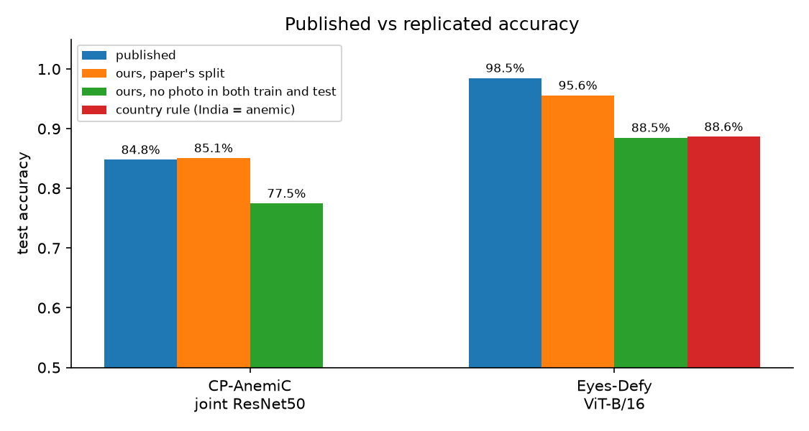
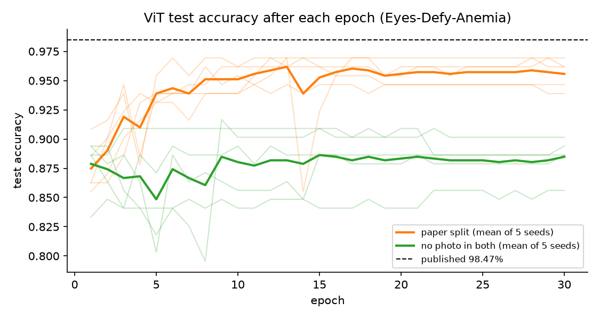
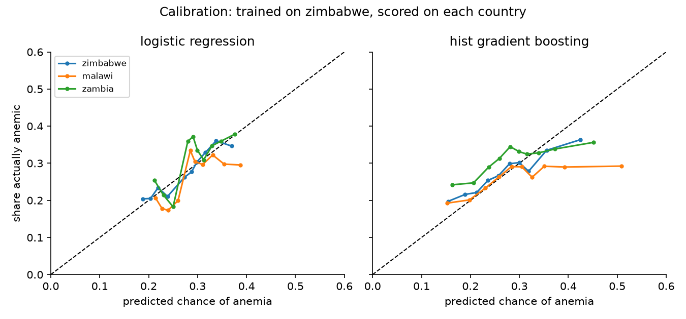
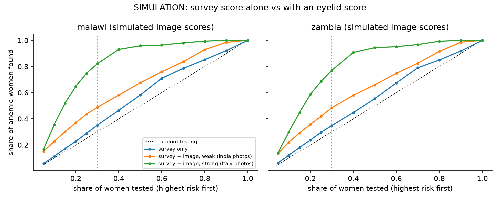

# Can eyelid photos and survey answers flag anemia across populations?

*Student research project for RBC Borealis's Let's SOLVE it mentorship program. Working branch: `jaineel`.
Every strategy we tried, why, and whether it worked, in plain English: [`PROGRESS.md`](PROGRESS.md).*

> **Key findings at a glance**
>
> **Part I: the published eyelid results**
>
> | | Published | We reproduce it? | Photos kept out of training |
> |---|---|---|---|
> | CP-AnemiC, ResNet50 [1] | 84.79% | **yes**, 85.1% | 77.5% |
> | Eyes-Defy, ViT [2] | 98.47% | **close**, 95.6% (5 splits) | 88.5%, same as "Indian photo = anemic" (88.6%) |
>
> - Both papers test on photos the model has already seen (copies, or flipped versions). Removing that costs 7-8 accuracy points.
> - On Eyes-Defy the published model mostly learns *which country* a photo is from. Within India it is at chance (AUROC 0.53).
>
> **Part II: does anything carry over to new populations?**
>
> | Question | Answer (AUROC; 0.5 = coin flip) |
> |---|---|
> | Eyelid model trained on Ghana children, tested on Italian/Indian adults | learned models break (0.32-0.62); the untrained "less red = anemic" rule holds up best (**0.84**), but only 0.67 within India, and Italy's score is mostly a photo-batch effect (Part III) |
> | Survey answers (age, pregnancy, wealth, education, contraception, urban/rural) in Zimbabwe | weak signal, **0.58**; testing the top 30% finds 38% of anemic women vs 29% at random |
> | Same survey model, unchanged, in Malawi and Zambia | keeps its small signal (**0.57**, 0.57), calibration stays close |
> | Survey + eyelid score together (**simulation**, no paired data exists) | the eyelid score would do most of the work; the survey adds about 0.01-0.02 |
>
> **Part III: following up the mentors' eyelid advice**
>
> | Question | Answer |
> |---|---|
> | How far can each eyelid dataset be pushed on its own? | Ghana children: TabPFN (a model pretrained for small tables) on 29 color numbers reaches **0.92**, gradient boosting 0.85, both still rising with more photos; a fine-tuned ViT scores 0.72 and the eye-pretrained VisionFM 0.79 fine-tuned. India: nothing beats the untrained rule (0.67) |
> | Why do populations differ? | the dataset is obvious from the pixels (AUROC 0.99-1.00); Italy's anemic photos sit almost all in one early batch, which alone predicts anemia at 0.91 |
> | Does debiasing help? | it closes the country gaps (rank gap 0.39 -> 0.10) but doesn't raise AUROC inside any country |
> | What would it save a clinic? | to catch 90% of anemic children, test 50% (TabPFN) instead of 90%; to catch all, test 83-98% |
> | Does color work without camera and batch differences? | on fingernails photographed in one light box (250 Moscow adults), logistic regression reaches **0.82**, the same on held-out photo sessions, and the no-color control sits at chance |
>
> *Research code only. This is not a medical device and must not be used to diagnose anyone.*

## Abstract

Anemia can be screened without a blood test by looking at how pale the inside of the lower eyelid (the conjunctiva) is, or by asking a few routine questions. Our goal is a tool that tells health workers who to test first, and an honest test of whether it works outside the place it was built. **Part I** re-implements the two published eyelid-photo results our proposal starts from: a ResNet50 on CP-AnemiC (Ghanaian children, 84.79% accuracy) and a Vision Transformer on Eyes-Defy-Anemia (Italian and Indian adults, 98.47%). We reproduce both protocols (85.1%, and 95.6% over 5 splits), but both let the same photo appear in training and test; with a clean split accuracy falls to 77.5% and 88.5%, and on Eyes-Defy 88.5% equals predicting "anemic" for every Indian photo. **Part II** tests transfer. Eyelid models trained on one dataset collapse on the other (AUROC 0.32-0.62), while the untrained rule "less red = anemic" holds up best (0.84 on Eyes-Defy, 0.67 within India). A survey model trained on Zimbabwe DHS data carries a weak but real signal (AUROC 0.58) and keeps it, with close calibration, in Malawi and Zambia (0.57). A clearly labelled simulation suggests that if an eyelid score worked on these women as it does on Eyes-Defy, it would add far more than the survey. **Part III** follows the mentors' eyelid advice. On Ghana children, 29 color statistics reach AUROC 0.85 with gradient boosting and 0.92 with TabPFN, a model pretrained for small tables, and both still improve with more photos, while a fine-tuned ViT scores 0.72; inside India nothing beats the untrained rule. Italy's anemic patients were almost all photographed in one early batch, so Italy's high scores are mostly a batch effect. Debiasing closes the gaps between countries without improving accuracy inside any country, and to catch 90% of anemic children the best model still sends half of the children for a blood test. The headline numbers in this field overstate what a model does on new people; leakage, site confounding and camera differences matter more than model choice.

## 1. Introduction

About a quarter of the world's population is anemic, and confirming it needs a blood test that many clinics cannot run. Two cheaper signals exist: the conjunctiva turns pale when hemoglobin (Hb) is low, and routine intake details (age, pregnancy, wealth) shift a woman's risk. Our proposal asks whether models built on either signal **generalize**: to a new dataset, a new country, a new survey round.

Our starting point is three published results:

| | Paper | Dataset | Reported result |
|---|---|---|---|
| **A** | Appiahene et al., 2023 [1] | CP-AnemiC: 710 eyelid images of children in Ghana | joint ResNet50, 84.79% accuracy, Hb error 1.54 g/dL |
| **B** | Ramos-Soto et al., 2025 [2] | Eyes-Defy-Anemia: 218 eye photos of adults in Italy and India [3] | ViT-B/16, **98.47% accuracy** |
| **C** | Chemhaka et al., 2025 [4] | DHS survey, women in Zimbabwe | machine-learning model on socioeconomic and demographic factors |

We ask, in order:

1. **Do the published eyelid numbers reproduce, and how much of each is real?** (Part I)
2. **Does an eyelid model trained on one dataset work on the other?** (Part II, Section 5.1)
3. **How well do survey answers predict anemia, and does a Zimbabwe model work unchanged in Malawi and Zambia?** (Sections 5.2-5.3)
4. **What could combining both signals add?** (Section 5.4, simulation)
5. **After the mentor meeting: how far can each eyelid dataset be pushed, why do the populations differ, does debiasing help, and what would a model save a clinic?** (Part III, Section 6)

### How the pipeline fits together

```
 data/raw/ (never committed)
     │
     ▼
 1. AUDIT      eyelid/audit*.py, survey/audit.py     duplicates, labels, variable codes, missing data
     │         -> data/processed/ (one row per photo or per woman)
     ▼
 2. SPLIT      common/splits.py                      by photo / by cluster; never the same photo or cluster on both sides
     │
     ▼
 3. TRAIN      eyelid/replicate_*.py, train_color.py, train_probe.py, cross_dataset.py
     │         survey/train_baselines.py, transfer.py, fusion_sim.py
     │         every model next to a dummy and a simple rule
     ▼
 4. EVALUATE   common/metrics.py                     AUROC, PR-AUC, sensitivity, recall at a testing budget,
     │                                               calibration, 2000-resample bootstrap CIs
     │         -> results/*.json (metrics + config + git commit)
     ▼
 5. REPORT     summary.py, figures.py                -> reports/*.md, reports/figures/*.png
```

## 2. Data

| | CP-AnemiC [1] | Eyes-Defy-Anemia [3] | DHS Individual Recode [5] |
|---|---|---|---|
| People | children 6-60 months, 4 hospitals in Ghana | adults: Bari, Italy and Chennai, India | women 15-49: Zimbabwe 2015, Malawi 2024, Zambia 2024 |
| Size | 710 rows, only 477 distinct photos | 218 eye photos + hand-drawn masks | 9,265 / 10,000 / 6,829 women with an Hb test |
| Anemia label | Hb < 11.0 g/dL (WHO, children) | replication: the ViT paper's cutoffs; Part II: WHO by sex (women < 12, men < 13 g/dL) | DHS `v457`: WHO for women (< 12, < 11 if pregnant), Hb adjusted for altitude and smoking |
| Anemic | 424 / 710 rows | paper's cutoffs 91 / 217; WHO 91 / 217 (India 72%, Italy 19%) | 27.3% / 26.1% / 31.1% |

**Anemia cutoffs differ between datasets by design** (children vs adults, and the ViT paper's own choice); every table says which one it uses, and the settings live in `configs/*.yaml`.

We audited every dataset before training (`src/eyelid/audit.py`, `src/eyelid/audit_eyes_defy.py`, `src/survey/audit.py`). The findings that shape everything else:

- **CP-AnemiC repeats photos.** The 710 rows hold only **477 distinct photos**: 212 rows are byte-identical copies under a different ID, and 29 more are the same photo re-saved or slightly re-cropped. The copies usually carry a *different* Hb, hospital, age and sex. Only 388 photos have no copy at all.
- **In Eyes-Defy, country almost decides the label.** Under the ViT paper's cutoffs 83% of Indian photos are anemic and 10% of Italian ones. The paper's counts (126/91) only come out with Italy Hb <= 10.5, although it writes "< 10.5". Eyes-Defy has no duplicate photos, but 187 of its mask files carry a corrupt color-profile block that common image libraries reject (we read them with OpenCV).
- **DHS.** Every variable the analysis uses exists in all three surveys with the same codes, but Zimbabwe's survey is 9 years older than the other two. Half the 2024 households were never selected for the Hb test; Malawi's wealth index is missing for 408 tested women, all in the Central region; two contraception codes appear only in 2024. The DHS wealth index is built separately for each country and survey, so "richest" does not mean the same wealth across the three.

## 3. Methods

**Replications (Part I).** *A* (`src/eyelid/replicate_cnn.py`): ResNet50 with an anemia head and an Hb head, the paper's loss, optimizer, learning rate, batch size, augmentation and 5-fold CV; ImageNet weights and 30 epochs instead of 150 from scratch (the scores matched). *B* (`src/eyelid/replicate_vit.py`): ViT-B/16 (ImageNet-21k), NAdam, learning rate 1e-5, weight decay 1e-4, batch size 8, 30 epochs, 224x224; each photo flipped twice, then the 651 images split 80/20 at random, 5 seeds. Each is rerun with **one change**: no photo (or copy, or flipped twin) on both sides. A best-epoch check records test accuracy after every epoch, since the ViT paper's only held-out data is its test set.

**Cross-dataset (Part II, `src/eyelid/cross_dataset.py`).** The same input on both sides: the hand-segmented palpebral conjunctiva. Color statistics (mean, median, spread of RGB, HSV and Lab channels) with logistic regression or a random forest, and a linear probe on frozen DINOv2 features, fit on all of one dataset and applied unchanged to the other.

**Survey model (`src/survey/`).** Inputs: age, pregnancy, wealth quintile (ordered), education (ordered), contraceptive method and urban/rural (one-hot). Logistic regression and gradient boosting, with all preprocessing inside the training folds. Zimbabwe is evaluated with cross-validation **by cluster** (whole villages or neighborhoods held out), 5 folds x 5 seeds, with and without survey weights. For transfer, models are fit on all of Zimbabwe and scored unchanged on Malawi and Zambia; then Platt scaling on 200 random local women (20 repeats) tests whether a little local data fixes calibration.

**Fusion simulation (`src/fusion_sim.py`).** No dataset has a photo and survey answers for the same woman, so nothing is trained jointly. Each Malawi and Zambia woman keeps her real survey score and gets an eyelid redness score drawn from Eyes-Defy photos with her anemia status; the two are added on the log-odds scale, assuming they are independent given anemia. Two scenarios: scores from Indian photos (weak signal) and from Italian photos (strong).

**Baselines and metrics.** Every model sits next to a dummy (most common class) and a simple rule: "less red = anemic", "Indian photo = anemic", "test pregnant women first", or random testing. The main metric is **AUROC**; we also report PR-AUC, sensitivity at 90% specificity, and for the survey model **recall when only the top 30% by risk get tested**, Brier score and calibration. Every number has a 95% bootstrap CI (2000 resamples of whole photos or whole clusters).

## 4. Results, Part I: the published eyelid results

### 4.1 Both protocols reproduce; much of each score does not survive a clean split



*Figure 1. Test accuracy as published, as replicated with the paper's split, and with no photo in both training and test. Eyes-Defy values are the mean of 5 random splits.*

| | Published | Ours, paper's split | Ours, no photo in both | Simple rule |
|---|---|---|---|---|
| **A. CP-AnemiC, joint ResNet50** | 84.79% | **85.1%** | 77.5% | - |
| AUROC | 0.835* | 0.921 [0.896, 0.944] | 0.852 [0.809, 0.889] | 0.650 (less red = anemic)** |
| Hb error (MAE, g/dL) | 1.54 | 1.46 | 1.61 | |
| **B. Eyes-Defy, ViT-B/16** | 98.47% | **95.6%** (93.9-97.0%) | 88.5% (85.6-90.2%) | 88.6% (India = anemic) |
| AUROC | not reported | 0.991 | 0.932 | 0.885 |

\* CP-AnemiC's reported AUC tracks its accuracy for all five of its models, which is what AUC computed from yes/no predictions gives, so it is not comparable with ours. \*\* On the 388 photos with no copy, Section 4.4.

- **Replication A matches**: 85.1% vs 84.79%, Hb error 1.46 vs 1.54.
- **Replication B lands 1.5-4.5 points under 98.47%.** Choosing the best epoch on the test set adds about 1 point (96.5% mean, best run 96.9%; Figure 2), and no run reaches 98.47%. With 131 test images, 98.47% means 2 errors and our best run makes 4, so a favourable split or an unreported detail is the likeliest explanation. We call this replication *close, not exact*.
- **Removing photo overlap costs 7-8 points** in both, with every other setting unchanged.

### 4.2 The Eyes-Defy model mostly detects country



*Figure 2. ViT test accuracy after each training epoch, 5 seeds per split (thin) and their mean (thick). Dashed: the published 98.47%. With no photo in both sets (green), accuracy sits near 88%, the country rule's level, from the first epoch. Only the paper's split (orange) keeps climbing, as the model learns the photos it will be tested on.*

| Country (no photo in both, 5 seeds pooled) | ViT AUROC [95% CI] | Anemic test photos |
|---|---|---|
| India | **0.53 [0.29, 0.80]**, chance | 53 of 64 |
| Italy | 0.93 [0.86, 0.98] | 7 of 86 |

Among Indian patients, where nearly all of the anemia is, the model cannot tell anemic from non-anemic. The Italian result rests on 7 anemic test photos with fairly severe anemia, so it is a hint, not a finding. Part III adds a second reason for caution: Italy's anemic patients were almost all photographed in one early batch.

### 4.3 Duplicate photos inflate CP-AnemiC scores

| Model (all 710 rows) | AUROC, copies may leak | AUROC, no photo in both |
|---|---|---|
| Color random forest | 0.937 [0.915, 0.954] | 0.885 [0.847, 0.916] |
| DINOv2 probe | 0.857 [0.820, 0.888] | 0.769 [0.715, 0.815] |
| Joint ResNet50 (Replication A) | 0.921 [0.896, 0.944] | 0.852 [0.809, 0.889] |
| **Control: random forest that never sees color** | **0.827 [0.780, 0.864]** | 0.681 [0.620, 0.738] |

The control only sees image size, sharpness and similar properties, so it cannot see pallor; it scores 0.83 by recognizing photos it trained on. It stays above chance even after grouping (0.68), so some re-cropped copies escape our detector, which is why our own baselines use only the 388 photos with no detected copy.

### 4.4 Our own baselines on CP-AnemiC (388 photos with no copy)

| Model | AUROC, 5x5 cross-validation | AUROC, leave one hospital out |
|---|---|---|
| Dummy | 0.493 [0.435, 0.549] | 0.381 [0.326, 0.436] |
| Rule: less red = anemic | 0.650 [0.597, 0.705] | 0.650 [0.597, 0.705] |
| Control: no color | 0.537 [0.474, 0.595] | 0.517 [0.456, 0.575] |
| Color logistic regression | 0.680 [0.627, 0.730] | 0.672 [0.619, 0.723] |
| **Color random forest** | **0.796 [0.752, 0.839]** | **0.786 [0.740, 0.830]** |
| DINOv2 probe | 0.672 [0.616, 0.723] | 0.652 [0.595, 0.708] |

On clean data the control drops to chance, simple color statistics (0.80) beat a large pretrained image model (0.67), and the color model holds up on hospitals it never saw (0.79). Normalizing each image's color balance (gray-world) lowers every model by 0.06-0.08, because it removes the redness signal itself.

## 5. Results, Part II: does anything carry over?

### 5.1 Eyelid models across datasets

Input is the palpebral conjunctiva on both sides. CP-AnemiC: 388 photos with no copy, Hb < 11.0. Eyes-Defy: 217 photos, WHO cutoffs by sex. AUROC [95% CI]:

| Model | CP-AnemiC, within (CV) | CP-AnemiC -> Eyes-Defy | -> India only | -> Italy only | Eyes-Defy -> CP-AnemiC |
|---|---|---|---|---|---|
| Color logistic regression | 0.680 [0.627, 0.730] | **0.315** [0.245, 0.389] | 0.491 [0.359, 0.625] | 0.441 [0.313, 0.567] | 0.506 [0.451, 0.562] |
| Color random forest | 0.796 [0.752, 0.839] | 0.587 [0.511, 0.662] | 0.706 [0.573, 0.826] | 0.790 [0.692, 0.876] | 0.580 [0.521, 0.635] |
| DINOv2 probe | 0.672 [0.616, 0.723] | 0.624 [0.546, 0.697] | 0.568 [0.443, 0.692] | 0.715 [0.598, 0.827] | 0.561 [0.502, 0.618] |
| **Rule: less red = anemic (no training)** | 0.650 [0.597, 0.705] | **0.835** [0.779, 0.884] | 0.671 [0.552, 0.787] | 0.924 [0.856, 0.977] | **0.650** [0.597, 0.705] |
| Rule: Indian photo = anemic | | 0.766 [0.709, 0.823] | | | |

Every learned model loses most of its signal on the other dataset, and the color logistic regression ranks Eyes-Defy patients *worse than chance*: the color patterns it learned are tied to CP-AnemiC's camera and lighting, and they reverse under Eyes-Defy's. The untrained redness rule keeps working in both directions and even beats the country rule on Eyes-Defy. Redness carries over; the learned details of it do not.

*Corrected after the mentor meeting (Part III, 2026-10-20).* 31 Italian mask files (folders 1-31) put the conjunctiva on a white background instead of a transparent one, so those photos were measured on a mostly white frame. With that fixed, the numbers above changed little (redness rule 0.808 -> 0.835). The bigger problem is that Italy's anemic photos sit almost all in that same early batch (21/31 anemic vs 2/91 later), which was photographed differently. The batch alone predicts Italian anemia at AUROC 0.91, and inside the early batch the redness rule scores 0.75 [0.52, 0.94]. So the "-> Italy only" column mostly measures the batch, not pallor.

### 5.2 Survey answers in Zimbabwe

9,265 women, cross-validated by cluster; bootstrap over clusters.

| Model | AUROC | PR-AUC | Recall, top 30% tested | Brier |
|---|---|---|---|---|
| Random testing | 0.493 [0.480, 0.507] | 0.270 [0.256, 0.285] | 0.294 [0.279, 0.309] | - |
| Pregnant women first, then random | 0.504 [0.490, 0.517] | 0.280 [0.266, 0.296] | 0.303 [0.289, 0.319] | - |
| Dummy | 0.490 [0.474, 0.507] | 0.273 [0.259, 0.289] | 0.292 [0.275, 0.314] | 0.199 [0.193, 0.204] |
| **Logistic regression** | **0.580 [0.566, 0.593]** | 0.323 [0.307, 0.341] | **0.379 [0.363, 0.394]** | 0.196 [0.190, 0.201] |
| Gradient boosting | 0.570 [0.556, 0.583] | 0.320 [0.303, 0.338] | 0.358 [0.341, 0.375] | 0.197 [0.192, 0.203] |


*Figure 3. Share of anemic women found as more women are tested, highest predicted risk first (Zimbabwe, out-of-fold).*

The survey answers carry a **weak but real** signal: testing the 30% of women the model ranks highest finds 38% of anemic women instead of 29%. Pregnant women are more often anemic (32% vs 27%) but are only 6% of women, so testing them first barely helps. Survey weights change nothing; the simpler logistic regression beats gradient boosting, which also turns out overconfident. Sensitivity at 90% specificity and the weighted runs are in [reports/stage7_survey.md](reports/stage7_survey.md).

### 5.3 The same survey model in Malawi and Zambia

Fit on all of Zimbabwe 2015 and applied **unchanged** to the 2024 surveys. Logistic regression:

| Country | Anemic | AUROC | Recall, top 30% tested | Brier | Calibration slope (ideal 1) | Calibration intercept (ideal 0) |
|---|---|---|---|---|---|---|
| Zimbabwe (cross-validated) | 27.3% | 0.580 [0.566, 0.593] | 0.379 [0.363, 0.394] | 0.196 | 0.93 [0.77, 1.10] | -0.07 [-0.23, 0.10] |
| Malawi | 26.1% | 0.568 [0.555, 0.581] | 0.351 [0.335, 0.367] | 0.192 | 0.90 [0.74, 1.07] | -0.24 [-0.40, -0.08] |
| Zambia | 31.1% | 0.565 [0.549, 0.580] | 0.349 [0.331, 0.365] | 0.212 | 1.00 [0.78, 1.22] | 0.09 [-0.11, 0.29] |



*Figure 4. Predicted vs observed anemia, model trained on Zimbabwe. Left: logistic regression stays near the diagonal in all three countries. Right: gradient boosting is overconfident.*

The model keeps most of its small signal across countries and 9 years, and stays reasonably calibrated; it overestimates Malawi's anemia by about 3 points (29.0% predicted vs 26.1%). Recalibrating on 200 local women fixes that average (26.2%), but with a signal this weak its fitted slope is noisy, so the Brier score does not improve. A model that barely separates women has little to lose in transfer.

### 5.4 Combining both signals (simulation)

**This is a simulation, not a trained model.**

| Malawi | AUROC | Recall, top 30% tested |
|---|---|---|
| Survey only | 0.568 [0.555, 0.581] | 0.351 [0.335, 0.367] |
| Eyelid only, weak (Indian photos) | 0.674 [0.662, 0.687] | 0.512 [0.483, 0.524] |
| Survey + eyelid, weak | 0.687 [0.676, 0.700] | 0.487 [0.471, 0.504] |
| Eyelid only, strong (Italian photos) | 0.927 [0.921, 0.932] | 0.818 [0.803, 0.833] |
| Survey + eyelid, strong | 0.929 [0.924, 0.935] | 0.821 [0.807, 0.836] |



*Figure 5. Simulated share of anemic women found by testing budget. Zambia (right) looks the same; full table in [reports/fusion_simulation.md](reports/fusion_simulation.md).*

The "strong" scenario borrows Italy's redness scores, which Part III shows are mostly a photo-batch effect, so treat it as an upper bound on what an eyelid score could add. If an eyelid score worked on these women as well as the redness rule does on Eyes-Defy, it would carry most of the signal; the survey adds about 0.01-0.02 AUROC on top of a weak eyelid score and nothing on top of a strong one. Whether an eyelid score works on African women photographed in the field is exactly what Section 5.1 leaves open, so this is a reason to collect paired data, not evidence that fusion works.

## 6. Results, Part III: following up the mentors' eyelid advice

After the mentor meeting we followed up the advice for the eyelid side. Survey advice is left to the survey work. The
suggestions and a log of every step are in [`docs/eyelid_followup.md`](docs/eyelid_followup.md), and the answers we
are bringing back to the mentors are in [`reports/mentor_followup_eyelid.md`](reports/mentor_followup_eyelid.md).

**Setup.**
- Anemia cutoffs as in Part II:
  - CP-AnemiC: Hb < 11.0, using the 388 photos that have no copy.
  - Eyes-Defy: WHO by sex, women < 12.0 and men < 13.0.
- Scores: 5-fold CV repeated 5 times, split by photo.
- Every population gets a **no-color control**: a random forest on image size and cut-out shape only. If it scores
  well above 0.5, the photos carry a shortcut.

### 6.1 How far can each population be fit on its own?

| Population | Redness rule | Best color model | DINOv2 probe | Fine-tuned ViT-B/16 | VisionFM probe (eye-pretrained) | TabPFN on color numbers | No-color control |
|---|---|---|---|---|---|---|---|
| CP-AnemiC (Ghana children, 388) | 0.650 [0.597, 0.705] | **gradient boosting 0.846 [0.807, 0.882]** | 0.672 [0.616, 0.723] | 0.715 [0.661, 0.765] | 0.765 [0.716, 0.815] | **0.919 [0.893, 0.945]** | 0.537 [0.474, 0.595] |
| India (95) | **0.671 [0.552, 0.787]** | random forest 0.673 [0.542, 0.791] | 0.658 [0.543, 0.778] | 0.654 [0.522, 0.783] | 0.585 [0.452, 0.722] | 0.648 [0.514, 0.766] | 0.548 [0.410, 0.677] |
| Italy (122) | 0.924 [0.856, 0.977] | logistic regression 0.920 [0.822, 0.983] | 0.879 [0.765, 0.963] | 0.919 [0.830, 0.980] | 0.927 [0.838, 0.986] | 0.909 [0.811, 0.975] | **0.751 [0.646, 0.837]** |

- **The models are big enough.** Gradient boosting and the ViT fit every training set perfectly (training AUROC 1.00).
- **Pretraining on eye photos helps, but not enough.** VisionFM's external-eye encoder (frozen, same probe as DINOv2)
  scores 0.765 in Ghana children, above DINOv2 (0.672) and the fine-tuned ViT (0.715) but below gradient boosting on
  color numbers (0.846). In India it scores 0.585. Fine-tuning all of VisionFM on Ghana photos (same settings as
  our ViT, 1 seed) reaches 0.785 [0.739, 0.829].
- **TabPFN, the tabular model named at the mentor meeting, is the best eyelid model so far.** TabPFN v2 is pretrained
  on millions of synthetic small tables and classifies a new one with no tuning. On the same 29 color numbers it
  reaches 0.919 in Ghana children (gradient boosting 0.846), and still rises with more photos (0.72 with 78, 0.92 with
  310). It doesn't help in India (0.648) or Italy (0.909). We have not yet run it on the no-color numbers or with
  hospitals held out, so 0.92 is not yet checked for shortcuts.
- **Ghana children carry a real color signal.** Gradient boosting climbs from 0.72 to 0.85 as its training photos go
  from 78 to 310, so more photos would likely help. The ViT does worse than 29 color numbers.
- **India is at the level of the untrained rule.** The deeper fold of the eyelid (the forniceal mask) does better than
  the palpebral one we used: rule 0.755 vs 0.671 (paired change +0.084 [+0.001, +0.175]), logistic regression 0.739
  vs 0.612 (+0.127 [+0.029, +0.228]); random forest doesn't change. With 95 photos and many comparisons this is a
  lead to confirm on new data, not a result.
- **Italy's score is mostly a shortcut**, since the no-color control alone reaches 0.75 (Section 6.2).
- Keeping CP-AnemiC's duplicate copies in training changes nothing (random forest 0.824 -> 0.831), as long as no copy
  of a test photo is in training.

Report: [`reports/stage9_ceiling.md`](reports/stage9_ceiling.md).

### 6.2 Why the populations differ, and a batch effect in Italy

- **The dataset is obvious from the pixels.** The same color numbers tell India from Italy at AUROC 0.998, and Ghana
  children from Eyes-Defy adults at 0.989. Anemia inside a population is only 0.61-0.68.
- **Population gaps are bigger than anemia gaps.** Redness (a*), anemic minus non-anemic, is -3.5 in Ghana and -2.8 in
  India, while non-anemic Ghana children are 12.0 lower than non-anemic Italians.
- **Italy is two photo batches.**
  - Folders 1-31 are 21/31 anemic, while folders 32-123 are 2/91.
  - Healthy people in the early batch already look paler (a* 32.9 vs 40.1).
  - The batch alone predicts Italian anemia at 0.91, and inside the early batch the redness rule is 0.752 [0.517,
    0.937].
  - The same 31 early masks put the conjunctiva on a white background instead of a transparent one. We fixed that in
    `src/eyelid/roi.py` and reran Part II (Section 5.1).

Report: [`reports/stage10_populations.md`](reports/stage10_populations.md).

### 6.3 Debiasing the country shortcut

On pooled Eyes-Defy we tried:
- gray-world;
- brightness scaling;
- per-country standardization;
- brightness and contrast jitter;
- reweighing (Kamiran and Calders);
- a logistic regression penalized for score gaps between countries;
- one model per country.

The fairness metrics were fixed beforehand: AUROC inside each country and in the Italy early batch, the rank gap
between countries at the same anemia status, and the TPR and FPR gaps at 90% sensitivity.

| Method | Pooled | Inside India | Italy early batch | Rank gap, non-anemic | FPR gap |
|---|---|---|---|---|---|
| Random forest | 0.890 [0.845, 0.932] | 0.687 [0.565, 0.799] | 0.752 [0.556, 0.923] | 0.39 | 0.75 |
| Random forest, brightness scaled | 0.897 [0.854, 0.938] | 0.739 [0.631, 0.838] | 0.771 [0.561, 0.948] | 0.37 | 0.74 |
| Fairness penalty, lambda=100 | 0.756 [0.683, 0.821] | 0.675 [0.557, 0.788] | 0.667 [0.429, 0.891] | 0.10 | 0.11 |
| One model per country | 0.883 [0.836, 0.928] | 0.676 [0.552, 0.787] | 0.710 [0.486, 0.913] | 0.41 | 0.91 |

The penalty and per-country standardization close the gaps, but no method improves AUROC inside a country beyond its
CI. Across datasets, the untrained rule still beats every debiased model (Eyes-Defy -> CP-AnemiC: rule 0.650, best
debiased model 0.606). Report: [`reports/stage11_debias.md`](reports/stage11_debias.md).

### 6.4 What it would mean in a clinic

The mentors pointed out that AUROC alone doesn't say what a clinic gains. We ranked people by score and asked what
share of everyone has to get a blood test to catch 90% (or 100%) of the anemic ones. Testing at random needs 90% to
catch 90%.

| Population (anemic) | Model | Tested to catch 90% | Anemic among those tested | Tested to catch 100% |
|---|---|---|---|---|
| CP-AnemiC (42.5%) | redness rule | 0.807 [0.760, 0.897] | 0.476 [0.406, 0.534] | 1.000 [0.985, 1.000] |
| | gradient boosting | **0.644 [0.552, 0.711]** | 0.596 [0.525, 0.704] | 0.979 [0.851, 0.990] |
| | VisionFM probe | 0.742 [0.662, 0.843] | 0.517 [0.436, 0.589] | 0.982 [0.923, 0.992] |
| | VisionFM fine-tuned | 0.729 [0.639, 0.796] | 0.530 [0.464, 0.615] | 0.982 [0.956, 0.992] |
| | **TabPFN** | **0.500 [0.443, 0.570]** | **0.768 [0.673, 0.847]** | 0.827 [0.649, 0.861] |
| India (71.6%) | random forest | 0.832 [0.758, 0.916] | 0.797 [0.678, 0.877] | 1.000 [0.947, 1.000] |
| Italy early batch (67.7%, n = 31) | redness rule | 0.871 [0.677, 0.968] | 0.778 [0.615, 0.929] | 0.871 [0.742, 0.968] |

- In Ghana children gradient boosting saves about a quarter of blood tests at 90% sensitivity, and TabPFN about 40%.
- To catch every anemic person, most models test 96-100% of people; TabPFN tests 83%.
- So an eyelid photo can rank who to test first, but it can't rule anyone out.
- Which sensitivity a clinic needs is a question for clinicians.

Report: [`reports/clinical_eyelid.md`](reports/clinical_eyelid.md).

### 6.5 Pretrained eyelid models and more data

- **Pretrained eyelid models.** No public model is pretrained on conjunctiva photos without having seen ours. The one
  Hugging Face anemia model was trained on CP-AnemiC and Eyes-Defy themselves. The closest real candidate, VisionFM's
  external-eye encoder, has not seen our data; we ran it in Section 6.1 (0.765 in Ghana children, below color
  numbers).
- **More data.** The best candidates are:
  - an open Russian fingernail set (250 adults);
  - a large Indian conjunctiva, palm and nail set (1,485 people), which needs a paid IEEE DataPort subscription, so
    we skipped it;
  - Ghana palm and nail sets (Mendeley, CC BY 4.0) that are almost certainly the CP-AnemiC children, not downloaded
    yet.

  We used the fingernail set (Section 6.6). The table and the download log are in
  [`docs/eyelid_followup.md`](docs/eyelid_followup.md) (Steps 7-9).

### 6.6 Fingernails under fixed lighting

Our eyelid photos mix cameras, lighting and batches, and models keep learning those instead of pallor. So we tested a
set photographed in one fixed LED box: Yakimov et al. 2024, *Scientific Data* (figshare
10.6084/m9.figshare.c.6760179), 250 adults in Moscow, one photo each with three nail boxes.

- **Cutoff: Hb < 12.0 g/dL (120 g/L) for everyone** (69 of 250 anemic). The file has no sex column, so we use one adult
  cutoff, the WHO cutoff for women; anemic men between 12.0 and 13.0 count as not anemic.
- Same 29 color numbers from the nail boxes, the same models, a no-color control on nail box sizes, and a model that
  sees only the photo session (20 sessions), to catch a batch shortcut like Italy's.

| Model | 5x5 CV by patient | Leave one session out | Share tested to catch 90% |
|---|---|---|---|
| Rule: less red = anemic | 0.703 [0.632, 0.770] | 0.703 [0.632, 0.770] | 0.732 [0.572, 0.876] |
| **Logistic regression** | **0.818 [0.755, 0.872]** | **0.815 [0.752, 0.871]** | 0.608 [0.484, 0.760] |
| Random forest | 0.809 [0.746, 0.865] | 0.802 [0.740, 0.858] | 0.576 [0.484, 0.684] |
| Gradient boosting | 0.791 [0.730, 0.848] | 0.795 [0.736, 0.848] | 0.612 [0.476, 0.736] |
| No-color control | 0.492 [0.406, 0.574] | 0.491 [0.413, 0.572] | 0.948 [0.908, 0.976] |
| Session only | 0.438 [0.350, 0.528] | - | 0.968 [0.920, 0.992] |

- **A clean color signal:** no shortcut shows up, and the scores hold on photo sessions the model never saw.
- **Simple is enough, and the learning curve is flat** (0.811 with 50 training photos, 0.818 with 200), so with fixed
  lighting these color numbers reach their limit fast.
- The untrained rule does better than on eyelids (0.70 vs 0.65-0.67), consistent with controlled lighting helping
  the raw color.

**Correcting the colors (Stage 12b).** Each photo has a white board behind the hand, and the data marks a patch of
skin just behind each nail. Changes below are paired (both inputs scored on the same resampled people).

- **White board as a color reference:** dividing each photo by its own white board raises the untrained rule from
  0.703 to 0.727 (change +0.025 [0.002, 0.049]) and the models by 0.00-0.03, within noise (random forest 0.825; 0.834
  on held-out sessions). The light box already keeps the lighting steady, so there is little to correct.
- **Nail minus skin hurts** (-0.11 to -0.31): the skin pales too (skin alone scores 0.73-0.76), so subtracting it
  removes the signal along with the lighting. A color reference helps only if it doesn't share the signal.

Report: [`reports/stage12_nails.md`](reports/stage12_nails.md).

## 7. Discussion

**Published numbers are real but not what they seem.** Both published eyelid methods reproduce, but their test sets share photos with training, and on Eyes-Defy the label is almost the same variable as the country. A 98% score there says little about a new patient.

**What survives is simple.** On clean CP-AnemiC data, color statistics beat a large pretrained model; across datasets, only the untrained "less red = anemic" rule keeps working. The learned models fit the camera, not the conjunctiva. That points to fixing the camera gap (a color reference card in each photo, or per-device color calibration) before training anything bigger. Part III backs this up: a fine-tuned ViT fits every training set perfectly yet does worse than gradient boosting on 29 color numbers, the best result comes from a tabular model (TabPFN) on those same numbers, and removing the country shortcut by debiasing doesn't add accuracy inside a country. The limit is the data (too few photos per population, one camera setup per site), not the model.

**Survey answers are a weak but portable screen.** Six routine questions lift the share of anemic women found at a 30% testing budget from 29% to 38%, and that small gain carries to two other countries and a survey 9 years newer with little loss. It is a modest tool on its own; the simulation suggests it is most useful as a cheap add-on to a better signal.

**Practical lessons:**

1. Check for duplicate photos before splitting (CP-AnemiC has 233 extra copies).
2. Split by photo, patient or cluster *before* augmenting.
3. Report a site or country baseline next to any model trained on pooled sites.
4. Never choose epochs or thresholds on the test set.
5. Test on a different dataset or country before trusting a number.

## 8. Ethics and data use

- **No individual data in this repository.** Photos, survey records, labels and per-person results stay on our machines (`data/` and `results/` are gitignored); only code, configs and aggregate reports are committed.
- **We follow each dataset's terms.** CP-AnemiC is for academic use; Eyes-Defy asks users to cite its papers [3]; DHS data is used under the DHS Program's registration terms and cannot be shared.
- **Skin tone, camera and site.** Conjunctiva color varies with skin tone, camera and lighting. Our results show how easily models latch onto site and camera differences, which could make a deployed tool fail unevenly across populations.
- **Not a diagnostic tool.** Nothing here is clinically validated. A screening tool would need prospective testing on new patients from new sites.

## 9. Limitations

- **No paired data.** No dataset links an eyelid photo to survey answers for the same person, so fusion is simulated and assumes the two signals are independent given anemia.
- **Different populations.** CP-AnemiC is young children, Eyes-Defy is adults including men, the survey is women 15-49.
- **Cutoffs differ.** CP-AnemiC: Hb < 11.0 (children). Eyes-Defy: the ViT paper's cutoffs in Part I, WHO by sex in Part II (pregnancy not recorded; assumed not pregnant). DHS: `v457` (WHO for women, adjusted for altitude and smoking). Fingernails (Section 6.6): Hb < 12.0 for everyone, since sex is not recorded.
- **Survey rounds differ.** Zimbabwe 2015 vs Malawi and Zambia 2024, so transfer mixes country with time. Malawi's missing wealth index is imputed inside the model.
- **Small image test sets.** Eyes-Defy test sets hold 44 photos when split by photo; Italy has few anemic adults.
- **Replications are not identical recipes.** Replication A uses ImageNet weights and 30 epochs; we do not have either paper's exact split or code; GPU differences (Apple M1 vs NVIDIA) can shift results slightly.
- **Duplicate detection is not perfect**, and labels on copied CP-AnemiC photos conflict (one photo is recorded with Hb 10.2 and 5.8); there is no patient ID.
- **Italy is confounded by photo batch.** Its anemic patients were almost all photographed in the first 31 folders, so Italian scores mostly measure the batch; we report the early batch alone (31 photos) as the fairer check.
- **The fine-tuned ViT and VisionFM in Part III have one seed each**, so their CIs come from the bootstrap only, not from seed variation.
- **TabPFN's 0.92 is not yet checked for shortcuts** (no-color numbers, held-out hospitals).
- **The Chemhaka et al. comparison was done by the survey side** and is not in this branch.

## 10. Reproducing

```bash
python3.12 -m venv .venv          # Python 3.11 or newer
source .venv/bin/activate
pip install -r requirements.txt
python -m pytest -q
```

Raw data is **never committed** (`data/` and `results/` are gitignored). Download each dataset and place it here:

| Dataset | Folder | Source |
|---|---|---|
| CP-AnemiC | `data/raw/cp_anemic/` | Mendeley Data (academic use) |
| Eyes-Defy-Anemia | `data/raw/eyes_defy/` (the `India/`, `Italy/` folders and the `.docx`) | IEEE DataPort, or the Kaggle mirror `harshwardhanfartale/eyes-defy-anemia` |
| DHS Individual Recode | `data/raw/dhs/{zimbabwe,malawi,zambia}/` (the `*IR*DT` folders: ZWIR72, MWIR81, ZMIR81) | DHS Program (registration required) |
| VisionFM external-eye weights (optional) | `data/weights/visionfm/VFM_External_weights.pth` | VisionFM GitHub README (github.com/ABILab-CUHK/VisionFM), research use only |
| TabPFN v2 classifier weights | `data/weights/tabpfn/tabpfn-v2-classifier-finetuned-zk73skhh.ckpt` | Hugging Face `Prior-Labs/TabPFN-v2-clf` (open download; see its model card for the license) |
| Fingernails (Yakimov et al. 2024) | `data/raw/yakimov_nails/` (`metadata.csv` and `photo/`, unzipped from `data.zip`) | figshare 10.6084/m9.figshare.c.6760179 (CC0) |

Then run, in order (Section 11 lists what each file does):

```bash
python -m src.eyelid.audit                 # CP-AnemiC audit and labels
python -m src.eyelid.audit_eyes_defy       # Eyes-Defy audit and the ViT paper's labels
python -m src.eyelid.train_color           # color baselines (4.4)
python -m src.eyelid.train_probe           # DINOv2 probe (4.4)
python -m src.eyelid.replicate_cnn         # Replication A, ~1 h on an M1
python -m src.eyelid.replicate_vit --seeds 0 1 2 3 4                 # Replication B, ~2.5 h
python -m src.eyelid.replicate_vit --seeds 0 1 2 3 4 --track-epochs  # best-epoch check, ~2.5 h
python -m src.eyelid.cross_dataset         # 5.1, ~2 min
python -m src.survey.build_dataset         # DHS -> data/processed/{country}.parquet
python -m src.survey.audit                 # DHS audit
python -m src.survey.train_baselines       # 5.2, ~2 min
python -m src.survey.transfer              # 5.3, ~2 min
python -m src.fusion_sim                   # 5.4, ~2 min
python -m src.eyelid.finetune_vit          # 6.1, fine-tuned ViT per population, ~2 h on an M1
python -m src.eyelid.finetune_vit --model visionfm   # 6.1, fine-tuned VisionFM on CP-AnemiC
python -m src.eyelid.ceiling               # 6.1, model ladder incl. TabPFN, learning curves, regions, copies (reads the ViT results; VisionFM rung if its weights are present)
python -m src.eyelid.populations           # 6.2
python -m src.eyelid.debias                # 6.3
python -m src.eyelid.clinical              # 6.4 (reads the ViT results)
python -m src.nails                        # 6.6, fingernails, ~1 min
python -m src.summary                      # reports/summary.md
python -m src.figures                      # reports/figures/replication.png, vit_epochs.png
```

Settings (seeds, cutoffs, hyperparameters) live in `configs/*.yaml`. Every run saves its metrics, config and git commit to `results/*.json`. Detailed reports: [summary](reports/summary.md), [Replication A](reports/replicate_cnn.md), [Replication B](reports/replicate_vit.md), [color baselines](reports/stage3_color.md), [DINOv2 probe](reports/stage4_probe.md), [cross-dataset](reports/stage5_cross_dataset.md), [survey baselines](reports/stage7_survey.md), [survey transfer](reports/stage8_transfer.md), [fusion simulation](reports/fusion_simulation.md), [Stage 9 ceiling](reports/stage9_ceiling.md), [Stage 10 populations](reports/stage10_populations.md), [Stage 11 debiasing](reports/stage11_debias.md), [clinical view](reports/clinical_eyelid.md), [fingernails](reports/stage12_nails.md), [answers for the mentors](reports/mentor_followup_eyelid.md).

## 11. Key files

| File | What it does |
|---|---|
| `src/eyelid/audit.py`, `audit_eyes_defy.py` | Image audits: duplicate photos, label checks against the papers |
| `src/eyelid/replicate_cnn.py`, `replicate_vit.py` | Replications A and B: paper's split vs no photo in both, best-epoch check |
| `src/eyelid/train_color.py`, `train_probe.py` | Color-statistics baselines, no-color control, DINOv2 probe |
| `src/eyelid/cross_dataset.py` | Train on one image dataset, test on the other |
| `src/eyelid/roi.py` | Reads the conjunctiva cut-outs (with an OpenCV fallback for Eyes-Defy's damaged masks, and white made transparent in the 31 masks that have no transparency) |
| `src/survey/build_dataset.py`, `audit.py` | DHS: verified variables -> clean table per country; audit and coding checks |
| `src/survey/train_baselines.py`, `transfer.py` | Survey baselines by cluster; transfer and recalibration |
| `src/fusion_sim.py` | Fusion simulation |
| `src/eyelid/ceiling.py`, `finetune_vit.py` | Part III: each population on its own, model ladder from the rule to TabPFN and fine-tuned ViT/VisionFM, learning curves |
| `src/eyelid/populations.py`, `debias.py`, `clinical.py` | Part III: population comparison and Italy batches; fairness metrics and debiasing; testing load at fixed sensitivity |
| `src/eyelid/visionfm.py` | Part III: frozen VisionFM external-eye features, loaded in PyTorch's safe weights-only mode |
| `src/nails.py` | Part III: fingernail photos under fixed lighting (Section 6.6) |
| `docs/eyelid_followup.md` | The mentors' eyelid suggestions and a log of every follow-up step |
| `src/common/metrics.py`, `splits.py`, `evaluate.py` | Metrics, calibration, bootstrap CIs, grouped splits |
| `src/summary.py`, `src/figures.py` | Build `reports/summary.md` and the figures from `results/*.json` |
| `configs/*.yaml` | Every setting: seeds, cutoffs, hyperparameters, DHS variable codes |
| `tests/` | Metric, feature, split, label and pipeline tests (`python -m pytest -q`) |

## 12. Glossary

- **Leakage**: when the test set contains information the model saw in training (here, the same photo), so the test score overstates how the model does on new people.
- **AUROC**: the chance that a model scores a random anemic person higher than a random non-anemic one. 0.5 is a coin flip, 1.0 is perfect.
- **PR-AUC**: like AUROC but focused on the anemic class; its chance level equals the share of anemic people.
- **Sensitivity at 90% specificity**: the share of anemic people caught when only 10% of healthy people are flagged.
- **Recall at a 30% testing budget**: the share of all anemic women found if only the 30% with the highest predicted risk get a blood test. Random testing finds 30%.
- **Calibration**: whether predicted risks match reality (of women given 30%, are 30% anemic?). Slope 1 and intercept 0 are perfect.
- **Cluster**: a DHS sampling area (a village or neighborhood). Splitting by cluster keeps neighbors out of each other's test sets.
- **Bootstrap 95% CI**: we resample the test set 2000 times and report the range that holds the middle 95% of scores.
- **Seed**: the number that fixes the random split and training order, so a run can be repeated.
- **No-color control**: a model that sees only image size and cut-out shape. If it beats a coin flip, the photos carry a shortcut (copies, batches, cameras) the real model can use too.
- **Share tested to catch 90%**: rank everyone by score, test from the top, and stop once 90% of the anemic people are found. Testing in random order needs 90%; lower is better.

## 13. Status and next steps

| Step | Status |
|---|---|
| Audits of CP-AnemiC, Eyes-Defy and DHS | done |
| Replications A and B, with clean splits and the best-epoch check | done |
| Color and DINOv2 baselines on CP-AnemiC | done |
| Cross-dataset eyelid test | done |
| Survey model on Zimbabwe, transfer to Malawi and Zambia | done |
| Fusion simulation | done |
| Comparison with Chemhaka et al. [4] | done by the survey side |
| Part III: the mentors' eyelid advice (ceiling, populations, debiasing, clinical view) | done; answers in `reports/mentor_followup_eyelid.md` |
| Fingernails under fixed lighting (Section 6.6) | done |
| Fingernail color correction: white board, skin (Section 6.6) | done |
| Eye-pretrained model (VisionFM external eye, frozen and fine-tuned, Section 6.1) | done |
| Deeper eyelid fold, paired check (Section 6.1) | done: borderline lead in India |
| TabPFN, the model named at the mentor meeting (Section 6.1) | done; shortcut checks pending |

Next, with more time: (1) collect paired data, an eyelid photo and survey answers from the same women, to test fusion for real; (2) fix the camera gap with a color reference card or per-device calibration, then retest the learned eyelid models across datasets; (3) compare the survey baseline with Chemhaka et al. and ask the CP-AnemiC authors about the duplicate photos.

## References

1. P. Appiahene, K. Chaturvedi, J. W. Asare, E. T. Donkoh, M. Prasad. CP-AnemiC: A conjunctival pallor dataset and benchmark for anemia detection in children. *Medicine in Novel Technology and Devices*, 2023. doi:10.1016/j.medntd.2023.100244
2. O. Ramos-Soto, J. Ramos-Frutos, E. Perez-Zarate, D. Oliva, S. J. Mousavirad, S. E. Balderas-Mata. Non-invasive anemia detection from conjunctiva and sclera images using vision transformer with attention map explainability. *Scientific Reports* 15, 44142, 2025. doi:10.1038/s41598-025-32343-w
3. R. Maglietta, M. E. Griseta, F. Clemente, A. Guarini, G. Dimauro. Eyes-defy-anemia dataset, described in: Advances in the automated diagnosis of anemia: a shared Eyes-defy-anemia dataset and a novel non-invasive system with machine learning.
4. Chemhaka et al. Socioeconomic and demographic factors associated with anaemia among women of reproductive age in Zimbabwe: a supervised machine learning approach. 2025. doi:10.1186/s12982-025-00524-7
5. The DHS Program. Demographic and Health Surveys: Zimbabwe 2015 (ZWIR72), Malawi 2024 (MWIR81), Zambia 2024 (ZMIR81), Individual Recode. ICF.
