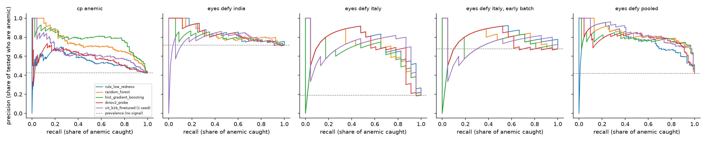

# What the eyelid models would mean in a clinic

Generated by `python -m src.eyelid.clinical`; settings in `configs/clinical.yaml`. Mentor advice M13 (`docs/eyelid_followup.md`). Held-out scores from Stage 9's folds (5x5 CV by photo, averaged; the ViT has one seed). Anemic: CP-AnemiC Hb < 11.0 g/dL (children, the 388 photos with no copy); Eyes-Defy WHO by sex (women < 12.0, men < 13.0). Bootstrap 95% CIs (2000 resamples).

How to read it: a clinic picks how many anemic people it can afford to miss. **Tested to catch 90%** is the share of *everyone* who must get a blood test, highest scores first, to catch 90% of the anemic ones. Testing everyone catches 100% at a load of 1.0, so a useful score has to land well below 1.0. **Anemic among tested** is the precision there. Which row matters is a clinical choice: what a missed anemic person costs against an unneeded blood test. That has to come from clinicians, not from us.

## Share of everyone sent for a blood test

| population | n | anemic | model | tested to catch 80% | tested to catch 90% | tested to catch 95% | tested to catch 100% |
|---|---|---|---|---|---|---|---|
| cp_anemic | 388 | 42.5% | rule_low_redness | 0.675 [0.626, 0.753] | 0.807 [0.760, 0.897] | 0.920 [0.850, 0.972] | 1.000 [0.985, 1.000] |
| cp_anemic | 388 | 42.5% | random_forest | 0.526 [0.479, 0.582] | 0.691 [0.582, 0.758] | 0.773 [0.704, 0.863] | 0.961 [0.899, 0.977] |
| cp_anemic | 388 | 42.5% | hist_gradient_boosting | 0.443 [0.399, 0.549] | 0.644 [0.552, 0.711] | 0.735 [0.662, 0.830] | 0.979 [0.851, 0.990] |
| cp_anemic | 388 | 42.5% | dinov2_probe | 0.673 [0.603, 0.773] | 0.827 [0.784, 0.902] | 0.915 [0.869, 0.954] | 0.992 [0.959, 1.000] |
| cp_anemic | 388 | 42.5% | vit_b16_finetuned (1 seed) | 0.595 [0.546, 0.662] | 0.776 [0.665, 0.838] | 0.879 [0.791, 0.948] | 0.979 [0.954, 0.992] |
| eyes_defy_india | 95 | 71.6% | rule_low_redness | 0.800 [0.694, 0.832] | 0.874 [0.800, 0.926] | 0.947 [0.853, 0.968] | 0.947 [0.895, 0.989] |
| eyes_defy_india | 95 | 71.6% | random_forest | 0.747 [0.663, 0.800] | 0.832 [0.758, 0.916] | 0.916 [0.811, 1.000] | 1.000 [0.947, 1.000] |
| eyes_defy_india | 95 | 71.6% | hist_gradient_boosting | 0.747 [0.684, 0.832] | 0.874 [0.800, 0.937] | 0.958 [0.863, 0.989] | 0.989 [0.937, 1.000] |
| eyes_defy_india | 95 | 71.6% | dinov2_probe | 0.758 [0.684, 0.832] | 0.863 [0.800, 0.958] | 0.947 [0.863, 1.000] | 1.000 [0.979, 1.000] |
| eyes_defy_india | 95 | 71.6% | vit_b16_finetuned (1 seed) | 0.832 [0.663, 0.832] | 0.874 [0.789, 0.947] | 0.958 [0.853, 1.000] | 1.000 [0.958, 1.000] |
| eyes_defy_italy | 122 | 18.9% | rule_low_redness | 0.238 [0.148, 0.361] | 0.311 [0.197, 0.738] | 0.344 [0.230, 0.762] | 0.705 [0.254, 0.779] |
| eyes_defy_italy | 122 | 18.9% | random_forest | 0.262 [0.148, 0.443] | 0.385 [0.205, 1.000] | 0.467 [0.254, 1.000] | 1.000 [0.287, 1.000] |
| eyes_defy_italy | 122 | 18.9% | hist_gradient_boosting | 0.270 [0.164, 0.434] | 0.361 [0.213, 0.984] | 0.467 [0.262, 0.992] | 0.975 [0.303, 1.000] |
| eyes_defy_italy | 122 | 18.9% | dinov2_probe | 0.238 [0.164, 0.811] | 0.549 [0.197, 0.885] | 0.828 [0.221, 0.910] | 0.861 [0.246, 0.918] |
| eyes_defy_italy | 122 | 18.9% | vit_b16_finetuned (1 seed) | 0.205 [0.131, 0.385] | 0.246 [0.164, 0.877] | 0.418 [0.180, 0.902] | 0.852 [0.197, 0.910] |
| eyes_defy_italy, early batch | 31 | 67.7% | rule_low_redness | 0.742 [0.548, 0.903] | 0.871 [0.677, 0.968] | 0.871 [0.742, 0.968] | 0.871 [0.742, 0.968] |
| eyes_defy_italy, early batch | 31 | 67.7% | random_forest | 0.774 [0.581, 0.935] | 0.839 [0.677, 1.000] | 0.935 [0.774, 1.000] | 1.000 [0.839, 1.000] |
| eyes_defy_italy, early batch | 31 | 67.7% | hist_gradient_boosting | 0.742 [0.581, 0.935] | 0.903 [0.710, 1.000] | 0.903 [0.806, 1.000] | 1.000 [0.871, 1.000] |
| eyes_defy_italy, early batch | 31 | 67.7% | dinov2_probe | 0.839 [0.613, 0.968] | 0.935 [0.806, 1.000] | 0.935 [0.871, 1.000] | 1.000 [0.903, 1.000] |
| eyes_defy_italy, early batch | 31 | 67.7% | vit_b16_finetuned (1 seed) | 0.710 [0.581, 0.871] | 0.806 [0.645, 0.968] | 0.806 [0.710, 1.000] | 0.935 [0.742, 1.000] |
| eyes_defy_pooled | 217 | 41.9% | rule_low_redness | 0.507 [0.442, 0.585] | 0.631 [0.539, 0.765] | 0.751 [0.613, 0.848] | 0.834 [0.774, 0.880] |
| eyes_defy_pooled | 217 | 41.9% | random_forest | 0.442 [0.369, 0.498] | 0.512 [0.438, 0.604] | 0.576 [0.493, 0.687] | 0.945 [0.594, 0.972] |
| eyes_defy_pooled | 217 | 41.9% | hist_gradient_boosting | 0.429 [0.378, 0.507] | 0.521 [0.451, 0.590] | 0.558 [0.484, 0.677] | 0.820 [0.571, 0.866] |
| eyes_defy_pooled | 217 | 41.9% | dinov2_probe | 0.452 [0.382, 0.512] | 0.535 [0.461, 0.705] | 0.737 [0.530, 0.834] | 0.894 [0.751, 0.931] |
| eyes_defy_pooled | 217 | 41.9% | vit_b16_finetuned (1 seed) | 0.456 [0.392, 0.530] | 0.544 [0.475, 0.608] | 0.571 [0.507, 0.659] | 0.885 [0.567, 0.922] |

## Share of those tested who are anemic (precision)

| population | n | anemic | model | anemic among tested, 80% | anemic among tested, 90% | anemic among tested, 95% | anemic among tested, 100% | PR-AUC |
|---|---|---|---|---|---|---|---|---|
| cp_anemic | 388 | 42.5% | rule_low_redness | 0.504 [0.434, 0.569] | 0.476 [0.406, 0.534] | 0.440 [0.389, 0.499] | 0.425 [0.376, 0.474] | 0.555 [0.483, 0.645] |
| cp_anemic | 388 | 42.5% | random_forest | 0.652 [0.576, 0.720] | 0.560 [0.490, 0.662] | 0.523 [0.452, 0.589] | 0.442 [0.394, 0.497] | 0.736 [0.666, 0.799] |
| cp_anemic | 388 | 42.5% | hist_gradient_boosting | 0.767 [0.617, 0.840] | 0.596 [0.525, 0.704] | 0.551 [0.475, 0.626] | 0.434 [0.389, 0.508] | 0.780 [0.710, 0.845] |
| cp_anemic | 388 | 42.5% | dinov2_probe | 0.510 [0.423, 0.583] | 0.464 [0.398, 0.521] | 0.442 [0.391, 0.496] | 0.429 [0.381, 0.478] | 0.583 [0.507, 0.665] |
| cp_anemic | 388 | 42.5% | vit_b16_finetuned (1 seed) | 0.571 [0.492, 0.638] | 0.495 [0.436, 0.587] | 0.463 [0.407, 0.534] | 0.434 [0.386, 0.486] | 0.637 [0.559, 0.707] |
| eyes_defy_india | 95 | 71.6% | rule_low_redness | 0.763 [0.662, 0.865] | 0.759 [0.663, 0.845] | 0.756 [0.663, 0.839] | 0.756 [0.660, 0.841] | 0.846 [0.759, 0.919] |
| eyes_defy_india | 95 | 71.6% | random_forest | 0.803 [0.700, 0.889] | 0.797 [0.678, 0.877] | 0.747 [0.642, 0.857] | 0.716 [0.628, 0.811] | 0.840 [0.751, 0.917] |
| eyes_defy_india | 95 | 71.6% | hist_gradient_boosting | 0.775 [0.667, 0.865] | 0.759 [0.655, 0.849] | 0.736 [0.639, 0.831] | 0.723 [0.634, 0.815] | 0.809 [0.705, 0.902] |
| eyes_defy_india | 95 | 71.6% | dinov2_probe | 0.764 [0.667, 0.863] | 0.756 [0.643, 0.843] | 0.722 [0.628, 0.818] | 0.716 [0.621, 0.800] | 0.838 [0.747, 0.916] |
| eyes_defy_india | 95 | 71.6% | vit_b16_finetuned (1 seed) | 0.772 [0.667, 0.882] | 0.747 [0.651, 0.850] | 0.725 [0.637, 0.826] | 0.716 [0.628, 0.800] | 0.784 [0.673, 0.906] |
| eyes_defy_italy | 122 | 18.9% | rule_low_redness | 0.655 [0.424, 0.917] | 0.553 [0.220, 0.806] | 0.524 [0.195, 0.750] | 0.267 [0.195, 0.676] | 0.731 [0.553, 0.924] |
| eyes_defy_italy | 122 | 18.9% | random_forest | 0.594 [0.333, 0.893] | 0.447 [0.156, 0.786] | 0.386 [0.131, 0.703] | 0.189 [0.131, 0.605] | 0.703 [0.515, 0.896] |
| eyes_defy_italy | 122 | 18.9% | hist_gradient_boosting | 0.576 [0.347, 0.857] | 0.477 [0.157, 0.760] | 0.386 [0.138, 0.675] | 0.193 [0.138, 0.578] | 0.629 [0.453, 0.855] |
| eyes_defy_italy | 122 | 18.9% | dinov2_probe | 0.690 [0.192, 0.875] | 0.313 [0.160, 0.828] | 0.218 [0.152, 0.794] | 0.219 [0.152, 0.692] | 0.723 [0.532, 0.897] |
| eyes_defy_italy | 122 | 18.9% | vit_b16_finetuned (1 seed) | 0.800 [0.396, 0.957] | 0.700 [0.182, 0.929] | 0.431 [0.159, 0.897] | 0.221 [0.159, 0.818] | 0.702 [0.524, 0.916] |
| eyes_defy_italy, early batch | 31 | 67.7% | rule_low_redness | 0.783 [0.615, 0.960] | 0.778 [0.615, 0.929] | 0.778 [0.607, 0.926] | 0.778 [0.607, 0.926] | 0.810 [0.636, 0.979] |
| eyes_defy_italy, early batch | 31 | 67.7% | random_forest | 0.750 [0.581, 0.955] | 0.731 [0.548, 0.913] | 0.690 [0.516, 0.880] | 0.677 [0.516, 0.852] | 0.800 [0.613, 0.961] |
| eyes_defy_italy, early batch | 31 | 67.7% | hist_gradient_boosting | 0.739 [0.555, 0.950] | 0.714 [0.548, 0.889] | 0.714 [0.516, 0.867] | 0.677 [0.516, 0.852] | 0.729 [0.552, 0.952] |
| eyes_defy_italy, early batch | 31 | 67.7% | dinov2_probe | 0.692 [0.520, 0.895] | 0.690 [0.533, 0.857] | 0.690 [0.516, 0.839] | 0.677 [0.516, 0.839] | 0.789 [0.609, 0.945] |
| eyes_defy_italy, early batch | 31 | 67.7% | vit_b16_finetuned (1 seed) | 0.818 [0.636, 0.957] | 0.800 [0.600, 0.957] | 0.800 [0.571, 0.950] | 0.724 [0.571, 0.923] | 0.739 [0.546, 0.964] |
| eyes_defy_pooled | 217 | 41.9% | rule_low_redness | 0.673 [0.568, 0.762] | 0.599 [0.487, 0.718] | 0.534 [0.444, 0.662] | 0.503 [0.435, 0.580] | 0.767 [0.676, 0.859] |
| eyes_defy_pooled | 217 | 41.9% | random_forest | 0.792 [0.694, 0.871] | 0.748 [0.628, 0.833] | 0.696 [0.584, 0.790] | 0.444 [0.388, 0.701] | 0.833 [0.755, 0.905] |
| eyes_defy_pooled | 217 | 41.9% | hist_gradient_boosting | 0.785 [0.673, 0.864] | 0.743 [0.658, 0.826] | 0.719 [0.585, 0.805] | 0.511 [0.451, 0.724] | 0.784 [0.689, 0.878] |
| eyes_defy_pooled | 217 | 41.9% | dinov2_probe | 0.755 [0.667, 0.862] | 0.707 [0.534, 0.809] | 0.544 [0.464, 0.756] | 0.469 [0.408, 0.577] | 0.788 [0.700, 0.878] |
| eyes_defy_pooled | 217 | 41.9% | vit_b16_finetuned (1 seed) | 0.737 [0.638, 0.843] | 0.703 [0.627, 0.789] | 0.710 [0.604, 0.788] | 0.474 [0.414, 0.732] | 0.843 [0.770, 0.907] |

