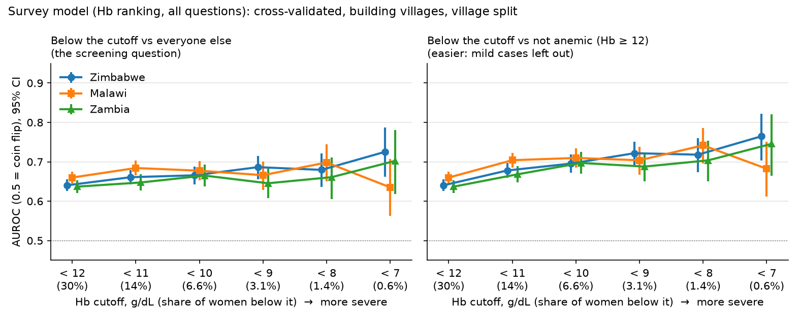

# Severity curve: does the survey model pick out the sickest women better?

Generated by `python -m src.survey.severity_curve` at commit `8de36d1 + uncommitted changes`; settings in `configs/countries.yaml` (`severity_curve`), written before running.

- **Score:** each woman's predicted Hb from the Hb ranking on all questions (Stage 30, village split, out-of-fold on the building villages, averaged over 5 repeats). Lower predicted Hb = higher risk. No model was refit and no locked test was used.
- **Cutoffs:** one cutoff for every woman, pregnant or not, on Hb adjusted for altitude and smoking. So the < 12 point differs slightly from the 'any anemia' results elsewhere, which use < 11 for pregnant women.
- **Vs everyone else:** women below the cutoff against all other women, mild cases included. This is the screening question.
- **Vs not anemic:** women below the cutoff against women with Hb >= 12 only. Easier, because the women in between are left out.
- Village-bootstrap 95% CIs, 2000 resamples. A point needs at least 30 cases.

**Zimbabwe**

| Hb cutoff (g/dL) | cases | share of women | AUROC vs everyone else | AUROC vs not anemic |
|---|---|---|---|---|
| < 12 | 2150 | 29.0% | 0.640 [0.625, 0.656] | 0.640 [0.625, 0.656] |
| < 11 | 1078 | 14.5% | 0.661 [0.642, 0.679] | 0.678 [0.659, 0.697] |
| < 10 | 528 | 7.1% | 0.666 [0.643, 0.688] | 0.695 [0.672, 0.719] |
| < 9 | 250 | 3.4% | 0.686 [0.655, 0.715] | 0.722 [0.690, 0.751] |
| < 8 | 118 | 1.6% | 0.679 [0.636, 0.721] | 0.718 [0.674, 0.760] |
| < 7 | 50 | 0.7% | 0.725 [0.662, 0.787] | 0.765 [0.703, 0.822] |

**Malawi**

| Hb cutoff (g/dL) | cases | share of women | AUROC vs everyone else | AUROC vs not anemic |
|---|---|---|---|---|
| < 12 | 2211 | 27.6% | 0.660 [0.645, 0.674] | 0.660 [0.645, 0.674] |
| < 11 | 1007 | 12.6% | 0.684 [0.666, 0.703] | 0.704 [0.685, 0.723] |
| < 10 | 465 | 5.8% | 0.677 [0.653, 0.702] | 0.710 [0.685, 0.734] |
| < 9 | 221 | 2.8% | 0.666 [0.629, 0.701] | 0.704 [0.667, 0.738] |
| < 8 | 96 | 1.2% | 0.698 [0.651, 0.745] | 0.742 [0.696, 0.786] |
| < 7 | 42 | 0.5% | 0.635 [0.562, 0.707] | 0.682 [0.611, 0.751] |

**Zambia**

| Hb cutoff (g/dL) | cases | share of women | AUROC vs everyone else | AUROC vs not anemic |
|---|---|---|---|---|
| < 12 | 1792 | 32.8% | 0.637 [0.621, 0.653] | 0.637 [0.621, 0.653] |
| < 11 | 866 | 15.9% | 0.648 [0.627, 0.668] | 0.668 [0.647, 0.689] |
| < 10 | 375 | 6.9% | 0.665 [0.638, 0.693] | 0.697 [0.669, 0.725] |
| < 9 | 172 | 3.1% | 0.645 [0.608, 0.682] | 0.688 [0.651, 0.723] |
| < 8 | 82 | 1.5% | 0.661 [0.606, 0.711] | 0.704 [0.650, 0.754] |
| < 7 | 35 | 0.6% | 0.702 [0.618, 0.781] | 0.746 [0.665, 0.820] |
