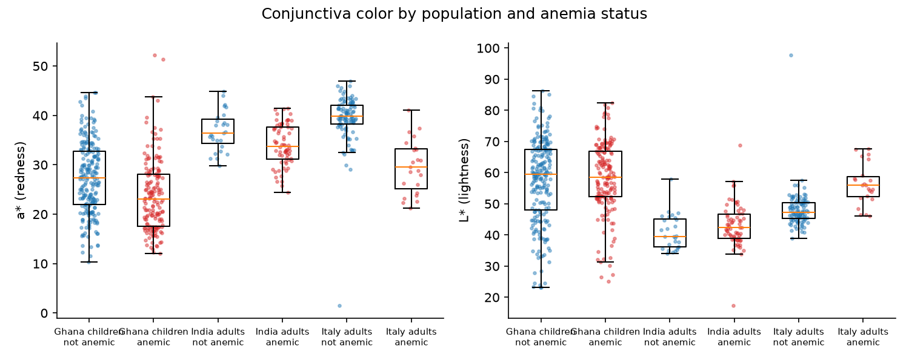

# Stage 10: why do the eyelid populations differ?

Generated by `python -m src.eyelid.populations`; settings in `configs/populations.yaml`. Mentor advice M4 (`docs/eyelid_followup.md`). Populations as in Stage 9: CP-AnemiC distinct photos (Ghana children, anemic = Hb < 11.0 g/dL) and Eyes-Defy India and Italy (adults, WHO by sex: women < 12.0, men < 13.0). Means with bootstrap 95% CIs (2000 resamples). Color measured on the hand-segmented conjunctiva in CIELAB: L* lightness, a* red (+) to green (-), b* yellow (+) to blue (-); S = HSV saturation.

## Who is in each population

| population | anemic | n | female | hb | age_years | L_mean | a_mean | b_mean | S_mean |
|---|---|---|---|---|---|---|---|---|---|
| Ghana children | no | 223 | 45% | 12.461 [12.346, 12.584] | 2.896 [2.718, 3.073] | 57.470 [55.752, 59.142] | 27.302 [26.354, 28.275] | 18.210 [17.092, 19.366] | 0.453 [0.437, 0.470] |
| Ghana children | yes | 165 | 36% | 8.958 [8.733, 9.169] | 2.343 [2.132, 2.564] | 58.209 [56.414, 59.958] | 23.775 [22.679, 24.967] | 17.102 [15.952, 18.289] | 0.421 [0.404, 0.438] |
| India adults | yes | 68 | 59% | 10.493 [10.154, 10.827] | 34.206 [31.161, 37.426] | 43.136 [41.422, 44.747] | 34.028 [33.072, 35.021] | -2.403 [-3.232, -1.589] | 0.491 [0.473, 0.510] |
| India adults | no | 27 | 22% | 13.937 [13.496, 14.389] | 32.333 [28.185, 37.223] | 40.915 [38.973, 43.153] | 36.842 [35.362, 38.387] | -0.073 [-1.941, 2.107] | 0.541 [0.512, 0.567] |
| Italy adults | yes | 23 | 57% | 10.428 [9.830, 11.015] | 64.783 [58.609, 70.000] | 56.203 [53.573, 58.784] | 29.651 [27.429, 31.817] | 4.105 [1.600, 6.786] | 0.388 [0.353, 0.423] |
| Italy adults | no | 99 | 27% | 14.619 [14.387, 14.848] | 45.646 [42.747, 48.465] | 48.232 [47.138, 49.559] | 39.326 [38.190, 40.222] | 12.373 [11.413, 13.391] | 0.537 [0.521, 0.552] |

## Redness gaps: anemia vs population

How much a* (and L*) moves with anemia inside a population, compared with how much it moves between populations among people who are **not** anemic.

| comparison | n | a* difference | L* difference |
|---|---|---|---|
| Ghana children: anemic minus non-anemic | 388 | -3.527 [-4.970, -2.154] | 0.739 [-1.828, 3.188] |
| India adults: anemic minus non-anemic | 95 | -2.814 [-4.683, -1.042] | 2.221 [-0.608, 4.840] |
| Italy adults: anemic minus non-anemic | 122 | -9.676 [-12.247, -7.277] | 7.971 [4.976, 11.137] |
| non-anemic only: India adults minus Italy adults | 126 | -2.484 [-4.313, -0.567] | -7.316 [-9.714, -4.894] |
| non-anemic only: Ghana children minus Italy adults | 322 | -12.024 [-13.312, -10.594] | 9.239 [7.003, 11.330] |
| non-anemic only: Ghana children minus India adults | 250 | -9.540 [-11.374, -7.763] | 16.555 [13.829, 19.124] |

## Shortcut detectors

The anemia models' own inputs (29 color features, or the DINOv2 embedding), with a different question: which population is this photo from? 5x5 stratified CV. An AUROC near 1 means the population is obvious from the pixels, so a model can use it as a shortcut whenever prevalence differs. The last rows show the anemia signal inside each population, with the same models, for comparison.

| task | n | model | AUROC | PR-AUC | Sens @ 90% spec |
|---|---|---|---|---|---|
| India vs Italy, all photos | 217 | logistic_regression (color) | 0.998 [0.995, 1.000] | 0.998 [0.994, 1.000] | 1.000 [1.000, 1.000] |
| India vs Italy, all photos | 217 | dinov2_probe | 0.996 [0.991, 1.000] | 0.996 [0.989, 0.999] | 0.989 [0.965, 1.000] |
| India vs Italy, non-anemic only | 126 | logistic_regression (color) | 0.999 [0.994, 1.000] | 0.995 [0.981, 1.000] | 1.000 [1.000, 1.000] |
| India vs Italy, non-anemic only | 126 | dinov2_probe | 0.972 [0.919, 1.000] | 0.945 [0.862, 1.000] | 0.963 [0.870, 1.000] |
| India vs Italy, anemic only | 91 | logistic_regression (color) | 0.997 [0.988, 1.000] | 0.999 [0.996, 1.000] | 0.985 [0.937, 1.000] |
| India vs Italy, anemic only | 91 | dinov2_probe | 0.997 [0.988, 1.000] | 0.999 [0.996, 1.000] | 1.000 [0.931, 1.000] |
| Ghana children vs Eyes-Defy adults | 605 | logistic_regression (color) | 0.989 [0.977, 0.996] | 0.982 [0.957, 0.998] | 0.974 [0.957, 0.992] |
| Ghana children vs Eyes-Defy adults | 605 | dinov2_probe | 1.000 [0.999, 1.000] | 1.000 [1.000, 1.000] | 1.000 [1.000, 1.000] |
| anemic vs not, Ghana children only | 388 | logistic_regression (color) | 0.680 [0.627, 0.730] | 0.580 [0.503, 0.663] | 0.267 [0.130, 0.345] |
| anemic vs not, Ghana children only | 388 | dinov2_probe | 0.672 [0.616, 0.723] | 0.583 [0.507, 0.665] | 0.273 [0.156, 0.389] |
| anemic vs not, India adults only | 95 | logistic_regression (color) | 0.612 [0.493, 0.726] | 0.805 [0.706, 0.899] | 0.294 [0.029, 0.514] |
| anemic vs not, India adults only | 95 | dinov2_probe | 0.658 [0.543, 0.778] | 0.838 [0.747, 0.916] | 0.265 [0.107, 0.533] |
| anemic vs not, Italy adults only | 122 | logistic_regression (color) | 0.920 [0.822, 0.983] | 0.751 [0.576, 0.938] | 0.826 [0.606, 1.000] |
| anemic vs not, Italy adults only | 122 | dinov2_probe | 0.879 [0.765, 0.963] | 0.723 [0.532, 0.897] | 0.870 [0.474, 1.000] |

## Italy: two acquisition batches

Eyes-Defy Italy came in two batches: folders 1-31 (photos named `N.jpg`, masks on a white background) and folders 32-123 (photos named `T_*`). Anemia sits almost entirely in the first. If the early batch was also photographed differently, an Italian model can score well by recognizing the batch. The last row asks whether non-anemic people in the early batch already look paler.

| batch | anemic | n | Hb | L* | a* |
|---|---|---|---|---|---|
| early (folders 1-31) | no | 10 | 13.662 [12.932, 14.402] | 55.374 [48.615, 65.672] | 32.861 [24.934, 38.378] |
| early (folders 1-31) | yes | 21 | 10.474 [9.985, 10.966] | 56.887 [54.304, 59.610] | 29.050 [27.047, 31.168] |
| later (folders 32-123) | no | 89 | 14.727 [14.512, 14.955] | 47.429 [46.730, 48.173] | 40.053 [39.383, 40.724] |
| later (folders 32-123) | yes | 2 | 9.950 [7.000, 12.900] | 49.020 [46.544, 51.496] | 35.958 [30.872, 41.044] |

| score | rows | n | positives | AUROC |
|---|---|---|---|---|
| batch only (early = 1), predicting anemia | all Italy | 122 | 23 | 0.906 [0.832, 0.964] |
| redness rule, predicting anemia | all Italy | 122 | 23 | 0.924 [0.856, 0.977] |
| redness rule, predicting anemia | early batch only | 31 | 21 | 0.752 [0.517, 0.937] |
| redness rule, predicting the early batch | non-anemic only | 99 | 10 | 0.752 [0.556, 0.933] |
