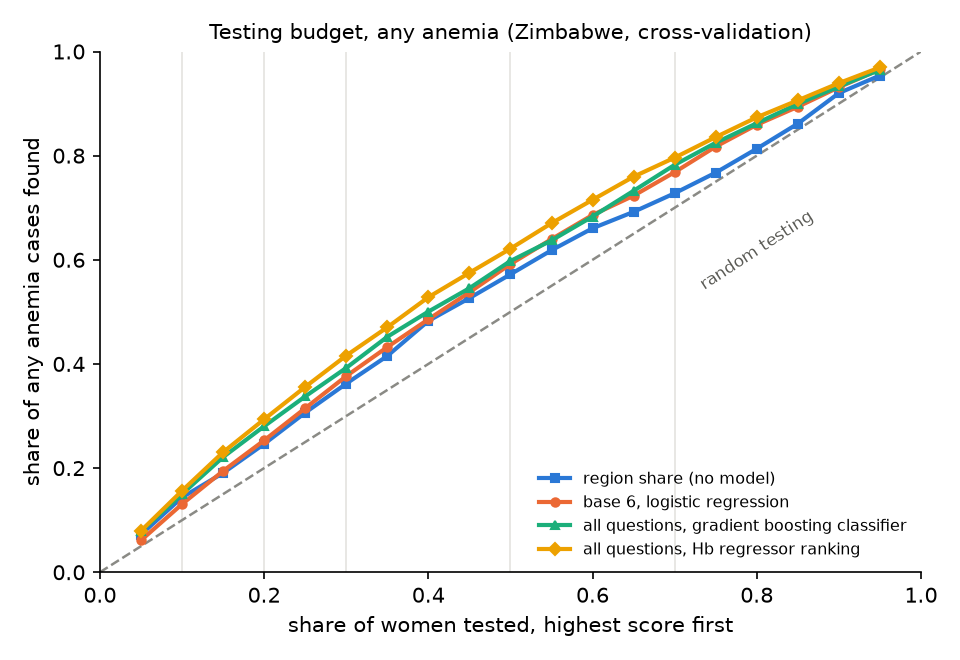
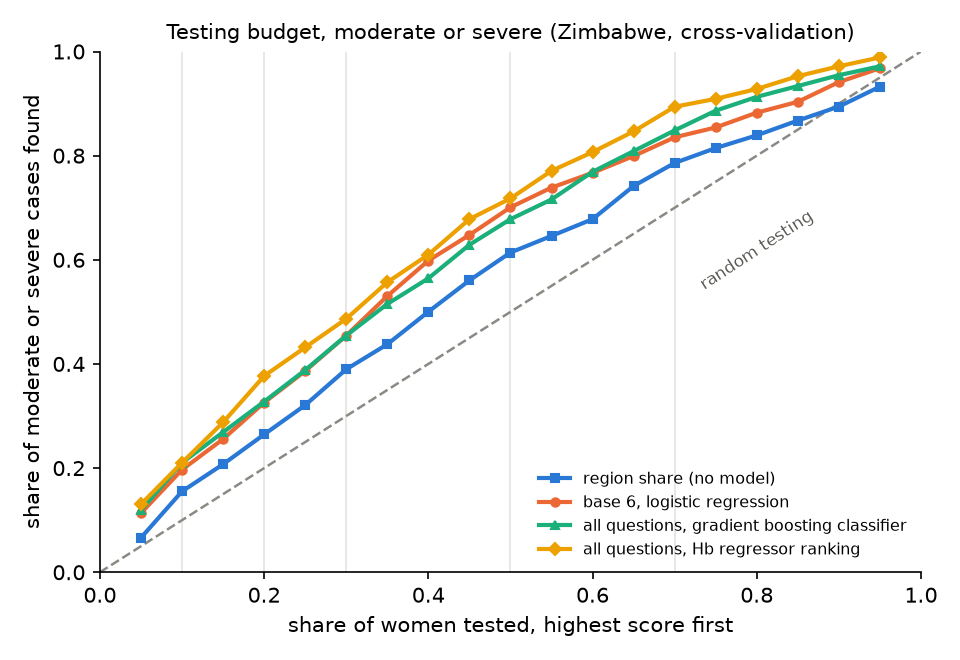

# Stage 29 Step 8e: Hb regression vs. classification, grouped importance, and the budget curve

Generated by `python -m src.survey.hb_vs_class` at commit `2ff02bc + uncommitted changes`; settings in `configs/feature_selection.yaml` (`hb_vs_class`). Building villages, the same 5 x 5 repeated village folds as Step 8a; village-bootstrap 95% CIs and paired differences, 2000 resamples.

- **Any anemia (primary):** DHS `v457` 1-3, adjusted Hb < 12.0 g/dL, or < 11.0 if pregnant (WHO). **Moderate or severe:** DHS `v457` 1-2, adjusted Hb < 10.0 g/dL for every woman, pregnant or not.
- Classifier and Hb regressor: the same 482 questions, the same gradient boosting settings (`models.hist_gradient_boosting`), the same folds. The regressor ranks women by her cutoff minus predicted Hb.

## 1. Does predicting the Hb number help, with the questions and the learner held fixed?

| target | model | AUROC |
|---|---|---|
| any anemia | all questions, gradient boosting classifier | 0.594 [0.579, 0.610] |
| any anemia | all questions, Hb regressor ranking | 0.617 [0.601, 0.633] |
| any anemia | all questions, TabPFN classifier (Step 8a) | 0.618 [0.603, 0.634] |
| any anemia | Hb regressor minus classifier (paired) | 0.022 [0.014, 0.030] |
| any anemia | Hb regressor minus TabPFN classifier (paired) | -0.002 [-0.010, 0.007] |
| moderate or severe | all questions, gradient boosting classifier | 0.632 [0.608, 0.655] |
| moderate or severe | all questions, Hb regressor ranking | 0.666 [0.643, 0.688] |
| moderate or severe | Hb regressor minus classifier (paired) | 0.034 [0.013, 0.054] |

## 2. Grouped permutation importance

Each group's columns are shuffled together (the same row order for all of them) on the held-out folds of the first repeat, 3 shuffles each; the table gives the mean drop in AUROC (or rise in Hb error) over the 5 folds. Groups are the DHS sections fixed in the config, with region (`v024`, `v139`) as its own group. This shows which blocks the model relies on, not why: a block can stand in for a cause, and region may also carry differences between survey teams and their Hb measurement, not only biology.

**Hb regressor (AUROC drop, any anemia)**

| group | questions | mean | SD over folds |
|---|---|---|---|
| contraception (v3xx) | 26 | +0.0350 | 0.0193 |
| region | 2 | +0.0287 | 0.0118 |
| fertility wishes (v6xx) | 14 | +0.0214 | 0.0117 |
| births (v2xx, birth history) | 28 | +0.0134 | 0.0054 |
| her health, breastfeeding, body measures (v4xx) | 34 | +0.0096 | 0.0033 |
| HIV/AIDS and STIs (v75x-v8xx) | 88 | +0.0078 | 0.0130 |
| partner, work, decisions (v70x-v74x) | 25 | +0.0062 | 0.0077 |
| marriage and sex (v5xx) | 15 | +0.0034 | 0.0047 |
| Zimbabwe-only questions (s) | 43 | +0.0014 | 0.0021 |
| child health and vaccines (h) | 21 | +0.0008 | 0.0009 |
| background and household (v0xx-v1xx) | 52 | +0.0001 | 0.0029 |
| bed nets (ml) | 2 | +0.0000 | 0.0000 |
| domestic violence (d) | 58 | -0.0003 | 0.0028 |
| pregnancy and delivery care (m) | 54 | -0.0004 | 0.0050 |
| siblings (mm, mmc) | 5 | -0.0006 | 0.0019 |
| child body measures (hw) | 15 | -0.0025 | 0.0046 |

**Hb regressor (MAE rise, g/dL)**

| group | questions | mean | SD over folds |
|---|---|---|---|
| contraception (v3xx) | 26 | +0.0294 | 0.0101 |
| fertility wishes (v6xx) | 14 | +0.0208 | 0.0050 |
| region | 2 | +0.0207 | 0.0051 |
| HIV/AIDS and STIs (v75x-v8xx) | 88 | +0.0093 | 0.0092 |
| births (v2xx, birth history) | 28 | +0.0089 | 0.0053 |
| her health, breastfeeding, body measures (v4xx) | 34 | +0.0078 | 0.0053 |
| background and household (v0xx-v1xx) | 52 | +0.0034 | 0.0023 |
| partner, work, decisions (v70x-v74x) | 25 | +0.0028 | 0.0048 |
| marriage and sex (v5xx) | 15 | +0.0022 | 0.0025 |
| Zimbabwe-only questions (s) | 43 | +0.0018 | 0.0029 |
| child health and vaccines (h) | 21 | +0.0001 | 0.0010 |
| bed nets (ml) | 2 | +0.0000 | 0.0000 |
| siblings (mm, mmc) | 5 | -0.0004 | 0.0021 |
| domestic violence (d) | 58 | -0.0006 | 0.0021 |
| pregnancy and delivery care (m) | 54 | -0.0013 | 0.0019 |
| child body measures (hw) | 15 | -0.0013 | 0.0017 |

**classifier (AUROC drop, any anemia)**

| group | questions | mean | SD over folds |
|---|---|---|---|
| region | 2 | +0.0307 | 0.0034 |
| contraception (v3xx) | 26 | +0.0199 | 0.0058 |
| partner, work, decisions (v70x-v74x) | 25 | +0.0082 | 0.0084 |
| her health, breastfeeding, body measures (v4xx) | 34 | +0.0053 | 0.0040 |
| HIV/AIDS and STIs (v75x-v8xx) | 88 | +0.0047 | 0.0086 |
| marriage and sex (v5xx) | 15 | +0.0034 | 0.0015 |
| births (v2xx, birth history) | 28 | +0.0024 | 0.0034 |
| background and household (v0xx-v1xx) | 52 | +0.0017 | 0.0087 |
| child health and vaccines (h) | 21 | +0.0017 | 0.0022 |
| fertility wishes (v6xx) | 14 | +0.0012 | 0.0054 |
| Zimbabwe-only questions (s) | 43 | +0.0007 | 0.0024 |
| bed nets (ml) | 2 | -0.0000 | 0.0000 |
| domestic violence (d) | 58 | -0.0004 | 0.0025 |
| siblings (mm, mmc) | 5 | -0.0014 | 0.0064 |
| pregnancy and delivery care (m) | 54 | -0.0015 | 0.0067 |
| child body measures (hw) | 15 | -0.0017 | 0.0013 |

## 3. Budget curve: share of cases found when testing a share of women, highest score first

Cross-validation (building villages):

| target | model | test 10% | test 20% | test 30% | test 50% | test 70% |
|---|---|---|---|---|---|---|
| any anemia | random testing | 0.100 [0.100, 0.100] | 0.200 [0.200, 0.200] | 0.300 [0.300, 0.300] | 0.500 [0.500, 0.500] | 0.700 [0.700, 0.700] |
| moderate or severe | random testing | 0.100 [0.100, 0.100] | 0.200 [0.200, 0.200] | 0.300 [0.300, 0.300] | 0.500 [0.500, 0.500] | 0.700 [0.700, 0.700] |
| any anemia | region share (no model) | 0.144 [0.120, 0.163] | 0.246 [0.227, 0.270] | 0.362 [0.340, 0.386] | 0.572 [0.548, 0.594] | 0.728 [0.707, 0.750] |
| any anemia | base 6, logistic regression | 0.131 [0.119, 0.144] | 0.253 [0.237, 0.270] | 0.377 [0.359, 0.394] | 0.592 [0.574, 0.610] | 0.768 [0.751, 0.784] |
| any anemia | all questions, gradient boosting classifier | 0.150 [0.139, 0.164] | 0.280 [0.264, 0.298] | 0.392 [0.377, 0.414] | 0.598 [0.575, 0.615] | 0.782 [0.766, 0.798] |
| any anemia | all questions, Hb regressor ranking | 0.156 [0.143, 0.169] | 0.294 [0.277, 0.312] | 0.416 [0.399, 0.436] | 0.621 [0.602, 0.643] | 0.796 [0.779, 0.813] |
| moderate or severe | region share (no model) | 0.155 [0.120, 0.194] | 0.265 [0.220, 0.309] | 0.390 [0.336, 0.432] | 0.614 [0.568, 0.661] | 0.786 [0.744, 0.822] |
| moderate or severe | base 6, logistic regression | 0.197 [0.162, 0.224] | 0.326 [0.291, 0.363] | 0.455 [0.414, 0.499] | 0.701 [0.662, 0.742] | 0.835 [0.801, 0.869] |
| moderate or severe | all questions, gradient boosting classifier | 0.210 [0.177, 0.238] | 0.328 [0.290, 0.360] | 0.455 [0.416, 0.491] | 0.678 [0.640, 0.716] | 0.848 [0.816, 0.877] |
| moderate or severe | all questions, Hb regressor ranking | 0.210 [0.179, 0.243] | 0.377 [0.336, 0.413] | 0.487 [0.447, 0.528] | 0.718 [0.681, 0.757] | 0.894 [0.866, 0.919] |

Locked test, descriptive (79 villages): only models already scored there (Steps 6 and 9), refit unchanged; the refits reproduce their earlier AUROCs exactly.

| target | model | test 10% | test 20% | test 30% | test 50% | test 70% |
|---|---|---|---|---|---|---|
| any anemia | region share (no model) | 0.130 [0.098, 0.158] | 0.224 [0.191, 0.264] | 0.320 [0.285, 0.365] | 0.553 [0.501, 0.595] | 0.736 [0.692, 0.774] |
| any anemia | base 6, logistic regression | 0.152 [0.123, 0.180] | 0.273 [0.240, 0.314] | 0.392 [0.354, 0.437] | 0.606 [0.563, 0.648] | 0.760 [0.724, 0.795] |
| any anemia | all questions, Hb regressor ranking | 0.145 [0.119, 0.175] | 0.269 [0.234, 0.306] | 0.396 [0.356, 0.433] | 0.634 [0.597, 0.669] | 0.796 [0.770, 0.830] |
| moderate or severe | region share (no model) | 0.181 [0.118, 0.248] | 0.284 [0.217, 0.368] | 0.385 [0.311, 0.469] | 0.555 [0.473, 0.642] | 0.737 [0.659, 0.803] |
| moderate or severe | base 6, logistic regression | 0.224 [0.157, 0.295] | 0.352 [0.282, 0.448] | 0.488 [0.391, 0.568] | 0.698 [0.612, 0.786] | 0.808 [0.741, 0.883] |
| moderate or severe | all questions, Hb regressor ranking | 0.248 [0.171, 0.325] | 0.416 [0.346, 0.512] | 0.528 [0.444, 0.618] | 0.744 [0.667, 0.810] | 0.888 [0.829, 0.934] |
| moderate or severe | all questions, gradient boosting classifier | 0.192 [0.127, 0.256] | 0.336 [0.252, 0.400] | 0.472 [0.400, 0.548] | 0.704 [0.617, 0.786] | 0.872 [0.816, 0.934] |

 

Each figure plots the cross-validation scores; the dashed line is random testing. The numbers behind the curves are in the tables above.
