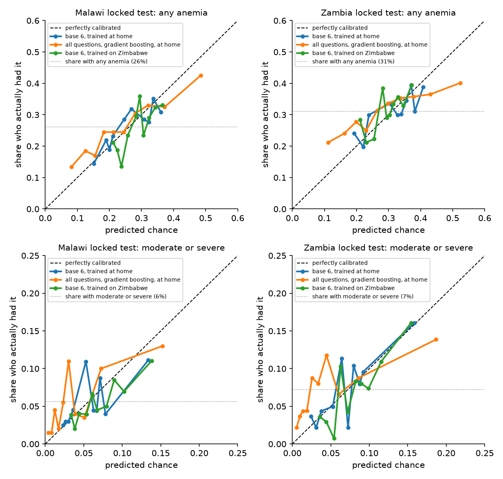

# Stage 30 for the mentors: random vs village split, and each country on its own

Full tables with every model and CI: [stage30_countries.md](stage30_countries.md). AUROC: 0.5 = coin flip, 1.0 = perfect.

## Why we did it

At the 2026-11-23 meeting the mentors suggested two things:

1. Report a random split next to our village split, in case the village split was too harsh.
2. Train and test each country on its own, instead of only training on Zimbabwe and transferring.

## What we did

- **Data:** three DHS surveys of women 15-49 with an Hb test:
  - Zimbabwe 2015: 9,265 women.
  - Malawi 2024: 10,000 women.
  - Zambia 2024: 6,829 women.
- **Cleaning:** each country was cleaned with the same rules we built for Zimbabwe in Stage 29, leaving about 480-550
  questions per country.
- **Targets:**
  - **Any anemia:** WHO cutoff on Hb adjusted for altitude and smoking: **< 12.0 g/dL, or < 11.0 if pregnant**.
  - **Moderate or severe:** **Hb < 10.0 g/dL for every woman**, the same rule in all three countries.
- **Fixed models, no feature selection** (why: see below):
  - a dummy;
  - region or district alone;
  - 6 basic questions: age, pregnancy, wealth, education, contraception, urban/rural;
  - the 6 questions plus place;
  - gradient boosting on all questions;
  - an "Hb ranking" model, which predicts each woman's Hb and ranks her by how far below her cutoff the prediction
    falls.
- **Locked tests:** 20% of villages in Malawi and Zambia were set aside before anything else and scored only once, at the
  end.
- **Written down in advance:** every choice was put in the config before running.
- **Uncertainty:** every number has a 95% CI from 2,000 village-bootstrap resamples.

## Results

### 1. The village split isn't what holds the scores down

Best model (Hb ranking), village split vs random split, 5 x 5 cross-validation:

| | Any anemia | Moderate or severe |
|---|---|---|
| Zimbabwe | 0.617 vs 0.617 | 0.666 vs 0.666 |
| Malawi | 0.630 vs 0.637 | 0.677 vs 0.679 |
| Zambia | 0.610 vs 0.615 | 0.665 vs 0.677 |

- The random split gains at most +0.017, for any model in any country.
- The models only see each woman's own answers, not her village, so having her neighbours in training gives them
  little extra.

### 2. Each country, trained on its own, lands in the same range

- **Any anemia:** 0.61-0.63. **Moderate or severe:** 0.67-0.68. The ceiling isn't a Zimbabwe quirk.
- **Place helps when it's fine enough.** Malawi's 3 regions add nothing, but its districts add +0.033 [+0.020, +0.045].
- **A woman's self-reported HIV test result** (asked only in 2024) adds almost nothing: +0.000 to +0.006.

### 3. Locked tests, scored once (any anemia)

- **Malawi:** the best model scores **0.625 [0.595, 0.653]** and beats the 6 basic questions (0.581) by +0.043
  [+0.011, +0.078].
- **Zambia:** no model beats the 6 basic questions. They score 0.562, and the best model 0.566.
- **Moderate or severe:** 0.60-0.66, with wide CIs, because each test holds only about 100 cases.

### 4. A model trained on Zimbabwe works as well as one trained at home

The 6-question model trained on Zimbabwe 2015 vs the same model trained on each country's own women, on that country's
locked test:

| | Any anemia | Moderate or severe |
|---|---|---|
| Malawi, home minus Zimbabwe-trained | -0.003 [-0.031, +0.028] | -0.013 [-0.051, +0.023] |
| Zambia, home minus Zimbabwe-trained | +0.010 [-0.025, +0.044] | -0.014 [-0.065, +0.037] |

Every CI includes zero. Transfer isn't failing. The questions are weak predictors everywhere.

### 5. Calibration

- The logistic regression's predicted risks match reality closely in both countries, whether trained at home or on
  Zimbabwe.
- Gradient boosting is a little overconfident.

## What it means

- **Survey answers carry a real but weak signal,** and it's the same strength in three countries over 9 years.
- **The limit is the information in the questions,** not the model, the split or the country.
- **On its own it's a weak individual screen.** To still catch 90% of anemic women, it saves about 8 blood tests per 100
  women in Zimbabwe.
- **It's more useful in two narrower roles:**
  - **finding high-risk areas:** it ranks villages better than region alone;
  - **flagging likely severe cases:** it's stronger for moderate or severe anemia.

  Either way it fits as the first step of a two-step screen, followed by the eyelid photo.

## Why we didn't use feature selection in Stage 30

1. **In Stage 29, feature selection didn't beat the 6 basic questions on the locked test.**
   - The winner, the top 10 questions by importance, looked a bit better in cross-validation: 0.595 vs 0.577.
   - On the locked test it scored 0.596 vs 0.590, a gain of +0.006 [-0.022, +0.036]. That's no real gain.
   - Its picks were unstable. Only region and partner's occupation were chosen every time.
   - Its predicted risks were too extreme, with a calibration slope of 0.74.
2. **Every selection method hit the same ceiling.** L1, top-k and forward selection all landed at 0.586-0.599. Gradient
   boosting on all the questions did just as well, with no selection step.
3. **The models on all questions already do their own selecting.** Gradient boosting and the Hb ranking learn which
   questions matter. That's why they're the strongest models in every country.
4. **Fixed models keep the comparison clean.** To answer "does the split matter?" and "does training per country help?",
   the models must stay the same while only the split or the country changes.
5. **It protects the locked tests.** Each extra tuning step makes cross-validation scores a bit optimistic, as happened in
   Stage 29.

## Caveats

- Zimbabwe is a 2015 survey; Malawi and Zambia are 2024.
- Zambia's locked test is small: 109 villages.
- Our moderate-or-severe cutoff (< 10.0 g/dL for everyone) is stricter than WHO's for non-pregnant women (< 11.0).

## Next

- Add village-level map data (malaria, rainfall, altitude), from the DHS geospatial and GPS files.
- Then confirm on an older Zimbabwe survey, since Zimbabwe's locked test is used up.
