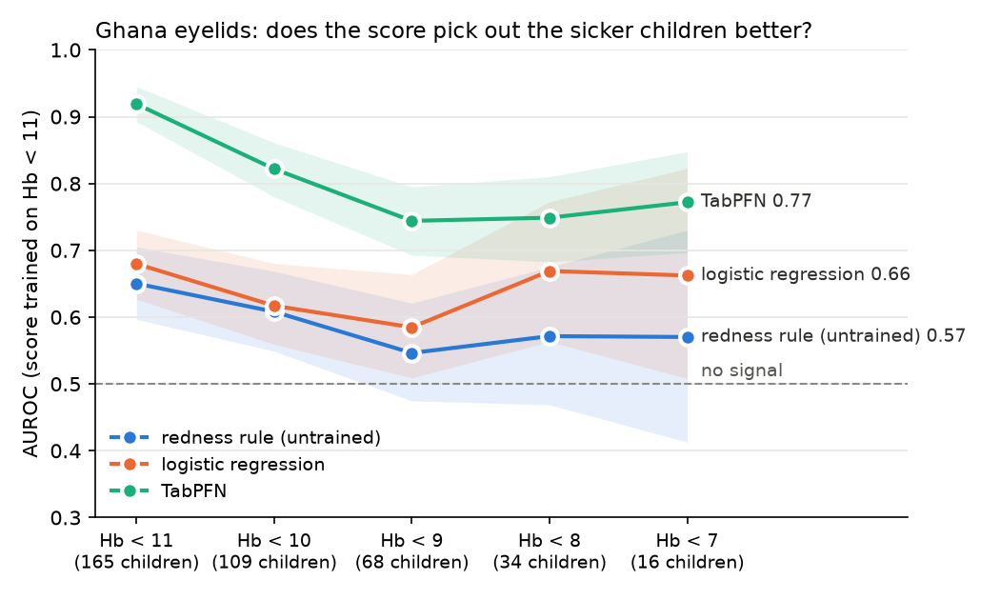

# Stage 38: numbers for the group talk (Ghana eyelids): severity and a fixed number of blood tests

Generated by `python -m src.eyelid.presentation_numbers` at commit `07466bd`; settings and the answers (fixed before running) in `configs/presentation_numbers.yaml`.

- **Cutoff:** Ghana eyelids (CP-AnemiC, the 388 photos with no copy, 165 anemic), children 6-59 months. Every model is trained on **Hb < 11 g/dL**; the same held-out score is then checked against lower cutoffs. Ghana only.
- **Scores:** 5-fold CV x 5 repeats by photo (Stage 9's folds), held-out scores averaged over repeats; models on the 29 color numbers, the untrained redness rule, and the dummy. Bootstrap 95% CIs, 2000 resamples; changes are paired (same children, same resamples).
- **Caveat:** every trained Ghana score carries the folder trace (Stages 30-37), so these numbers show what the scores do, not how much of it is anemia.

## 4. Severity on the x axis, AUROC on the y axis

Mentor (2026-11-17): "On the X axis severity, on the Y axis AUROC ... maybe top 10% we get something surprisingly high." Each column: the children below that Hb against everyone else.

**Answer:** the score picks out the sickest children (Hb < 8, about the sickest 9%) better than all anemic children for: no score.

| score | Hb < 11 (165) | Hb < 10 (109) | Hb < 9 (68) | Hb < 8 (34) | Hb < 7 (16) | Hb < 8 minus Hb < 11 | better for the sickest? |
|---|---|---|---|---|---|---|---|
| dummy | 0.493 [0.435, 0.549] | 0.524 [0.459, 0.586] | 0.524 [0.451, 0.598] | 0.508 [0.404, 0.607] | 0.536 [0.392, 0.693] | 0.015 [-0.084, 0.113] | no |
| redness rule (untrained) | 0.650 [0.597, 0.705] | 0.608 [0.549, 0.669] | 0.546 [0.475, 0.621] | 0.572 [0.469, 0.675] | 0.570 [0.413, 0.730] | -0.079 [-0.178, 0.019] | no |
| logistic regression | 0.680 [0.627, 0.730] | 0.617 [0.559, 0.680] | 0.585 [0.509, 0.664] | 0.669 [0.563, 0.773] | 0.662 [0.508, 0.823] | -0.011 [-0.114, 0.088] | no |
| TabPFN | 0.919 [0.893, 0.945] | 0.822 [0.780, 0.861] | 0.744 [0.693, 0.795] | 0.749 [0.683, 0.810] | 0.772 [0.697, 0.848] | -0.170 [-0.235, -0.108] | no |

## 5. 100 children, blood tests for only 20 (or 30)

Mentor: "100 people come in. You only have capacity to test 20. If you randomly pick the 20 ..." The children with the highest scores get the test. 42.5% of these children are anemic, so even a perfect score can catch at most 47% of them with 20 tests.

**Answer, 20% tested:** catches more anemic children than the rule: TabPFN.

**Answer, 30% tested:** catches more anemic children than the rule: TabPFN.

| tests | score | anemic children caught | of those with Hb < 8, caught | minus the rule | better than the rule? |
|---|---|---|---|---|---|
| 20% tested | random pick | 20% | 20% | - | - |
| 20% tested | dummy | 0.207 [0.169, 0.245] | 0.228 [0.104, 0.359] | -0.084 [-0.158, -0.029] | no |
| 20% tested | redness rule (untrained) | 0.291 [0.251, 0.346] | 0.235 [0.108, 0.408] | - | - |
| 20% tested | logistic regression | 0.291 [0.247, 0.345] | 0.559 [0.395, 0.719] | 0.000 [-0.058, 0.051] | no |
| 20% tested | TabPFN | 0.430 [0.383, 0.477] | 0.382 [0.226, 0.541] | 0.139 [0.073, 0.189] | **yes** |
| 20% tested | perfect score | 47% | - | - | - |
| 30% tested | random pick | 30% | 30% | - | - |
| 30% tested | dummy | 0.302 [0.251, 0.350] | 0.277 [0.139, 0.419] | -0.117 [-0.196, -0.043] | no |
| 30% tested | redness rule (untrained) | 0.418 [0.364, 0.472] | 0.441 [0.286, 0.606] | - | - |
| 30% tested | logistic regression | 0.412 [0.356, 0.471] | 0.559 [0.400, 0.722] | -0.006 [-0.065, 0.053] | no |
| 30% tested | TabPFN | 0.618 [0.564, 0.699] | 0.618 [0.450, 0.781] | 0.200 [0.136, 0.289] | **yes** |
| 30% tested | perfect score | 71% | - | - | - |

## Every severity score

| score | children | n below | AUROC | PR-AUC | sens @ 90% spec |
|---|---|---|---|---|---|
| dummy | Hb < 11 | 165 | 0.493 [0.435, 0.549] | 0.426 [0.367, 0.491] | 0.109 [0.000, 0.155] |
| dummy | Hb < 10 | 109 | 0.524 [0.459, 0.586] | 0.299 [0.242, 0.364] | 0.128 [0.000, 0.191] |
| dummy | Hb < 9 | 68 | 0.524 [0.451, 0.598] | 0.188 [0.143, 0.248] | 0.132 [0.000, 0.211] |
| dummy | Hb < 8 | 34 | 0.508 [0.404, 0.607] | 0.100 [0.063, 0.158] | 0.176 [0.000, 0.306] |
| dummy | Hb < 7 | 16 | 0.536 [0.392, 0.693] | 0.058 [0.027, 0.122] | 0.250 [0.000, 0.471] |
| redness rule (untrained) | Hb < 11 | 165 | 0.650 [0.597, 0.705] | 0.555 [0.483, 0.645] | 0.273 [0.135, 0.354] |
| redness rule (untrained) | Hb < 10 | 109 | 0.608 [0.549, 0.669] | 0.363 [0.298, 0.455] | 0.193 [0.088, 0.318] |
| redness rule (untrained) | Hb < 9 | 68 | 0.546 [0.475, 0.621] | 0.197 [0.150, 0.273] | 0.103 [0.038, 0.193] |
| redness rule (untrained) | Hb < 8 | 34 | 0.572 [0.469, 0.675] | 0.111 [0.075, 0.183] | 0.118 [0.025, 0.235] |
| redness rule (untrained) | Hb < 7 | 16 | 0.570 [0.413, 0.730] | 0.055 [0.030, 0.102] | 0.062 [0.000, 0.200] |
| logistic regression | Hb < 11 | 165 | 0.680 [0.627, 0.730] | 0.580 [0.503, 0.663] | 0.267 [0.130, 0.345] |
| logistic regression | Hb < 10 | 109 | 0.617 [0.559, 0.680] | 0.398 [0.320, 0.499] | 0.229 [0.133, 0.352] |
| logistic regression | Hb < 9 | 68 | 0.585 [0.509, 0.664] | 0.232 [0.174, 0.325] | 0.176 [0.087, 0.333] |
| logistic regression | Hb < 8 | 34 | 0.669 [0.563, 0.773] | 0.201 [0.126, 0.334] | 0.412 [0.207, 0.613] |
| logistic regression | Hb < 7 | 16 | 0.662 [0.508, 0.823] | 0.096 [0.046, 0.221] | 0.375 [0.053, 0.667] |
| TabPFN | Hb < 11 | 165 | 0.919 [0.893, 0.945] | 0.874 [0.822, 0.923] | 0.758 [0.656, 0.855] |
| TabPFN | Hb < 10 | 109 | 0.822 [0.780, 0.861] | 0.542 [0.453, 0.641] | 0.294 [0.200, 0.475] |
| TabPFN | Hb < 9 | 68 | 0.744 [0.693, 0.795] | 0.293 [0.230, 0.388] | 0.221 [0.091, 0.319] |
| TabPFN | Hb < 8 | 34 | 0.749 [0.683, 0.810] | 0.167 [0.113, 0.256] | 0.265 [0.083, 0.412] |
| TabPFN | Hb < 7 | 16 | 0.772 [0.697, 0.848] | 0.093 [0.053, 0.183] | 0.250 [0.053, 0.500] |
