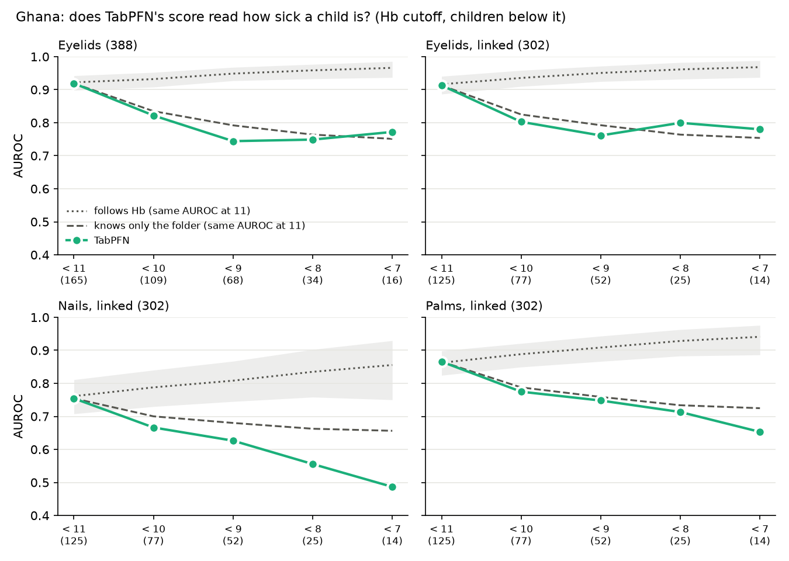

# Stage 39: does any Ghana body site's score read how sick a child is, beyond the anemic / healthy folder?

Generated by `python -m src.eyelid.severity_reference` at commit `bf4be20`; settings and the answer (fixed before running) in `configs/severity_reference.yaml`.

- **Cutoff:** Ghana children 6-59 months; every model is trained on **Hb < 11 g/dL** and the same held-out score is checked against lower cutoffs (children below each vs everyone else). Ghana only.
- **Sets:** the 388 eyelid photos with no copy (folds by photo, as Stage 38), and the 302 children with an eyelid, nail and palm photo linked by file number (Stage 24; folds by child group; the link is probable, not certain).
- **Scores:** 5-fold CV x 5 repeats, held-out scores averaged over repeats; the untrained redness rule, the dummy, and logistic regression and TabPFN on the 29 color numbers. Bootstrap 95% CIs, 2000 resamples.
- **Two reference lines per score,** matched to its own AUROC at Hb < 11: *knows only the folder* (every anemic-healthy pair ordered right with the same chance, two anemic children a coin flip; it falls at lower cutoffs) and *follows Hb* (minus Hb plus noise, the jump test's steady reference; median of 2000 draws).
- **Answer, fixed before running:** a score reads severity beyond the folder if its AUROC at Hb < 8 minus the folder-only line has its CI above 0.

## Answer: which scores read severity beyond the folder?

- **Eyelids (388)** (165 anemic, 34 below 8): no score
- **Eyelids, linked (302)** (125 anemic, 25 below 8): no score
- **Nails, linked (302)** (125 anemic, 25 below 8): no score
- **Palms, linked (302)** (125 anemic, 25 below 8): no score

## Each score against its two reference lines

Each cell: the score's AUROC / knows only the folder / follows Hb (median).

| set | score | Hb < 11 | Hb < 10 | Hb < 9 | Hb < 8 | Hb < 7 | Hb < 8 minus the folder line | beyond the folder? |
|---|---|---|---|---|---|---|---|---|
| Eyelids (388) | dummy | 0.493 [0.435, 0.549] | 0.524 / 0.495 / 0.522 | 0.524 / 0.495 / 0.524 | 0.508 / 0.496 / 0.529 | 0.536 / 0.496 / 0.529 | 0.012 [-0.083, 0.105] | no |
| Eyelids (388) | redness rule (untrained) | 0.650 [0.597, 0.705] | 0.608 / 0.620 / 0.666 | 0.546 / 0.605 / 0.683 | 0.572 / 0.595 / 0.701 | 0.570 / 0.590 / 0.722 | -0.023 [-0.119, 0.075] | no |
| Eyelids (388) | logistic regression | 0.680 [0.627, 0.730] | 0.617 / 0.644 / 0.698 | 0.585 / 0.625 / 0.717 | 0.669 / 0.613 / 0.738 | 0.662 / 0.608 / 0.760 | 0.056 [-0.045, 0.156] | no |
| Eyelids (388) | TabPFN | 0.919 [0.893, 0.945] | 0.822 / 0.835 / 0.932 | 0.744 / 0.792 / 0.949 | 0.749 / 0.764 / 0.958 | 0.772 / 0.751 / 0.966 | -0.015 [-0.076, 0.043] | no |
| Eyelids, linked (302) | dummy | 0.499 [0.435, 0.561] | 0.462 / 0.499 / 0.522 | 0.497 / 0.500 / 0.523 | 0.443 / 0.500 / 0.529 | 0.505 / 0.500 / 0.530 | -0.056 [-0.176, 0.063] | no |
| Eyelids, linked (302) | redness rule (untrained) | 0.632 [0.570, 0.696] | 0.585 / 0.604 / 0.647 | 0.551 / 0.593 / 0.661 | 0.649 / 0.584 / 0.681 | 0.617 / 0.581 / 0.695 | 0.065 [-0.048, 0.170] | no |
| Eyelids, linked (302) | logistic regression | 0.643 [0.579, 0.704] | 0.585 / 0.612 / 0.667 | 0.577 / 0.601 / 0.684 | 0.698 / 0.591 / 0.704 | 0.664 / 0.588 / 0.718 | 0.107 [-0.009, 0.215] | no |
| Eyelids, linked (302) | TabPFN | 0.913 [0.877, 0.943] | 0.803 / 0.825 / 0.936 | 0.761 / 0.792 / 0.951 | 0.800 / 0.764 / 0.961 | 0.780 / 0.754 / 0.968 | 0.036 [-0.030, 0.101] | no |
| Nails, linked (302) | dummy | 0.499 [0.435, 0.561] | 0.462 / 0.499 / 0.521 | 0.497 / 0.500 / 0.522 | 0.443 / 0.500 / 0.528 | 0.505 / 0.500 / 0.531 | -0.056 [-0.176, 0.063] | no |
| Nails, linked (302) | redness rule (untrained) | 0.493 [0.424, 0.562] | 0.519 / 0.495 / 0.521 | 0.534 / 0.495 / 0.524 | 0.560 / 0.496 / 0.528 | 0.660 / 0.496 / 0.531 | 0.064 [-0.065, 0.187] | no |
| Nails, linked (302) | logistic regression | 0.637 [0.574, 0.699] | 0.607 / 0.608 / 0.649 | 0.568 / 0.597 / 0.662 | 0.545 / 0.588 / 0.684 | 0.463 / 0.584 / 0.700 | -0.043 [-0.144, 0.057] | no |
| Nails, linked (302) | TabPFN | 0.754 [0.695, 0.808] | 0.666 / 0.700 / 0.788 | 0.626 / 0.680 / 0.808 | 0.556 / 0.663 / 0.835 | 0.487 / 0.656 / 0.856 | -0.107 [-0.213, -0.009] | no |
| Palms, linked (302) | dummy | 0.499 [0.435, 0.561] | 0.462 / 0.499 / 0.521 | 0.497 / 0.500 / 0.524 | 0.443 / 0.500 / 0.528 | 0.505 / 0.500 / 0.533 | -0.056 [-0.176, 0.063] | no |
| Palms, linked (302) | redness rule (untrained) | 0.597 [0.531, 0.665] | 0.604 / 0.576 / 0.608 | 0.619 / 0.569 / 0.619 | 0.619 / 0.562 / 0.632 | 0.630 / 0.560 / 0.645 | 0.057 [-0.059, 0.171] | no |
| Palms, linked (302) | logistic regression | 0.651 [0.586, 0.714] | 0.643 / 0.618 / 0.666 | 0.679 / 0.607 / 0.682 | 0.612 / 0.596 / 0.704 | 0.586 / 0.593 / 0.719 | 0.016 [-0.104, 0.136] | no |
| Palms, linked (302) | TabPFN | 0.866 [0.824, 0.905] | 0.775 / 0.788 / 0.888 | 0.748 / 0.759 / 0.908 | 0.713 / 0.734 / 0.928 | 0.653 / 0.725 / 0.941 | -0.020 [-0.099, 0.057] | no |

## Every severity score

| set | score | children | n below | AUROC | PR-AUC | sens @ 90% spec |
|---|---|---|---|---|---|---|
| Eyelids (388) | dummy | Hb < 11 | 165 | 0.493 [0.435, 0.549] | 0.426 [0.367, 0.491] | 0.109 [0.000, 0.155] |
| Eyelids (388) | dummy | Hb < 10 | 109 | 0.524 [0.459, 0.586] | 0.299 [0.242, 0.364] | 0.128 [0.000, 0.191] |
| Eyelids (388) | dummy | Hb < 9 | 68 | 0.524 [0.451, 0.598] | 0.188 [0.143, 0.248] | 0.132 [0.000, 0.211] |
| Eyelids (388) | dummy | Hb < 8 | 34 | 0.508 [0.404, 0.607] | 0.100 [0.063, 0.158] | 0.176 [0.000, 0.306] |
| Eyelids (388) | dummy | Hb < 7 | 16 | 0.536 [0.392, 0.693] | 0.058 [0.027, 0.122] | 0.250 [0.000, 0.471] |
| Eyelids (388) | redness rule (untrained) | Hb < 11 | 165 | 0.650 [0.597, 0.705] | 0.555 [0.483, 0.645] | 0.273 [0.135, 0.354] |
| Eyelids (388) | redness rule (untrained) | Hb < 10 | 109 | 0.608 [0.549, 0.669] | 0.363 [0.298, 0.455] | 0.193 [0.088, 0.318] |
| Eyelids (388) | redness rule (untrained) | Hb < 9 | 68 | 0.546 [0.475, 0.621] | 0.197 [0.150, 0.273] | 0.103 [0.038, 0.193] |
| Eyelids (388) | redness rule (untrained) | Hb < 8 | 34 | 0.572 [0.469, 0.675] | 0.111 [0.075, 0.183] | 0.118 [0.025, 0.235] |
| Eyelids (388) | redness rule (untrained) | Hb < 7 | 16 | 0.570 [0.413, 0.730] | 0.055 [0.030, 0.102] | 0.062 [0.000, 0.200] |
| Eyelids (388) | logistic regression | Hb < 11 | 165 | 0.680 [0.627, 0.730] | 0.580 [0.503, 0.663] | 0.267 [0.130, 0.345] |
| Eyelids (388) | logistic regression | Hb < 10 | 109 | 0.617 [0.559, 0.680] | 0.398 [0.320, 0.499] | 0.229 [0.133, 0.352] |
| Eyelids (388) | logistic regression | Hb < 9 | 68 | 0.585 [0.509, 0.664] | 0.232 [0.174, 0.325] | 0.176 [0.087, 0.333] |
| Eyelids (388) | logistic regression | Hb < 8 | 34 | 0.669 [0.563, 0.773] | 0.201 [0.126, 0.334] | 0.412 [0.207, 0.613] |
| Eyelids (388) | logistic regression | Hb < 7 | 16 | 0.662 [0.508, 0.823] | 0.096 [0.046, 0.221] | 0.375 [0.053, 0.667] |
| Eyelids (388) | TabPFN | Hb < 11 | 165 | 0.919 [0.893, 0.945] | 0.874 [0.822, 0.923] | 0.758 [0.656, 0.855] |
| Eyelids (388) | TabPFN | Hb < 10 | 109 | 0.822 [0.780, 0.861] | 0.542 [0.453, 0.641] | 0.294 [0.200, 0.475] |
| Eyelids (388) | TabPFN | Hb < 9 | 68 | 0.744 [0.693, 0.795] | 0.293 [0.230, 0.388] | 0.221 [0.091, 0.319] |
| Eyelids (388) | TabPFN | Hb < 8 | 34 | 0.749 [0.683, 0.810] | 0.167 [0.113, 0.256] | 0.265 [0.083, 0.412] |
| Eyelids (388) | TabPFN | Hb < 7 | 16 | 0.772 [0.697, 0.848] | 0.093 [0.053, 0.183] | 0.250 [0.053, 0.500] |
| Eyelids, linked (302) | dummy | Hb < 11 | 125 | 0.499 [0.435, 0.561] | 0.424 [0.359, 0.504] | 0.096 [0.008, 0.172] |
| Eyelids, linked (302) | dummy | Hb < 10 | 77 | 0.462 [0.389, 0.533] | 0.238 [0.190, 0.298] | 0.052 [0.000, 0.103] |
| Eyelids, linked (302) | dummy | Hb < 9 | 52 | 0.497 [0.413, 0.583] | 0.172 [0.127, 0.236] | 0.077 [0.000, 0.152] |
| Eyelids, linked (302) | dummy | Hb < 8 | 25 | 0.443 [0.320, 0.568] | 0.077 [0.050, 0.121] | 0.040 [0.000, 0.133] |
| Eyelids, linked (302) | dummy | Hb < 7 | 14 | 0.505 [0.344, 0.668] | 0.051 [0.028, 0.097] | 0.071 [0.000, 0.250] |
| Eyelids, linked (302) | redness rule (untrained) | Hb < 11 | 125 | 0.632 [0.570, 0.696] | 0.520 [0.444, 0.620] | 0.256 [0.086, 0.336] |
| Eyelids, linked (302) | redness rule (untrained) | Hb < 10 | 77 | 0.585 [0.509, 0.659] | 0.310 [0.240, 0.410] | 0.156 [0.053, 0.279] |
| Eyelids, linked (302) | redness rule (untrained) | Hb < 9 | 52 | 0.551 [0.467, 0.639] | 0.192 [0.140, 0.271] | 0.077 [0.018, 0.186] |
| Eyelids, linked (302) | redness rule (untrained) | Hb < 8 | 25 | 0.649 [0.528, 0.762] | 0.132 [0.080, 0.223] | 0.160 [0.000, 0.310] |
| Eyelids, linked (302) | redness rule (untrained) | Hb < 7 | 14 | 0.617 [0.436, 0.768] | 0.070 [0.037, 0.129] | 0.000 [0.000, 0.211] |
| Eyelids, linked (302) | logistic regression | Hb < 11 | 125 | 0.643 [0.579, 0.704] | 0.513 [0.437, 0.610] | 0.176 [0.069, 0.336] |
| Eyelids, linked (302) | logistic regression | Hb < 10 | 77 | 0.585 [0.505, 0.660] | 0.313 [0.241, 0.409] | 0.169 [0.044, 0.319] |
| Eyelids, linked (302) | logistic regression | Hb < 9 | 52 | 0.577 [0.483, 0.667] | 0.223 [0.156, 0.315] | 0.192 [0.038, 0.407] |
| Eyelids, linked (302) | logistic regression | Hb < 8 | 25 | 0.698 [0.567, 0.813] | 0.181 [0.105, 0.308] | 0.360 [0.125, 0.667] |
| Eyelids, linked (302) | logistic regression | Hb < 7 | 14 | 0.664 [0.488, 0.810] | 0.091 [0.042, 0.180] | 0.286 [0.000, 0.625] |
| Eyelids, linked (302) | TabPFN | Hb < 11 | 125 | 0.913 [0.877, 0.943] | 0.863 [0.797, 0.920] | 0.736 [0.597, 0.853] |
| Eyelids, linked (302) | TabPFN | Hb < 10 | 77 | 0.803 [0.749, 0.852] | 0.465 [0.376, 0.578] | 0.247 [0.110, 0.440] |
| Eyelids, linked (302) | TabPFN | Hb < 9 | 52 | 0.761 [0.699, 0.818] | 0.313 [0.235, 0.427] | 0.250 [0.098, 0.367] |
| Eyelids, linked (302) | TabPFN | Hb < 8 | 25 | 0.800 [0.728, 0.864] | 0.211 [0.132, 0.354] | 0.280 [0.115, 0.516] |
| Eyelids, linked (302) | TabPFN | Hb < 7 | 14 | 0.780 [0.703, 0.850] | 0.102 [0.058, 0.188] | 0.143 [0.000, 0.429] |
| Nails, linked (302) | dummy | Hb < 11 | 125 | 0.499 [0.435, 0.561] | 0.424 [0.359, 0.504] | 0.096 [0.008, 0.172] |
| Nails, linked (302) | dummy | Hb < 10 | 77 | 0.462 [0.389, 0.533] | 0.238 [0.190, 0.298] | 0.052 [0.000, 0.103] |
| Nails, linked (302) | dummy | Hb < 9 | 52 | 0.497 [0.413, 0.583] | 0.172 [0.127, 0.236] | 0.077 [0.000, 0.152] |
| Nails, linked (302) | dummy | Hb < 8 | 25 | 0.443 [0.320, 0.568] | 0.077 [0.050, 0.121] | 0.040 [0.000, 0.133] |
| Nails, linked (302) | dummy | Hb < 7 | 14 | 0.505 [0.344, 0.668] | 0.051 [0.028, 0.097] | 0.071 [0.000, 0.250] |
| Nails, linked (302) | redness rule (untrained) | Hb < 11 | 125 | 0.493 [0.424, 0.562] | 0.478 [0.397, 0.574] | 0.240 [0.122, 0.314] |
| Nails, linked (302) | redness rule (untrained) | Hb < 10 | 77 | 0.519 [0.443, 0.598] | 0.311 [0.236, 0.417] | 0.169 [0.072, 0.266] |
| Nails, linked (302) | redness rule (untrained) | Hb < 9 | 52 | 0.534 [0.446, 0.626] | 0.212 [0.152, 0.315] | 0.173 [0.065, 0.296] |
| Nails, linked (302) | redness rule (untrained) | Hb < 8 | 25 | 0.560 [0.427, 0.691] | 0.134 [0.075, 0.270] | 0.240 [0.074, 0.435] |
| Nails, linked (302) | redness rule (untrained) | Hb < 7 | 14 | 0.660 [0.491, 0.819] | 0.120 [0.051, 0.285] | 0.357 [0.091, 0.632] |
| Nails, linked (302) | logistic regression | Hb < 11 | 125 | 0.637 [0.574, 0.699] | 0.541 [0.457, 0.638] | 0.208 [0.089, 0.304] |
| Nails, linked (302) | logistic regression | Hb < 10 | 77 | 0.607 [0.532, 0.683] | 0.336 [0.256, 0.443] | 0.156 [0.058, 0.280] |
| Nails, linked (302) | logistic regression | Hb < 9 | 52 | 0.568 [0.483, 0.650] | 0.195 [0.145, 0.271] | 0.038 [0.000, 0.196] |
| Nails, linked (302) | logistic regression | Hb < 8 | 25 | 0.545 [0.439, 0.650] | 0.094 [0.058, 0.163] | 0.040 [0.000, 0.240] |
| Nails, linked (302) | logistic regression | Hb < 7 | 14 | 0.463 [0.299, 0.620] | 0.052 [0.025, 0.134] | 0.071 [0.000, 0.273] |
| Nails, linked (302) | TabPFN | Hb < 11 | 125 | 0.754 [0.695, 0.808] | 0.627 [0.546, 0.726] | 0.312 [0.128, 0.583] |
| Nails, linked (302) | TabPFN | Hb < 10 | 77 | 0.666 [0.592, 0.733] | 0.362 [0.282, 0.466] | 0.130 [0.056, 0.309] |
| Nails, linked (302) | TabPFN | Hb < 9 | 52 | 0.626 [0.547, 0.702] | 0.221 [0.167, 0.313] | 0.096 [0.019, 0.213] |
| Nails, linked (302) | TabPFN | Hb < 8 | 25 | 0.556 [0.440, 0.660] | 0.095 [0.060, 0.164] | 0.080 [0.000, 0.227] |
| Nails, linked (302) | TabPFN | Hb < 7 | 14 | 0.487 [0.324, 0.627] | 0.047 [0.026, 0.090] | 0.000 [0.000, 0.158] |
| Palms, linked (302) | dummy | Hb < 11 | 125 | 0.499 [0.435, 0.561] | 0.424 [0.359, 0.504] | 0.096 [0.008, 0.172] |
| Palms, linked (302) | dummy | Hb < 10 | 77 | 0.462 [0.389, 0.533] | 0.238 [0.190, 0.298] | 0.052 [0.000, 0.103] |
| Palms, linked (302) | dummy | Hb < 9 | 52 | 0.497 [0.413, 0.583] | 0.172 [0.127, 0.236] | 0.077 [0.000, 0.152] |
| Palms, linked (302) | dummy | Hb < 8 | 25 | 0.443 [0.320, 0.568] | 0.077 [0.050, 0.121] | 0.040 [0.000, 0.133] |
| Palms, linked (302) | dummy | Hb < 7 | 14 | 0.505 [0.344, 0.668] | 0.051 [0.028, 0.097] | 0.071 [0.000, 0.250] |
| Palms, linked (302) | redness rule (untrained) | Hb < 11 | 125 | 0.597 [0.531, 0.665] | 0.571 [0.488, 0.662] | 0.280 [0.206, 0.378] |
| Palms, linked (302) | redness rule (untrained) | Hb < 10 | 77 | 0.604 [0.528, 0.678] | 0.382 [0.292, 0.502] | 0.325 [0.194, 0.426] |
| Palms, linked (302) | redness rule (untrained) | Hb < 9 | 52 | 0.619 [0.529, 0.700] | 0.292 [0.203, 0.428] | 0.327 [0.192, 0.458] |
| Palms, linked (302) | redness rule (untrained) | Hb < 8 | 25 | 0.619 [0.495, 0.737] | 0.145 [0.084, 0.269] | 0.360 [0.125, 0.545] |
| Palms, linked (302) | redness rule (untrained) | Hb < 7 | 14 | 0.630 [0.467, 0.788] | 0.096 [0.043, 0.236] | 0.286 [0.000, 0.600] |
| Palms, linked (302) | logistic regression | Hb < 11 | 125 | 0.651 [0.586, 0.714] | 0.587 [0.499, 0.682] | 0.336 [0.194, 0.440] |
| Palms, linked (302) | logistic regression | Hb < 10 | 77 | 0.643 [0.563, 0.721] | 0.419 [0.320, 0.540] | 0.273 [0.172, 0.425] |
| Palms, linked (302) | logistic regression | Hb < 9 | 52 | 0.679 [0.581, 0.764] | 0.374 [0.255, 0.519] | 0.327 [0.189, 0.489] |
| Palms, linked (302) | logistic regression | Hb < 8 | 25 | 0.612 [0.477, 0.734] | 0.142 [0.079, 0.275] | 0.200 [0.045, 0.389] |
| Palms, linked (302) | logistic regression | Hb < 7 | 14 | 0.586 [0.397, 0.765] | 0.083 [0.036, 0.217] | 0.214 [0.000, 0.429] |
| Palms, linked (302) | TabPFN | Hb < 11 | 125 | 0.866 [0.824, 0.905] | 0.795 [0.722, 0.873] | 0.600 [0.413, 0.770] |
| Palms, linked (302) | TabPFN | Hb < 10 | 77 | 0.775 [0.714, 0.830] | 0.480 [0.381, 0.604] | 0.364 [0.202, 0.492] |
| Palms, linked (302) | TabPFN | Hb < 9 | 52 | 0.748 [0.684, 0.808] | 0.324 [0.238, 0.451] | 0.269 [0.122, 0.418] |
| Palms, linked (302) | TabPFN | Hb < 8 | 25 | 0.713 [0.626, 0.793] | 0.165 [0.095, 0.307] | 0.200 [0.067, 0.414] |
| Palms, linked (302) | TabPFN | Hb < 7 | 14 | 0.653 [0.542, 0.758] | 0.068 [0.037, 0.133] | 0.143 [0.000, 0.364] |
