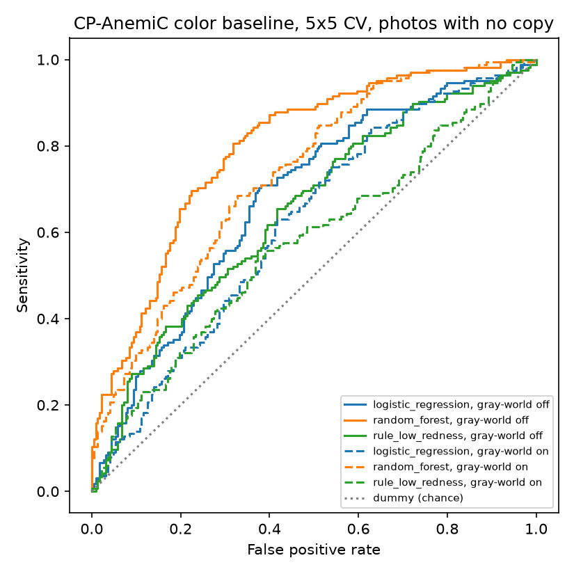

# Stage 3: color-feature baseline (CP-AnemiC)

Generated by `python -m src.eyelid.train_color` at commit `bb9a083`. Anemia = Hb < 11.0 g/dL. Estimates with bootstrap 95% CIs (2000 resamples).

- `cv_5x5_no_copies` (**headline**): repeated stratified 5-fold CV, 5 repeats, on the 388 photos with no byte-identical copy and no detected near-duplicate. Scores averaged over repeats.
- `leave_one_hospital_out`: the same 388 photos (the only ones whose hospital is trustworthy); pooled out-of-fold predictions across the held-out hospitals. The dummy scores below 0.5 here because each fold's prior comes from the other hospitals, so high-prevalence hospitals get lower scores.
- `cv_5x5_distinct_photos`: one row per distinct photo (n=476), copies merged. The no-color control stays above chance here, which points to near-duplicates the audit rule missed, so treat it as optimistic.
- `rule_low_redness`: no training, score = minus mean a* (paler = more likely anemic).
- `negative_control_rf_no_color`: random forest on image size and cut-out shape only, no color. Near 0.5 means the split is not leaking duplicate photos.

| experiment | n | model | gray_world | AUROC | PR-AUC | Sens @ 90% spec |
|---|---|---|---|---|---|---|
| cv_5x5_no_copies | 388 | dummy | False | 0.493 [0.435, 0.549] | 0.426 [0.367, 0.491] | 0.109 [0.000, 0.155] |
| cv_5x5_no_copies | 388 | logistic_regression | False | 0.680 [0.627, 0.730] | 0.580 [0.503, 0.663] | 0.267 [0.130, 0.345] |
| cv_5x5_no_copies | 388 | random_forest | False | 0.796 [0.752, 0.839] | 0.736 [0.666, 0.799] | 0.370 [0.256, 0.491] |
| cv_5x5_no_copies | 388 | rule_low_redness | False | 0.650 [0.597, 0.705] | 0.555 [0.483, 0.645] | 0.273 [0.135, 0.354] |
| cv_5x5_no_copies | 388 | negative_control_rf_no_color | False | 0.537 [0.474, 0.595] | 0.497 [0.425, 0.578] | 0.164 [0.098, 0.252] |
| cv_5x5_no_copies | 388 | dummy | True | 0.493 [0.435, 0.549] | 0.426 [0.367, 0.491] | 0.109 [0.000, 0.155] |
| cv_5x5_no_copies | 388 | logistic_regression | True | 0.621 [0.565, 0.674] | 0.521 [0.446, 0.601] | 0.139 [0.084, 0.256] |
| cv_5x5_no_copies | 388 | random_forest | True | 0.733 [0.683, 0.779] | 0.668 [0.597, 0.738] | 0.321 [0.218, 0.404] |
| cv_5x5_no_copies | 388 | rule_low_redness | True | 0.577 [0.521, 0.633] | 0.510 [0.441, 0.594] | 0.194 [0.125, 0.281] |
| cv_5x5_no_copies | 388 | negative_control_rf_no_color | True | 0.537 [0.474, 0.595] | 0.497 [0.425, 0.578] | 0.164 [0.098, 0.252] |
| leave_one_hospital_out | 388 | dummy | False | 0.381 [0.326, 0.436] | 0.358 [0.308, 0.413] | 0.000 [0.000, 0.000] |
| leave_one_hospital_out | 388 | logistic_regression | False | 0.672 [0.619, 0.723] | 0.562 [0.486, 0.646] | 0.224 [0.100, 0.288] |
| leave_one_hospital_out | 388 | random_forest | False | 0.786 [0.740, 0.830] | 0.702 [0.628, 0.773] | 0.333 [0.237, 0.454] |
| leave_one_hospital_out | 388 | rule_low_redness | False | 0.650 [0.597, 0.705] | 0.555 [0.483, 0.645] | 0.273 [0.135, 0.354] |
| leave_one_hospital_out | 388 | negative_control_rf_no_color | False | 0.517 [0.456, 0.575] | 0.473 [0.403, 0.552] | 0.133 [0.067, 0.205] |
| leave_one_hospital_out | 388 | dummy | True | 0.381 [0.326, 0.436] | 0.358 [0.308, 0.413] | 0.000 [0.000, 0.000] |
| leave_one_hospital_out | 388 | logistic_regression | True | 0.592 [0.536, 0.646] | 0.495 [0.424, 0.571] | 0.133 [0.074, 0.209] |
| leave_one_hospital_out | 388 | random_forest | True | 0.716 [0.667, 0.765] | 0.639 [0.565, 0.711] | 0.261 [0.163, 0.371] |
| leave_one_hospital_out | 388 | rule_low_redness | True | 0.577 [0.521, 0.633] | 0.510 [0.441, 0.594] | 0.194 [0.125, 0.281] |
| leave_one_hospital_out | 388 | negative_control_rf_no_color | True | 0.517 [0.456, 0.575] | 0.473 [0.403, 0.552] | 0.133 [0.067, 0.205] |
| cv_5x5_distinct_photos | 476 | dummy | False | 0.487 [0.439, 0.538] | 0.498 [0.448, 0.559] | 0.068 [0.039, 0.102] |
| cv_5x5_distinct_photos | 476 | logistic_regression | False | 0.671 [0.620, 0.719] | 0.631 [0.568, 0.702] | 0.191 [0.101, 0.269] |
| cv_5x5_distinct_photos | 476 | random_forest | False | 0.827 [0.789, 0.862] | 0.812 [0.761, 0.862] | 0.468 [0.377, 0.618] |
| cv_5x5_distinct_photos | 476 | rule_low_redness | False | 0.590 [0.539, 0.641] | 0.578 [0.515, 0.649] | 0.217 [0.138, 0.290] |
| cv_5x5_distinct_photos | 476 | negative_control_rf_no_color | False | 0.600 [0.549, 0.648] | 0.583 [0.519, 0.652] | 0.213 [0.104, 0.288] |
| cv_5x5_distinct_photos | 476 | dummy | True | 0.487 [0.439, 0.538] | 0.498 [0.448, 0.559] | 0.068 [0.039, 0.102] |
| cv_5x5_distinct_photos | 476 | logistic_regression | True | 0.633 [0.583, 0.683] | 0.592 [0.530, 0.660] | 0.128 [0.073, 0.198] |
| cv_5x5_distinct_photos | 476 | random_forest | True | 0.783 [0.742, 0.824] | 0.765 [0.707, 0.822] | 0.426 [0.338, 0.495] |
| cv_5x5_distinct_photos | 476 | rule_low_redness | True | 0.554 [0.504, 0.604] | 0.545 [0.485, 0.613] | 0.162 [0.097, 0.238] |
| cv_5x5_distinct_photos | 476 | negative_control_rf_no_color | True | 0.600 [0.549, 0.648] | 0.583 [0.519, 0.652] | 0.213 [0.104, 0.288] |

## Leakage check: all 710 rows

Same features and models; the only difference is whether copies of the same photo may sit in both train and test. Bootstrap resamples whole photo groups.

| split | n | model | AUROC | PR-AUC | Sens @ 90% spec |
|---|---|---|---|---|---|
| random rows (copies can leak) | 710 | logistic_regression | 0.726 [0.670, 0.777] | 0.787 [0.714, 0.845] | 0.351 [0.183, 0.514] |
| random rows (copies can leak) | 710 | random_forest | 0.937 [0.915, 0.954] | 0.959 [0.940, 0.973] | 0.811 [0.744, 0.859] |
| random rows (copies can leak) | 710 | negative_control_rf_no_color | 0.827 [0.780, 0.864] | 0.885 [0.837, 0.920] | 0.604 [0.504, 0.690] |
| grouped by photo (no leak) | 710 | logistic_regression | 0.693 [0.633, 0.749] | 0.762 [0.688, 0.823] | 0.278 [0.176, 0.445] |
| grouped by photo (no leak) | 710 | random_forest | 0.885 [0.847, 0.916] | 0.923 [0.892, 0.947] | 0.675 [0.585, 0.774] |
| grouped by photo (no leak) | 710 | negative_control_rf_no_color | 0.681 [0.620, 0.738] | 0.753 [0.688, 0.816] | 0.304 [0.219, 0.431] |

