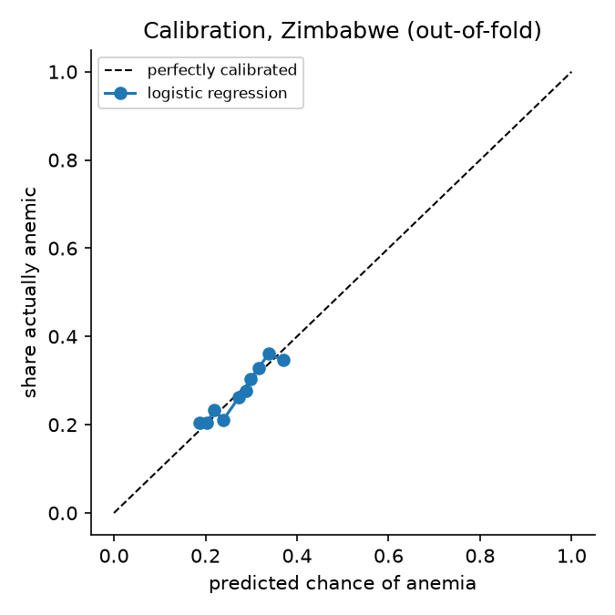
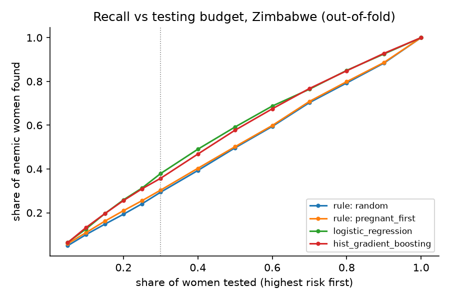

# Stage 7: survey baselines on Zimbabwe

Generated by `python -m src.survey.train_baselines`. 9265 women 15-49 from the Zimbabwe 2015 DHS with an Hb result. Anemic = DHS `v457` at any severity (WHO: Hb adjusted for altitude and smoking < 12.0 g/dL, < 11.0 if pregnant); 27.3% anemic. StratifiedGroupKFold by cluster, 5 folds x 5 seeds; scores averaged over seeds. Bootstrap 95% CIs (2000 resamples) resample whole clusters. `weights = survey` fits with the DHS sample weights; metrics are unweighted. Rules rank women and have no probability, so no Brier score.

| model | weights | AUROC | PR-AUC | Sens @ 90% spec | Recall, top 30% tested | Brier |
|---|---|---|---|---|---|---|
| rule: random | - | 0.493 [0.480, 0.507] | 0.270 [0.256, 0.285] | 0.101 [0.088, 0.117] | 0.294 [0.279, 0.309] | - |
| rule: pregnant_first | - | 0.504 [0.490, 0.517] | 0.280 [0.266, 0.296] | 0.116 [0.100, 0.129] | 0.303 [0.289, 0.319] | - |
| dummy | none | 0.490 [0.474, 0.507] | 0.273 [0.259, 0.289] | 0.104 [0.087, 0.122] | 0.292 [0.275, 0.314] | 0.199 [0.193, 0.204] |
| dummy | survey | 0.498 [0.480, 0.516] | 0.271 [0.255, 0.288] | 0.100 [0.079, 0.115] | 0.296 [0.276, 0.319] | 0.199 [0.193, 0.204] |
| logistic_regression | none | 0.580 [0.566, 0.593] | 0.323 [0.307, 0.341] | 0.146 [0.123, 0.163] | 0.379 [0.363, 0.394] | 0.196 [0.190, 0.201] |
| logistic_regression | survey | 0.579 [0.566, 0.593] | 0.324 [0.307, 0.343] | 0.148 [0.132, 0.166] | 0.376 [0.359, 0.393] | 0.196 [0.190, 0.201] |
| hist_gradient_boosting | none | 0.570 [0.556, 0.583] | 0.320 [0.303, 0.338] | 0.146 [0.129, 0.163] | 0.358 [0.341, 0.375] | 0.197 [0.192, 0.203] |
| hist_gradient_boosting | survey | 0.566 [0.552, 0.579] | 0.315 [0.299, 0.332] | 0.145 [0.126, 0.162] | 0.357 [0.339, 0.373] | 0.199 [0.193, 0.204] |

 
