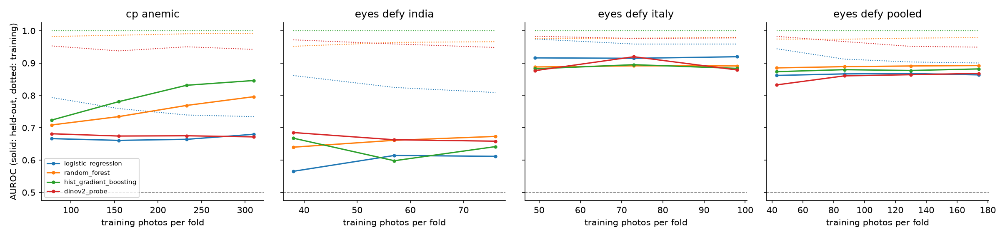

# Stage 9: how far can each population be fit on its own?

Generated by `python -m src.eyelid.ceiling`; settings in `configs/ceiling.yaml`. Mentor advice M1-M3 (`docs/eyelid_followup.md`). Anemic: CP-AnemiC Hb < 11.0 g/dL (children); Eyes-Defy WHO adult cutoffs by sex (women < 12.0, men < 13.0). Input is the hand-segmented conjunctiva in every case. Held-out = repeated stratified 5-fold CV by photo (5 repeats, scores averaged), bootstrap 95% CIs (2000 resamples). **train** = AUROC of each fold's model on its own training photos, mean (min-max) over folds: a diagnostic of how well the model can fit, so no bootstrap. **gap** = train minus held-out; a large gap means the model memorizes rather than generalizes. The fine-tuned ViT uses one seed and 5 folds.

## Model ladder

| population | n | anemic | model | train | gap | Held-out AUROC | PR-AUC | Sens @ 90% spec |
|---|---|---|---|---|---|---|---|---|
| cp_anemic | 388 | 42.5% | rule_low_redness (no training) | - | - | 0.650 [0.597, 0.705] | 0.555 [0.483, 0.645] | 0.273 [0.135, 0.354] |
| cp_anemic | 388 | 42.5% | negative_control_rf_no_color | 0.968 (0.95-0.98) | +0.431 | 0.537 [0.474, 0.595] | 0.497 [0.425, 0.578] | 0.164 [0.098, 0.252] |
| cp_anemic | 388 | 42.5% | dummy | 0.500 (0.50-0.50) | +0.007 | 0.493 [0.435, 0.549] | 0.426 [0.367, 0.491] | 0.109 [0.000, 0.155] |
| cp_anemic | 388 | 42.5% | logistic_regression | 0.734 (0.71-0.78) | +0.055 | 0.680 [0.627, 0.730] | 0.580 [0.503, 0.663] | 0.267 [0.130, 0.345] |
| cp_anemic | 388 | 42.5% | random_forest | 0.992 (0.99-0.99) | +0.196 | 0.796 [0.752, 0.839] | 0.736 [0.666, 0.799] | 0.370 [0.256, 0.491] |
| cp_anemic | 388 | 42.5% | hist_gradient_boosting | 1.000 (1.00-1.00) | +0.154 | 0.846 [0.807, 0.882] | 0.780 [0.710, 0.845] | 0.582 [0.322, 0.753] |
| cp_anemic | 388 | 42.5% | dinov2_probe | 0.942 (0.82-1.00) | +0.271 | 0.672 [0.616, 0.723] | 0.583 [0.507, 0.665] | 0.273 [0.156, 0.389] |
| cp_anemic | 388 | 42.5% | vit_b16_finetuned (jitter, 1 seed) | 1.000 (1.00-1.00) | +0.284 | 0.715 [0.661, 0.765] | 0.637 [0.559, 0.707] | 0.261 [0.169, 0.344] |
| eyes_defy_india | 95 | 71.6% | rule_low_redness (no training) | - | - | 0.671 [0.552, 0.787] | 0.846 [0.759, 0.919] | 0.250 [0.147, 0.551] |
| eyes_defy_india | 95 | 71.6% | negative_control_rf_no_color | 0.906 (0.87-0.93) | +0.358 | 0.548 [0.410, 0.677] | 0.757 [0.649, 0.864] | 0.118 [0.045, 0.231] |
| eyes_defy_india | 95 | 71.6% | dummy | 0.500 (0.50-0.50) | +0.076 | 0.424 [0.298, 0.552] | 0.675 [0.567, 0.794] | 0.000 [0.000, 0.138] |
| eyes_defy_india | 95 | 71.6% | logistic_regression | 0.809 (0.78-0.84) | +0.197 | 0.612 [0.493, 0.726] | 0.805 [0.706, 0.899] | 0.294 [0.029, 0.514] |
| eyes_defy_india | 95 | 71.6% | random_forest | 0.966 (0.95-0.98) | +0.293 | 0.673 [0.542, 0.791] | 0.840 [0.751, 0.917] | 0.265 [0.132, 0.479] |
| eyes_defy_india | 95 | 71.6% | hist_gradient_boosting | 1.000 (1.00-1.00) | +0.358 | 0.642 [0.515, 0.760] | 0.809 [0.705, 0.902] | 0.191 [0.039, 0.483] |
| eyes_defy_india | 95 | 71.6% | dinov2_probe | 0.948 (0.89-1.00) | +0.290 | 0.658 [0.543, 0.778] | 0.838 [0.747, 0.916] | 0.265 [0.107, 0.533] |
| eyes_defy_india | 95 | 71.6% | vit_b16_finetuned (jitter, 1 seed) | 1.000 (1.00-1.00) | +0.346 | 0.654 [0.522, 0.783] | 0.784 [0.673, 0.906] | 0.059 [0.000, 0.540] |
| eyes_defy_italy | 122 | 18.9% | rule_low_redness (no training) | - | - | 0.924 [0.856, 0.977] | 0.731 [0.553, 0.924] | 0.783 [0.526, 0.960] |
| eyes_defy_italy | 122 | 18.9% | negative_control_rf_no_color | 0.904 (0.88-0.94) | +0.153 | 0.751 [0.646, 0.837] | 0.346 [0.228, 0.529] | 0.217 [0.000, 0.458] |
| eyes_defy_italy | 122 | 18.9% | dummy | 0.500 (0.50-0.50) | +0.059 | 0.441 [0.281, 0.584] | 0.185 [0.112, 0.303] | 0.087 [0.000, 0.261] |
| eyes_defy_italy | 122 | 18.9% | logistic_regression | 0.959 (0.95-0.99) | +0.039 | 0.920 [0.822, 0.983] | 0.751 [0.576, 0.938] | 0.826 [0.606, 1.000] |
| eyes_defy_italy | 122 | 18.9% | random_forest | 0.979 (0.97-0.99) | +0.088 | 0.891 [0.787, 0.968] | 0.703 [0.515, 0.896] | 0.739 [0.522, 0.950] |
| eyes_defy_italy | 122 | 18.9% | hist_gradient_boosting | 1.000 (1.00-1.00) | +0.116 | 0.884 [0.784, 0.958] | 0.629 [0.453, 0.855] | 0.696 [0.480, 0.944] |
| eyes_defy_italy | 122 | 18.9% | dinov2_probe | 0.978 (0.94-1.00) | +0.099 | 0.879 [0.765, 0.963] | 0.723 [0.532, 0.897] | 0.870 [0.474, 1.000] |
| eyes_defy_italy | 122 | 18.9% | vit_b16_finetuned (jitter, 1 seed) | 1.000 (1.00-1.00) | +0.081 | 0.919 [0.830, 0.980] | 0.702 [0.524, 0.916] | 0.913 [0.731, 1.000] |
| eyes_defy_pooled | 217 | 41.9% | rule_low_redness (no training) | - | - | 0.835 [0.779, 0.884] | 0.767 [0.676, 0.859] | 0.495 [0.344, 0.707] |
| eyes_defy_pooled | 217 | 41.9% | negative_control_rf_no_color | 0.901 (0.87-0.93) | +0.159 | 0.742 [0.675, 0.804] | 0.656 [0.555, 0.767] | 0.363 [0.212, 0.490] |
| eyes_defy_pooled | 217 | 41.9% | dummy | 0.500 (0.50-0.50) | +0.034 | 0.466 [0.392, 0.545] | 0.409 [0.335, 0.501] | 0.077 [0.022, 0.138] |
| eyes_defy_pooled | 217 | 41.9% | logistic_regression | 0.900 (0.88-0.93) | +0.037 | 0.864 [0.812, 0.911] | 0.759 [0.665, 0.860] | 0.505 [0.350, 0.708] |
| eyes_defy_pooled | 217 | 41.9% | random_forest | 0.979 (0.97-0.98) | +0.086 | 0.892 [0.849, 0.935] | 0.833 [0.755, 0.905] | 0.549 [0.375, 0.831] |
| eyes_defy_pooled | 217 | 41.9% | hist_gradient_boosting | 1.000 (1.00-1.00) | +0.118 | 0.882 [0.835, 0.925] | 0.784 [0.689, 0.878] | 0.484 [0.308, 0.803] |
| eyes_defy_pooled | 217 | 41.9% | dinov2_probe | 0.949 (0.90-1.00) | +0.081 | 0.868 [0.818, 0.916] | 0.788 [0.700, 0.878] | 0.604 [0.373, 0.802] |
| eyes_defy_pooled | 217 | 41.9% | vit_b16_finetuned (jitter, 1 seed) | 1.000 (1.00-1.00) | +0.108 | 0.892 [0.848, 0.930] | 0.843 [0.770, 0.907] | 0.604 [0.417, 0.785] |
| eyes_defy_pooled | 217 | 41.9% | vit_b16_finetuned (no jitter, 1 seed) | 1.000 (1.00-1.00) | +0.102 | 0.898 [0.853, 0.937] | 0.831 [0.743, 0.910] | 0.703 [0.522, 0.824] |

## Learning curves

Held-out AUROC when each training fold is cut to a stratified share. Still rising at 1.0 = more photos would help; flat = the population's ceiling for that model. Points with fewer than 8 training photos of the rarer class are skipped.

| population | model | fraction | n_train | train AUROC | Held-out AUROC |
|---|---|---|---|---|---|
| cp_anemic | logistic_regression | 0.25 | 78 | 0.794 | 0.666 [0.612, 0.720] |
| cp_anemic | logistic_regression | 0.5 | 155 | 0.759 | 0.661 [0.606, 0.714] |
| cp_anemic | logistic_regression | 0.75 | 233 | 0.739 | 0.664 [0.609, 0.716] |
| cp_anemic | logistic_regression | 1.0 | 310 | 0.734 | 0.680 [0.627, 0.730] |
| cp_anemic | random_forest | 0.25 | 78 | 0.982 | 0.709 [0.657, 0.759] |
| cp_anemic | random_forest | 0.5 | 155 | 0.986 | 0.735 [0.685, 0.783] |
| cp_anemic | random_forest | 0.75 | 233 | 0.991 | 0.769 [0.723, 0.814] |
| cp_anemic | random_forest | 1.0 | 310 | 0.992 | 0.796 [0.752, 0.839] |
| cp_anemic | hist_gradient_boosting | 0.25 | 78 | 1.000 | 0.724 [0.672, 0.773] |
| cp_anemic | hist_gradient_boosting | 0.5 | 155 | 1.000 | 0.781 [0.732, 0.823] |
| cp_anemic | hist_gradient_boosting | 0.75 | 233 | 1.000 | 0.831 [0.788, 0.868] |
| cp_anemic | hist_gradient_boosting | 1.0 | 310 | 1.000 | 0.846 [0.807, 0.882] |
| cp_anemic | dinov2_probe | 0.25 | 78 | 0.953 | 0.681 [0.625, 0.734] |
| cp_anemic | dinov2_probe | 0.5 | 155 | 0.938 | 0.674 [0.619, 0.731] |
| cp_anemic | dinov2_probe | 0.75 | 233 | 0.950 | 0.675 [0.618, 0.728] |
| cp_anemic | dinov2_probe | 1.0 | 310 | 0.942 | 0.672 [0.616, 0.723] |
| eyes_defy_india | logistic_regression | 0.5 | 38 | 0.862 | 0.565 [0.443, 0.685] |
| eyes_defy_india | logistic_regression | 0.75 | 57 | 0.825 | 0.614 [0.490, 0.727] |
| eyes_defy_india | logistic_regression | 1.0 | 76 | 0.809 | 0.612 [0.493, 0.726] |
| eyes_defy_india | random_forest | 0.5 | 38 | 0.952 | 0.640 [0.506, 0.767] |
| eyes_defy_india | random_forest | 0.75 | 57 | 0.964 | 0.661 [0.530, 0.782] |
| eyes_defy_india | random_forest | 1.0 | 76 | 0.966 | 0.673 [0.542, 0.791] |
| eyes_defy_india | hist_gradient_boosting | 0.5 | 38 | 1.000 | 0.668 [0.556, 0.774] |
| eyes_defy_india | hist_gradient_boosting | 0.75 | 57 | 1.000 | 0.598 [0.473, 0.717] |
| eyes_defy_india | hist_gradient_boosting | 1.0 | 76 | 1.000 | 0.642 [0.515, 0.760] |
| eyes_defy_india | dinov2_probe | 0.5 | 38 | 0.972 | 0.685 [0.572, 0.791] |
| eyes_defy_india | dinov2_probe | 0.75 | 57 | 0.959 | 0.663 [0.542, 0.778] |
| eyes_defy_india | dinov2_probe | 1.0 | 76 | 0.948 | 0.658 [0.543, 0.778] |
| eyes_defy_italy | logistic_regression | 0.5 | 49 | 0.975 | 0.916 [0.818, 0.985] |
| eyes_defy_italy | logistic_regression | 0.75 | 73 | 0.959 | 0.915 [0.816, 0.981] |
| eyes_defy_italy | logistic_regression | 1.0 | 98 | 0.959 | 0.920 [0.822, 0.983] |
| eyes_defy_italy | random_forest | 0.5 | 49 | 0.976 | 0.888 [0.786, 0.963] |
| eyes_defy_italy | random_forest | 0.75 | 73 | 0.977 | 0.892 [0.788, 0.967] |
| eyes_defy_italy | random_forest | 1.0 | 98 | 0.979 | 0.891 [0.787, 0.968] |
| eyes_defy_italy | hist_gradient_boosting | 0.5 | 49 | 1.000 | 0.882 [0.794, 0.954] |
| eyes_defy_italy | hist_gradient_boosting | 0.75 | 73 | 1.000 | 0.895 [0.811, 0.961] |
| eyes_defy_italy | hist_gradient_boosting | 1.0 | 98 | 1.000 | 0.884 [0.784, 0.958] |
| eyes_defy_italy | dinov2_probe | 0.5 | 49 | 0.983 | 0.877 [0.760, 0.965] |
| eyes_defy_italy | dinov2_probe | 0.75 | 73 | 0.976 | 0.920 [0.852, 0.970] |
| eyes_defy_italy | dinov2_probe | 1.0 | 98 | 0.978 | 0.879 [0.765, 0.963] |
| eyes_defy_pooled | logistic_regression | 0.25 | 43 | 0.944 | 0.862 [0.808, 0.910] |
| eyes_defy_pooled | logistic_regression | 0.5 | 87 | 0.912 | 0.867 [0.817, 0.913] |
| eyes_defy_pooled | logistic_regression | 0.75 | 130 | 0.903 | 0.868 [0.817, 0.913] |
| eyes_defy_pooled | logistic_regression | 1.0 | 174 | 0.900 | 0.864 [0.812, 0.911] |
| eyes_defy_pooled | random_forest | 0.25 | 43 | 0.974 | 0.885 [0.838, 0.927] |
| eyes_defy_pooled | random_forest | 0.5 | 87 | 0.974 | 0.889 [0.843, 0.932] |
| eyes_defy_pooled | random_forest | 0.75 | 130 | 0.977 | 0.891 [0.846, 0.933] |
| eyes_defy_pooled | random_forest | 1.0 | 174 | 0.979 | 0.892 [0.849, 0.935] |
| eyes_defy_pooled | hist_gradient_boosting | 0.25 | 43 | 1.000 | 0.873 [0.822, 0.921] |
| eyes_defy_pooled | hist_gradient_boosting | 0.5 | 87 | 1.000 | 0.880 [0.832, 0.924] |
| eyes_defy_pooled | hist_gradient_boosting | 0.75 | 130 | 1.000 | 0.877 [0.828, 0.922] |
| eyes_defy_pooled | hist_gradient_boosting | 1.0 | 174 | 1.000 | 0.882 [0.835, 0.925] |
| eyes_defy_pooled | dinov2_probe | 0.25 | 43 | 0.983 | 0.833 [0.777, 0.885] |
| eyes_defy_pooled | dinov2_probe | 0.5 | 87 | 0.967 | 0.860 [0.810, 0.910] |
| eyes_defy_pooled | dinov2_probe | 0.75 | 130 | 0.952 | 0.864 [0.810, 0.914] |
| eyes_defy_pooled | dinov2_probe | 1.0 | 174 | 0.949 | 0.868 [0.818, 0.916] |

## Eyes-Defy: mask region and gray-world

Only photos with all three masks. Color models and the rule, within one country at a time.

| country | n | anemic | region | gray_world | model | AUROC |
|---|---|---|---|---|---|---|
| India | 95 | 71.6% | palpebral | False | rule_low_redness | 0.671 [0.552, 0.787] |
| India | 95 | 71.6% | palpebral | False | logistic_regression | 0.612 [0.493, 0.726] |
| India | 95 | 71.6% | palpebral | False | random_forest | 0.673 [0.542, 0.791] |
| India | 95 | 71.6% | palpebral | True | rule_low_redness | 0.556 [0.430, 0.678] |
| India | 95 | 71.6% | palpebral | True | logistic_regression | 0.587 [0.458, 0.715] |
| India | 95 | 71.6% | palpebral | True | random_forest | 0.656 [0.519, 0.784] |
| India | 95 | 71.6% | forniceal | False | rule_low_redness | 0.755 [0.647, 0.858] |
| India | 95 | 71.6% | forniceal | False | logistic_regression | 0.739 [0.620, 0.842] |
| India | 95 | 71.6% | forniceal | False | random_forest | 0.639 [0.497, 0.768] |
| India | 95 | 71.6% | forniceal | True | rule_low_redness | 0.669 [0.540, 0.792] |
| India | 95 | 71.6% | forniceal | True | logistic_regression | 0.612 [0.486, 0.733] |
| India | 95 | 71.6% | forniceal | True | random_forest | 0.637 [0.508, 0.755] |
| India | 95 | 71.6% | both | False | rule_low_redness | 0.746 [0.638, 0.845] |
| India | 95 | 71.6% | both | False | logistic_regression | 0.729 [0.621, 0.827] |
| India | 95 | 71.6% | both | False | random_forest | 0.709 [0.594, 0.814] |
| India | 95 | 71.6% | both | True | rule_low_redness | 0.610 [0.489, 0.725] |
| India | 95 | 71.6% | both | True | logistic_regression | 0.614 [0.494, 0.737] |
| India | 95 | 71.6% | both | True | random_forest | 0.602 [0.477, 0.730] |
| Italy | 116 | 19.0% | palpebral | False | rule_low_redness | 0.920 [0.845, 0.975] |
| Italy | 116 | 19.0% | palpebral | False | logistic_regression | 0.908 [0.798, 0.979] |
| Italy | 116 | 19.0% | palpebral | False | random_forest | 0.879 [0.765, 0.960] |
| Italy | 116 | 19.0% | palpebral | True | rule_low_redness | 0.381 [0.238, 0.549] |
| Italy | 116 | 19.0% | palpebral | True | logistic_regression | 0.884 [0.775, 0.962] |
| Italy | 116 | 19.0% | palpebral | True | random_forest | 0.870 [0.772, 0.950] |
| Italy | 116 | 19.0% | forniceal | False | rule_low_redness | 0.926 [0.864, 0.973] |
| Italy | 116 | 19.0% | forniceal | False | logistic_regression | 0.897 [0.829, 0.953] |
| Italy | 116 | 19.0% | forniceal | False | random_forest | 0.862 [0.755, 0.946] |
| Italy | 116 | 19.0% | forniceal | True | rule_low_redness | 0.576 [0.442, 0.703] |
| Italy | 116 | 19.0% | forniceal | True | logistic_regression | 0.766 [0.654, 0.857] |
| Italy | 116 | 19.0% | forniceal | True | random_forest | 0.791 [0.677, 0.884] |
| Italy | 116 | 19.0% | both | False | rule_low_redness | 0.949 [0.905, 0.982] |
| Italy | 116 | 19.0% | both | False | logistic_regression | 0.922 [0.867, 0.964] |
| Italy | 116 | 19.0% | both | False | random_forest | 0.925 [0.870, 0.969] |
| Italy | 116 | 19.0% | both | True | rule_low_redness | 0.749 [0.612, 0.877] |
| Italy | 116 | 19.0% | both | True | logistic_regression | 0.857 [0.767, 0.933] |
| Italy | 116 | 19.0% | both | True | random_forest | 0.879 [0.802, 0.942] |

## CP-AnemiC: duplicate copies as training augmentation

Folds over all 476 distinct photos; the training side either keeps every copy of its photos or only one, and copies of a test photo never enter training. Scored only on the held-out photos that have no copy (n below), the subset where the no-color control sits near chance.

| model | training rows | mean training rows | n | AUROC | PR-AUC | Sens @ 90% spec |
|---|---|---|---|---|---|---|
| logistic_regression | one per photo | 381 | 388 | 0.680 [0.624, 0.733] | 0.575 [0.498, 0.659] | 0.200 [0.096, 0.285] |
| logistic_regression | every copy | 566 | 388 | 0.662 [0.608, 0.717] | 0.561 [0.486, 0.644] | 0.218 [0.094, 0.353] |
| random_forest | one per photo | 381 | 388 | 0.824 [0.783, 0.863] | 0.767 [0.701, 0.829] | 0.467 [0.359, 0.607] |
| random_forest | every copy | 566 | 388 | 0.831 [0.791, 0.869] | 0.792 [0.730, 0.846] | 0.509 [0.412, 0.662] |
| dinov2_probe | one per photo | 381 | 388 | 0.680 [0.624, 0.732] | 0.620 [0.545, 0.702] | 0.327 [0.237, 0.445] |
| dinov2_probe | every copy | 566 | 388 | 0.675 [0.620, 0.727] | 0.620 [0.542, 0.698] | 0.327 [0.234, 0.433] |
