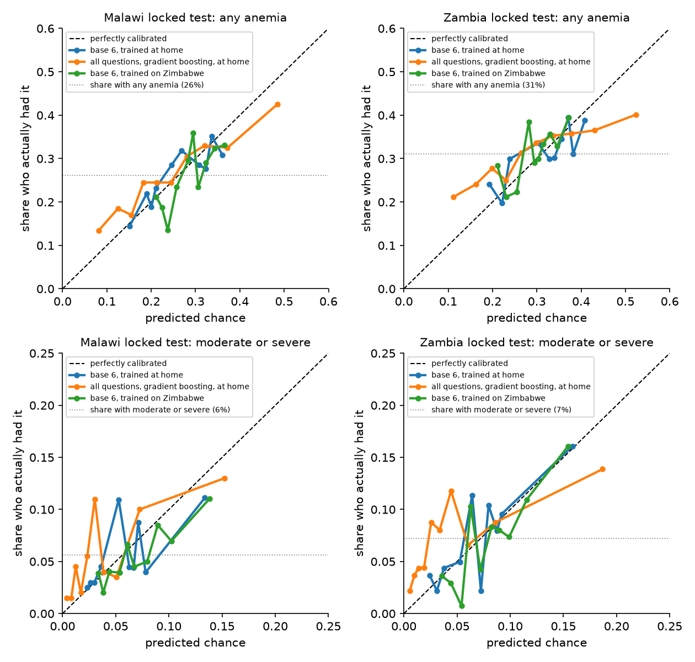

# Stage 30: random vs village split, and each country on its own

Generated by `python -m src.survey.countries` at commit `938254d + uncommitted changes`; settings in `configs/countries.yaml`, written before running. Village-bootstrap 95% CIs, 2000 resamples; paired differences on the same women.

- **Any anemia:** DHS `v457` 1-3 = Hb adjusted for altitude and smoking < 12.0 g/dL, or < 11.0 if pregnant (checked to match in all three files).
- **Moderate or severe:** adjusted Hb **< 10.0 g/dL for every woman, in all three countries.** This equals Zimbabwe 2015's `v457` 1-2, but **not** Malawi/Zambia 2024's `v457` 1-2, which use WHO 2011 (< 11.0, or < 10.0 if pregnant).
- **Questions:** each country's own cleaning with the Stage 29 rules. `v861` (self-reported result of her last HIV test; asked in 2024 only) is left out of the main models and added back in one extra row.
- **Fixed models, no feature selection.** Splits: **village** = whole villages held out (new villages); **random** = women held out at random, so neighbours of a test woman can be in training (new women from villages already surveyed).

## The data

| country | building women / villages | locked women / villages | questions | any anemia | moderate or severe |
|---|---|---|---|---|---|
| zimbabwe | 7416 / 321 | 1849 / 79 | 482 | 27.3% (2531) | 7.0% (653) |
| malawi | 7999 / 636 | 2001 / 157 | 499 | 26.1% (2607) | 5.8% (578) |
| zambia | 5461 / 436 | 1368 / 109 | 553 | 31.1% (2126) | 6.9% (474) |

Zimbabwe's locked test is not used here (it was used in Stage 29). Malawi's and Zambia's were locked before anything else and are scored once below.

## Any anemia: cross-validation on the building villages (5 x 5)

**Zimbabwe**

| model | AUROC, village split | AUROC, random split | random minus village | minus base 6 (village split) |
|---|---|---|---|---|
| dummy | 0.493 [0.475, 0.512] | 0.497 [0.483, 0.511] | +0.004 [-0.018, +0.026] | -0.087 [-0.110, -0.063] |
| base 6, logistic regression | 0.580 [0.566, 0.594] | 0.576 [0.562, 0.590] | -0.003 [-0.006, -0.002] | - |
| all questions, gradient boosting | 0.594 [0.579, 0.610] | 0.594 [0.579, 0.609] | -0.000 [-0.006, +0.005] | +0.015 [-0.000, +0.031] |
| all questions, Hb ranking | 0.617 [0.601, 0.633] | 0.617 [0.601, 0.633] | -0.000 [-0.005, +0.004] | +0.037 [+0.022, +0.054] |
| place share, v024 (no model) | 0.557 [0.538, 0.576] | 0.560 [0.541, 0.579] | +0.003 [-0.002, +0.008] | -0.023 [-0.046, +0.002] |
| base 6 + v024, logistic regression | 0.606 [0.590, 0.621] | 0.606 [0.590, 0.621] | -0.000 [-0.002, +0.002] | +0.026 [+0.014, +0.040] |

**Malawi**

| model | AUROC, village split | AUROC, random split | random minus village | minus base 6 (village split) |
|---|---|---|---|---|
| dummy | 0.496 [0.478, 0.514] | 0.501 [0.487, 0.515] | +0.005 [-0.019, +0.027] | -0.095 [-0.118, -0.073] |
| base 6, logistic regression | 0.592 [0.577, 0.607] | 0.592 [0.578, 0.608] | +0.001 [-0.001, +0.003] | - |
| all questions, gradient boosting | 0.618 [0.603, 0.633] | 0.628 [0.613, 0.643] | +0.010 [+0.005, +0.015] | +0.027 [+0.011, +0.042] |
| all questions, Hb ranking | 0.630 [0.614, 0.644] | 0.637 [0.621, 0.651] | +0.007 [+0.002, +0.011] | +0.038 [+0.023, +0.054] |
| place share, v024 (no model) | 0.492 [0.473, 0.510] | 0.494 [0.476, 0.513] | +0.002 [-0.006, +0.011] | -0.100 [-0.124, -0.076] |
| base 6 + v024, logistic regression | 0.592 [0.577, 0.607] | 0.593 [0.578, 0.608] | +0.001 [-0.001, +0.003] | +0.000 [-0.002, +0.003] |
| place share, sdistrict (no model) | 0.592 [0.573, 0.608] | 0.593 [0.575, 0.609] | +0.001 [-0.002, +0.005] | +0.000 [-0.022, +0.022] |
| base 6 + sdistrict, logistic regression | 0.624 [0.608, 0.640] | 0.627 [0.611, 0.642] | +0.003 [+0.000, +0.005] | +0.033 [+0.020, +0.045] |
| all + self-reported HIV result, gradient boosting | 0.618 [0.603, 0.632] | 0.628 [0.612, 0.642] | +0.010 [+0.004, +0.016] | +0.026 [+0.010, +0.042] |
| all + self-reported HIV result, Hb ranking | 0.630 [0.614, 0.645] | 0.637 [0.622, 0.652] | +0.008 [+0.003, +0.012] | +0.038 [+0.022, +0.054] |

**Zambia**

| model | AUROC, village split | AUROC, random split | random minus village | minus base 6 (village split) |
|---|---|---|---|---|
| dummy | 0.496 [0.475, 0.516] | 0.497 [0.482, 0.511] | +0.001 [-0.024, +0.025] | -0.083 [-0.109, -0.057] |
| base 6, logistic regression | 0.579 [0.562, 0.595] | 0.578 [0.561, 0.594] | -0.001 [-0.004, +0.001] | - |
| all questions, gradient boosting | 0.603 [0.586, 0.619] | 0.610 [0.594, 0.626] | +0.008 [+0.001, +0.014] | +0.024 [+0.007, +0.041] |
| all questions, Hb ranking | 0.610 [0.593, 0.627] | 0.615 [0.598, 0.631] | +0.004 [-0.001, +0.010] | +0.032 [+0.015, +0.049] |
| place share, v024 (no model) | 0.542 [0.522, 0.562] | 0.547 [0.527, 0.566] | +0.004 [-0.001, +0.009] | -0.036 [-0.063, -0.010] |
| base 6 + v024, logistic regression | 0.599 [0.581, 0.615] | 0.600 [0.582, 0.617] | +0.002 [-0.001, +0.004] | +0.020 [+0.007, +0.033] |
| all + self-reported HIV result, gradient boosting | 0.605 [0.588, 0.622] | 0.612 [0.597, 0.629] | +0.007 [+0.001, +0.014] | +0.026 [+0.009, +0.044] |
| all + self-reported HIV result, Hb ranking | 0.616 [0.599, 0.632] | 0.620 [0.603, 0.636] | +0.004 [-0.002, +0.010] | +0.037 [+0.020, +0.054] |

### Any anemia: locked test, scored once (Malawi, Zambia)

| country | model | AUROC | PR-AUC | Sens @ 90% spec | Recall, top 30% tested | Brier |
|---|---|---|---|---|---|---|
| malawi | dummy | 0.500 [0.500, 0.500] | 0.261 [0.237, 0.284] | 0.000 [0.000, 0.000] | 0.300 [0.300, 0.300] | 0.193 [0.181, 0.204] |
| malawi | base 6, logistic regression | 0.581 [0.551, 0.609] | 0.311 [0.279, 0.347] | 0.136 [0.099, 0.172] | 0.357 [0.321, 0.391] | 0.190 [0.179, 0.201] |
| malawi | all questions, gradient boosting | 0.622 [0.591, 0.651] | 0.370 [0.323, 0.423] | 0.207 [0.161, 0.252] | 0.414 [0.377, 0.454] | 0.187 [0.175, 0.198] |
| malawi | all questions, Hb ranking | 0.625 [0.595, 0.653] | 0.377 [0.332, 0.425] | 0.218 [0.173, 0.275] | 0.423 [0.385, 0.463] | - |
| malawi | place share, v024 (no model) | 0.490 [0.458, 0.525] | 0.257 [0.231, 0.286] | 0.000 [0.000, 0.000] | 0.293 [0.259, 0.328] | 0.193 [0.181, 0.204] |
| malawi | base 6 + v024, logistic regression | 0.579 [0.549, 0.607] | 0.315 [0.281, 0.352] | 0.134 [0.102, 0.170] | 0.358 [0.322, 0.389] | 0.190 [0.179, 0.201] |
| malawi | place share, sdistrict (no model) | 0.592 [0.558, 0.624] | 0.330 [0.291, 0.367] | 0.146 [0.102, 0.198] | 0.383 [0.349, 0.432] | 0.189 [0.177, 0.201] |
| malawi | base 6 + sdistrict, logistic regression | 0.619 [0.588, 0.649] | 0.359 [0.318, 0.402] | 0.205 [0.158, 0.251] | 0.408 [0.373, 0.448] | 0.186 [0.175, 0.198] |
| malawi | all + self-reported HIV result, gradient boosting | 0.622 [0.592, 0.652] | 0.369 [0.322, 0.422] | 0.195 [0.147, 0.242] | 0.418 [0.381, 0.457] | 0.187 [0.175, 0.199] |
| malawi | all + self-reported HIV result, Hb ranking | 0.627 [0.598, 0.655] | 0.376 [0.333, 0.422] | 0.226 [0.174, 0.270] | 0.431 [0.395, 0.467] | - |
| zambia | dummy | 0.500 [0.500, 0.500] | 0.311 [0.280, 0.341] | 0.000 [0.000, 0.000] | 0.300 [0.300, 0.301] | 0.214 [0.203, 0.226] |
| zambia | base 6, logistic regression | 0.562 [0.528, 0.596] | 0.350 [0.308, 0.400] | 0.139 [0.098, 0.188] | 0.351 [0.309, 0.385] | 0.212 [0.202, 0.223] |
| zambia | all questions, gradient boosting | 0.577 [0.544, 0.610] | 0.367 [0.322, 0.421] | 0.141 [0.104, 0.193] | 0.362 [0.323, 0.398] | 0.215 [0.203, 0.228] |
| zambia | all questions, Hb ranking | 0.566 [0.536, 0.598] | 0.371 [0.328, 0.420] | 0.174 [0.123, 0.211] | 0.348 [0.315, 0.388] | - |
| zambia | place share, v024 (no model) | 0.520 [0.476, 0.562] | 0.335 [0.287, 0.388] | 0.064 [0.012, 0.161] | 0.336 [0.280, 0.380] | 0.214 [0.202, 0.226] |
| zambia | base 6 + v024, logistic regression | 0.568 [0.533, 0.604] | 0.374 [0.319, 0.438] | 0.169 [0.116, 0.224] | 0.355 [0.315, 0.401] | 0.212 [0.200, 0.223] |
| zambia | all + self-reported HIV result, gradient boosting | 0.577 [0.546, 0.611] | 0.373 [0.326, 0.428] | 0.153 [0.107, 0.217] | 0.369 [0.333, 0.406] | 0.215 [0.203, 0.227] |
| zambia | all + self-reported HIV result, Hb ranking | 0.566 [0.534, 0.595] | 0.368 [0.326, 0.418] | 0.146 [0.108, 0.196] | 0.369 [0.330, 0.407] | - |

| country | model | AUROC minus base 6 (paired) |
|---|---|---|
| malawi | dummy | -0.081 [-0.109, -0.051] |
| malawi | all questions, gradient boosting | +0.041 [+0.006, +0.076] |
| malawi | all questions, Hb ranking | +0.043 [+0.011, +0.078] |
| malawi | place share, v024 (no model) | -0.091 [-0.134, -0.045] |
| malawi | base 6 + v024, logistic regression | -0.002 [-0.007, +0.003] |
| malawi | place share, sdistrict (no model) | +0.011 [-0.031, +0.055] |
| malawi | base 6 + sdistrict, logistic regression | +0.038 [+0.011, +0.066] |
| malawi | all + self-reported HIV result, gradient boosting | +0.041 [+0.006, +0.074] |
| malawi | all + self-reported HIV result, Hb ranking | +0.046 [+0.013, +0.080] |
| zambia | dummy | -0.062 [-0.096, -0.028] |
| zambia | all questions, gradient boosting | +0.015 [-0.021, +0.050] |
| zambia | all questions, Hb ranking | +0.004 [-0.031, +0.040] |
| zambia | place share, v024 (no model) | -0.042 [-0.096, +0.014] |
| zambia | base 6 + v024, logistic regression | +0.006 [-0.023, +0.035] |
| zambia | all + self-reported HIV result, gradient boosting | +0.015 [-0.019, +0.049] |
| zambia | all + self-reported HIV result, Hb ranking | +0.004 [-0.031, +0.037] |

## Moderate or severe: cross-validation on the building villages (5 x 5)

**Zimbabwe**

| model | AUROC, village split | AUROC, random split | random minus village | minus base 6 (village split) |
|---|---|---|---|---|
| dummy | 0.443 [0.414, 0.472] | 0.448 [0.424, 0.472] | +0.005 [-0.033, +0.042] | -0.187 [-0.226, -0.151] |
| base 6, logistic regression | 0.630 [0.604, 0.656] | 0.629 [0.603, 0.654] | -0.001 [-0.004, +0.002] | - |
| all questions, gradient boosting | 0.632 [0.608, 0.655] | 0.634 [0.611, 0.657] | +0.002 [-0.008, +0.013] | +0.002 [-0.024, +0.026] |
| all questions, Hb ranking | 0.666 [0.643, 0.688] | 0.666 [0.644, 0.689] | +0.001 [-0.007, +0.009] | +0.036 [+0.011, +0.059] |
| place share, v024 (no model) | 0.566 [0.537, 0.593] | 0.566 [0.538, 0.594] | +0.000 [-0.008, +0.007] | -0.064 [-0.103, -0.025] |
| base 6 + v024, logistic regression | 0.646 [0.622, 0.671] | 0.647 [0.623, 0.671] | +0.001 [-0.003, +0.005] | +0.016 [+0.000, +0.032] |

**Malawi**

| model | AUROC, village split | AUROC, random split | random minus village | minus base 6 (village split) |
|---|---|---|---|---|
| dummy | 0.460 [0.429, 0.492] | 0.459 [0.435, 0.485] | -0.001 [-0.040, +0.039] | -0.170 [-0.210, -0.129] |
| base 6, logistic regression | 0.630 [0.606, 0.654] | 0.633 [0.609, 0.656] | +0.003 [-0.002, +0.007] | - |
| all questions, gradient boosting | 0.629 [0.603, 0.654] | 0.641 [0.615, 0.667] | +0.012 [-0.001, +0.025] | -0.002 [-0.026, +0.023] |
| all questions, Hb ranking | 0.677 [0.653, 0.702] | 0.679 [0.653, 0.704] | +0.001 [-0.006, +0.009] | +0.047 [+0.024, +0.070] |
| place share, v024 (no model) | 0.485 [0.451, 0.517] | 0.499 [0.468, 0.529] | +0.014 [-0.003, +0.030] | -0.145 [-0.184, -0.106] |
| base 6 + v024, logistic regression | 0.629 [0.605, 0.653] | 0.634 [0.610, 0.657] | +0.005 [+0.000, +0.010] | -0.001 [-0.006, +0.004] |
| place share, sdistrict (no model) | 0.567 [0.537, 0.597] | 0.575 [0.546, 0.604] | +0.008 [-0.000, +0.016] | -0.063 [-0.099, -0.028] |
| base 6 + sdistrict, logistic regression | 0.651 [0.625, 0.676] | 0.658 [0.632, 0.683] | +0.007 [+0.001, +0.013] | +0.021 [+0.004, +0.037] |
| all + self-reported HIV result, gradient boosting | 0.633 [0.607, 0.658] | 0.636 [0.610, 0.662] | +0.003 [-0.010, +0.016] | +0.003 [-0.021, +0.027] |
| all + self-reported HIV result, Hb ranking | 0.680 [0.656, 0.704] | 0.680 [0.655, 0.706] | -0.000 [-0.007, +0.007] | +0.050 [+0.028, +0.073] |

**Zambia**

| model | AUROC, village split | AUROC, random split | random minus village | minus base 6 (village split) |
|---|---|---|---|---|
| dummy | 0.434 [0.402, 0.468] | 0.456 [0.424, 0.487] | +0.022 [-0.027, +0.067] | -0.192 [-0.236, -0.147] |
| base 6, logistic regression | 0.626 [0.595, 0.654] | 0.628 [0.598, 0.656] | +0.002 [-0.003, +0.007] | - |
| all questions, gradient boosting | 0.644 [0.614, 0.672] | 0.659 [0.630, 0.687] | +0.015 [+0.004, +0.027] | +0.018 [-0.010, +0.046] |
| all questions, Hb ranking | 0.665 [0.638, 0.693] | 0.677 [0.649, 0.704] | +0.012 [+0.003, +0.021] | +0.039 [+0.013, +0.068] |
| place share, v024 (no model) | 0.568 [0.536, 0.600] | 0.568 [0.536, 0.598] | -0.000 [-0.010, +0.008] | -0.057 [-0.100, -0.014] |
| base 6 + v024, logistic regression | 0.660 [0.629, 0.689] | 0.661 [0.630, 0.690] | +0.001 [-0.003, +0.006] | +0.034 [+0.014, +0.057] |
| all + self-reported HIV result, gradient boosting | 0.643 [0.614, 0.671] | 0.659 [0.629, 0.687] | +0.016 [+0.005, +0.028] | +0.017 [-0.011, +0.046] |
| all + self-reported HIV result, Hb ranking | 0.666 [0.637, 0.693] | 0.683 [0.655, 0.709] | +0.017 [+0.008, +0.027] | +0.040 [+0.013, +0.070] |

### Moderate or severe: locked test, scored once (Malawi, Zambia)

| country | model | AUROC | PR-AUC | Sens @ 90% spec | Recall, top 30% tested | Brier |
|---|---|---|---|---|---|---|
| malawi | dummy | 0.500 [0.500, 0.500] | 0.056 [0.047, 0.066] | 0.000 [0.000, 0.000] | 0.300 [0.300, 0.300] | 0.053 [0.045, 0.062] |
| malawi | base 6, logistic regression | 0.600 [0.546, 0.652] | 0.083 [0.065, 0.112] | 0.195 [0.132, 0.276] | 0.416 [0.327, 0.500] | 0.053 [0.045, 0.061] |
| malawi | all questions, gradient boosting | 0.661 [0.609, 0.713] | 0.113 [0.081, 0.168] | 0.239 [0.159, 0.336] | 0.469 [0.374, 0.551] | 0.053 [0.045, 0.061] |
| malawi | all questions, Hb ranking | 0.638 [0.578, 0.693] | 0.114 [0.081, 0.165] | 0.292 [0.195, 0.381] | 0.469 [0.367, 0.556] | - |
| malawi | place share, v024 (no model) | 0.523 [0.471, 0.576] | 0.060 [0.048, 0.074] | 0.000 [0.000, 0.000] | 0.337 [0.269, 0.408] | 0.053 [0.045, 0.062] |
| malawi | base 6 + v024, logistic regression | 0.600 [0.548, 0.652] | 0.087 [0.066, 0.118] | 0.212 [0.133, 0.292] | 0.425 [0.336, 0.500] | 0.053 [0.045, 0.061] |
| malawi | place share, sdistrict (no model) | 0.609 [0.562, 0.654] | 0.080 [0.061, 0.105] | 0.133 [0.064, 0.206] | 0.427 [0.338, 0.509] | 0.053 [0.044, 0.061] |
| malawi | base 6 + sdistrict, logistic regression | 0.648 [0.597, 0.697] | 0.103 [0.076, 0.143] | 0.195 [0.130, 0.275] | 0.478 [0.374, 0.561] | 0.053 [0.044, 0.061] |
| malawi | all + self-reported HIV result, gradient boosting | 0.664 [0.612, 0.716] | 0.117 [0.084, 0.170] | 0.265 [0.180, 0.362] | 0.487 [0.406, 0.578] | 0.053 [0.045, 0.061] |
| malawi | all + self-reported HIV result, Hb ranking | 0.649 [0.590, 0.702] | 0.122 [0.084, 0.174] | 0.257 [0.175, 0.349] | 0.504 [0.398, 0.600] | - |
| zambia | dummy | 0.500 [0.500, 0.500] | 0.072 [0.058, 0.087] | 0.000 [0.000, 0.000] | 0.300 [0.300, 0.301] | 0.067 [0.055, 0.080] |
| zambia | base 6, logistic regression | 0.643 [0.586, 0.699] | 0.130 [0.094, 0.186] | 0.222 [0.136, 0.313] | 0.465 [0.379, 0.582] | 0.066 [0.054, 0.078] |
| zambia | all questions, gradient boosting | 0.638 [0.585, 0.692] | 0.156 [0.102, 0.226] | 0.222 [0.136, 0.315] | 0.404 [0.333, 0.519] | 0.066 [0.054, 0.079] |
| zambia | all questions, Hb ranking | 0.656 [0.589, 0.725] | 0.176 [0.125, 0.247] | 0.303 [0.212, 0.405] | 0.515 [0.415, 0.617] | - |
| zambia | place share, v024 (no model) | 0.575 [0.519, 0.630] | 0.092 [0.069, 0.117] | 0.162 [0.000, 0.221] | 0.359 [0.270, 0.449] | 0.067 [0.055, 0.079] |
| zambia | base 6 + v024, logistic regression | 0.661 [0.601, 0.718] | 0.159 [0.107, 0.230] | 0.263 [0.173, 0.358] | 0.455 [0.353, 0.560] | 0.065 [0.054, 0.077] |
| zambia | all + self-reported HIV result, gradient boosting | 0.660 [0.603, 0.716] | 0.169 [0.114, 0.238] | 0.242 [0.143, 0.330] | 0.495 [0.398, 0.587] | 0.066 [0.054, 0.078] |
| zambia | all + self-reported HIV result, Hb ranking | 0.653 [0.585, 0.724] | 0.166 [0.116, 0.233] | 0.283 [0.196, 0.380] | 0.545 [0.441, 0.652] | - |

| country | model | AUROC minus base 6 (paired) |
|---|---|---|
| malawi | dummy | -0.100 [-0.152, -0.046] |
| malawi | all questions, gradient boosting | +0.061 [+0.004, +0.122] |
| malawi | all questions, Hb ranking | +0.038 [-0.017, +0.093] |
| malawi | place share, v024 (no model) | -0.076 [-0.147, -0.001] |
| malawi | base 6 + v024, logistic regression | +0.001 [-0.005, +0.008] |
| malawi | place share, sdistrict (no model) | +0.009 [-0.061, +0.079] |
| malawi | base 6 + sdistrict, logistic regression | +0.049 [+0.016, +0.082] |
| malawi | all + self-reported HIV result, gradient boosting | +0.065 [+0.010, +0.122] |
| malawi | all + self-reported HIV result, Hb ranking | +0.049 [-0.009, +0.105] |
| zambia | dummy | -0.143 [-0.199, -0.086] |
| zambia | all questions, gradient boosting | -0.005 [-0.063, +0.060] |
| zambia | all questions, Hb ranking | +0.013 [-0.053, +0.087] |
| zambia | place share, v024 (no model) | -0.068 [-0.142, +0.005] |
| zambia | base 6 + v024, logistic regression | +0.018 [-0.016, +0.054] |
| zambia | all + self-reported HIV result, gradient boosting | +0.016 [-0.046, +0.085] |
| zambia | all + self-reported HIV result, Hb ranking | +0.010 [-0.054, +0.082] |

## Transfer: base 6 trained on Zimbabwe vs. at home, on each country's locked test

Base 6 logistic regression with the Stage 7/8 coding, trained on Zimbabwe's building women or on the country's own building women; both scored on the country's locked villages.

| country | target | model | AUROC | PR-AUC | Sens @ 90% spec | Recall, top 30% tested | Brier |
|---|---|---|---|---|---|---|---|
| malawi | any anemia | base 6, trained at home | 0.574 [0.544, 0.602] | 0.307 [0.276, 0.342] | 0.107 [0.082, 0.146] | 0.347 [0.314, 0.382] | 0.190 [0.179, 0.201] |
| malawi | any anemia | base 6, trained on Zimbabwe | 0.577 [0.549, 0.603] | 0.309 [0.276, 0.345] | 0.140 [0.108, 0.175] | 0.363 [0.325, 0.396] | 0.191 [0.180, 0.200] |
| malawi | moderate or severe | base 6, trained at home | 0.601 [0.550, 0.649] | 0.083 [0.064, 0.113] | 0.177 [0.110, 0.254] | 0.389 [0.303, 0.477] | 0.053 [0.045, 0.061] |
| malawi | moderate or severe | base 6, trained on Zimbabwe | 0.614 [0.558, 0.667] | 0.092 [0.070, 0.132] | 0.195 [0.124, 0.282] | 0.469 [0.368, 0.552] | 0.053 [0.045, 0.061] |
| zambia | any anemia | base 6, trained at home | 0.563 [0.530, 0.597] | 0.348 [0.306, 0.398] | 0.115 [0.082, 0.164] | 0.358 [0.319, 0.397] | 0.212 [0.202, 0.223] |
| zambia | any anemia | base 6, trained on Zimbabwe | 0.553 [0.518, 0.587] | 0.357 [0.315, 0.407] | 0.146 [0.107, 0.179] | 0.348 [0.307, 0.384] | 0.213 [0.201, 0.225] |
| zambia | moderate or severe | base 6, trained at home | 0.634 [0.579, 0.690] | 0.120 [0.088, 0.174] | 0.232 [0.151, 0.316] | 0.455 [0.345, 0.543] | 0.066 [0.054, 0.078] |
| zambia | moderate or severe | base 6, trained on Zimbabwe | 0.648 [0.581, 0.712] | 0.128 [0.093, 0.184] | 0.242 [0.154, 0.333] | 0.480 [0.380, 0.582] | 0.066 [0.055, 0.078] |

| country | target | home minus Zimbabwe-trained AUROC (paired) |
|---|---|---|
| malawi | any anemia | -0.003 [-0.031, +0.028] |
| malawi | moderate or severe | -0.013 [-0.051, +0.023] |
| zambia | any anemia | +0.010 [-0.025, +0.044] |
| zambia | moderate or severe | -0.014 [-0.065, +0.037] |

## Calibration on the locked tests (Malawi, Zambia)

Does a predicted chance of 30% mean about 30% of those women have it? Points on the dashed line are right; 10 equal-sized groups of women per line. The Hb ranking gives a score, not a probability, so it has no curve. Brier scores are in the locked-test tables above.

