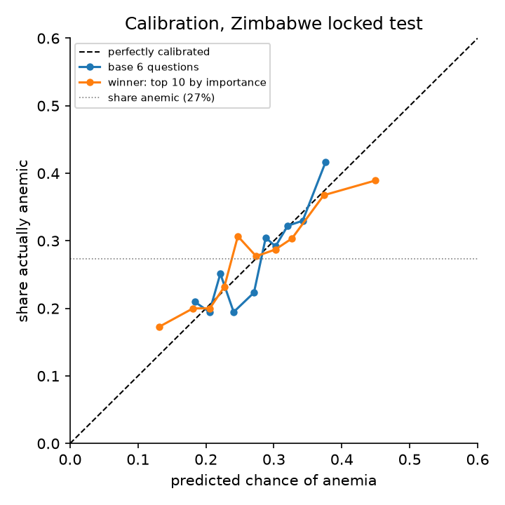

# Stage 29 Step 6: the one-time score on the locked final test (Zimbabwe 2015)

Generated by `python -m src.survey.final_test` at commit `2ff02bc`; settings in `configs/feature_selection.yaml` (`final_test`). Every model was fit on all 7416 building women, with its questions chosen there, and scored once on the **locked test: 1849 women in 79 villages, 27.3% anemic**. Anemic = DHS `v457` (WHO for women on Hb adjusted for altitude and smoking: < 12.0 g/dL, < 11.0 if pregnant).

- The two candidates were named in the config after Step 5 and before this test was opened.
- Bootstrap 95% CIs, 2000 resamples of whole villages. Rankings (the rule, the Hb ranking) have no probability, so no Brier score or calibration.
- Calibration slope 1 and intercept 0 = perfectly calibrated.

| model | questions | AUROC | PR-AUC | Sens @ 90% spec | Recall, top 30% tested | Brier | Calibration slope | Calibration intercept |
|---|---|---|---|---|---|---|---|---|
| dummy (everyone the same risk) | 0 | 0.500 [0.500, 0.500] | 0.273 [0.247, 0.299] | 0.000 [0.000, 0.000] | 0.300 [0.300, 0.300] | 0.199 [0.187, 0.210] | - | - |
| rule: pregnant first, then random | 1 | 0.495 [0.465, 0.525] | 0.282 [0.254, 0.318] | 0.127 [0.092, 0.160] | 0.301 [0.268, 0.339] | - | - | - |
| base 6 questions | 6 | 0.590 [0.555, 0.623] | 0.343 [0.305, 0.389] | 0.184 [0.139, 0.240] | 0.392 [0.354, 0.437] | 0.195 [0.183, 0.207] | 1.018 [0.606, 1.447] | 0.008 [-0.404, 0.416] |
| winner: top 10 by importance | 10 | 0.596 [0.563, 0.626] | 0.358 [0.319, 0.398] | 0.158 [0.124, 0.206] | 0.387 [0.348, 0.425] | 0.194 [0.182, 0.207] | 0.736 [0.508, 0.961] | -0.243 [-0.480, -0.020] |
| Hb ranking: all 482 questions | 482 | 0.614 [0.585, 0.643] | 0.360 [0.318, 0.405] | 0.174 [0.128, 0.225] | 0.396 [0.356, 0.433] | - | - | - |

**AUROC change over the 6-question baseline** (paired: same resampled villages):

- winner: top 10 by importance: +0.006 [-0.022, +0.036]
- Hb ranking: all 482 questions: +0.024 [-0.001, +0.052]

## The winner's 10 questions (chosen on the building villages)

1. `v024` region
2. `v312` current contraceptive method
3. `v716` respondent's occupation
4. `d103c` ever been insulted or made to feel bad by husband/partner
5. `v139` de jure region of residence
6. `v704` husband/partner's occupation
7. `v379` source known for any method
8. `v394` visited health facility last 12 months
9. `v315` month of start of use of method
10. `v836` total lifetime number of sex partners

## Extra target: the Hb number

- Average error: 1.303 [1.246, 1.363] g/dL; guessing everyone at the building mean: 1.345 [1.283, 1.408] g/dL.
- Applying each woman's cutoff to the estimate: sensitivity 0.129 [0.093, 0.166], specificity 0.927 [0.906, 0.945].

